# Casos para julgar — Tela Solicitar serviço

10 casos. Leia antes o [LEIAME](LEIAME.md) (5 min). Cada caso leva uns 3 a 4 minutos.

Responda num comentário do Linear com uma linha por caso (modelo no fim desta página).

## R-01

**O que o cartão diz que acontece:** Botão "Selecione o arquivo" tem aria-hidden="true" mas é focável (tabindex="1"); como o input file está display:none, é o único caminho de teclado para o upload e chega ao leitor de tela sem nome/papel.

**Correção que o cartão sugere:** Elemento focável não pode estar oculto da árvore de acessibilidade; remover aria-hidden (ou torná-lo não focável e expor o input file).

**Regra citada:** axe-core 4.11.4 · axe:aria-hidden-focus · ARIA hidden element must not be focusable or contain focusable elements
> Ensure aria-hidden elements are not focusable nor contain focusable elements
> etiquetas: EN-301-549, EN-9.4.1.2, RGAA-10.8.1, RGAAv4, TT6.a, TTv5, cat.name-role-value, wcag2a, wcag412

**Onde:**
- `<button> "Selecione o arquivo"` — seletor `body>div:nth-of-type(1)>div>main>form>div:nth-of-type(6)>div>button`
- seletor escrito no cartão: `.upload-button`

**Como chegar ao estado** (janela 1280×900):
1. abrir a página (estado inicial)

**Na página congelada, depois desses passos** (refeitos automaticamente, como estão escritos, em janela 1280×900):
- nenhum passo no cartão: página no estado inicial


[a mesma tela sem o contorno](img/R-01-tela-sem-marca.png)

**Medido** (não é julgamento):
- foco depois dos passos: &lt;body&gt; (nenhum elemento focado) (não é elemento deste cartão)
- &lt;button.upload-button&gt; "Selecione o arquivo": aria-hidden "true"; tabindex "1"

**Defeitos da lista que parecem próximos** (só uma pista; pode ser outro da lista, ou nenhum):
- **A-02** — O botão do upload tem tabindex=1: o primeiro Tab da página cai nele, antes do atalho para o conteúdo e de todos os campos que o precedem no formulário.
- **A-10** — O upload aceita arrastar e soltar (comportamento do core.js), mas o texto de apoio informa só formato e tamanho — não diz que o arquivo pode ser arrastado.
- **P-02** — Camada de página (D-83) · não sorteada · área de rodapé. A página não tem área de rodapé: nenhum componente Footer do DS e nenhuma região de rodapé (footer ou contentinfo), em estado algum. A âncora é o documento porque a área ausente não tem elemento.

**Sua resposta** (copie a linha e complete):

```
R-01: fato  descumpre  defeito  quem-escreveu
```

---

## R-02

**O que o cartão diz que acontece:** color: rgb(51, 67, 51) (#334333) no texto da modal, valor fora do registro de tokens (mais próximo --green-cool-70 #37493b).

**Correção que o cartão sugere:** Cor de texto a partir de token do DS (ex.: --color, #333333).

**Regra citada:** base de regras do DS 3.7.0 (id mascarado, D-87)
> 'Interfaces governamentais devem usar as cores predefinidas do Design System' (required) — uma cor fora do registro de tokens é exatamente o que essa regra proíbe.
> Interfaces digitais do governo devem utilizar sempre as cores pré-definidas. *(força declarada na base: obrigatorio)*
> Componentes devem consumir tokens oficiais corretamente e sem duplicação desnecessária. *(força declarada na base: obrigatorio)*

**Onde:**
- `<div> "Descartar solicitação? Os dados preenchidos nest"` — seletor `body>div:nth-of-type(1)>div>div>div`
- seletor escrito no cartão: `.dialogo-descarte`

**Como chegar ao estado** (janela 1280×900):
1. click button.acao-cancelar

**Na página congelada, depois desses passos** (refeitos automaticamente, como estão escritos, em janela 1280×900):
- passo 1 ("click button.acao-cancelar"): feito


[a mesma tela sem o contorno](img/R-02-tela-sem-marca.png)

**Medido** (não é julgamento):
- foco depois dos passos: &lt;button.br-button.secondary&gt; "Continuar preenchendo" (dentro do elemento 1 do cartão)
- &lt;div.br-modal.medium&gt; "Descartar solicitação? Os dados preenchi": color rgb(51, 67, 51)

**Defeitos da lista que parecem próximos** (só uma pista; pode ser outro da lista, ou nenhum):
- **A-01** — Ao fechar o diálogo de descarte (X, Continuar preenchendo ou Esc) o foco não volta ao botão Cancelar que o abriu: cai em &lt;body&gt;. Abrir o diálogo leva o foco para dentro dele, como deve.
- **A-03** — O texto do diálogo usa #334333 — a cor de texto do DS (#333333) com o canal verde acrescido de 16 —, valor que não corresponde a token algum.
- **P-02** — Camada de página (D-83) · não sorteada · área de rodapé. A página não tem área de rodapé: nenhum componente Footer do DS e nenhuma região de rodapé (footer ou contentinfo), em estado algum. A âncora é o documento porque a área ausente não tem elemento.

**Sua resposta** (copie a linha e complete):

```
R-02: fato  descumpre  defeito  quem-escreveu
```

---

## R-03

**O que o cartão diz que acontece:** Com foco por teclado (classe focus-visible), outline:none, box-shadow:none e borda inalterada (#888): não há indicador de foco visível. Causa: regra da tela ".campo-servico .br-input input:focus, ... .campo-unidade ..." que anula o foco do DS.

**Correção que o cartão sugere:** Indicador de foco visível do DS (box-shadow/borda na cor --focus), como em #nome e #cpf.

**Regra citada:** WCAG 2.2 · wcag:2.4.7 · Focus Visible · nível AA

**Onde:**
- `<input#servico> "Selecione uma opção"` — seletor `body>div:nth-of-type(1)>div>main>form>div:nth-of-type(3)>div:nth-of-type(1)>div>div:nth-of-type(1)>div>input`
- `<input#unidade> "Selecione uma opção"` — seletor `body>div:nth-of-type(1)>div>main>form>div:nth-of-type(3)>div:nth-of-type(2)>div>div:nth-of-type(1)>div>input`
- seletor escrito no cartão: `#servico, #unidade`

**Como chegar ao estado** (janela 1280×900):
1. Tab x8 até #servico

**Na página congelada, depois desses passos** (refeitos automaticamente, como estão escritos, em janela 1280×900):
- passo 1 ("Tab x8 até #servico"): termina com o foco em &lt;input#cpf&gt; "00000000000", não em #servico

**Atenção: refeitos como estão escritos, os passos não chegam ao estado que o cartão descreve** (ver acima). As imagens e a medida são do estado a que eles chegam.

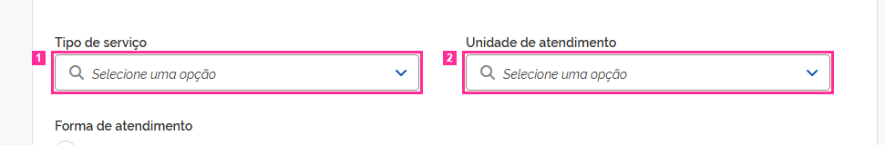

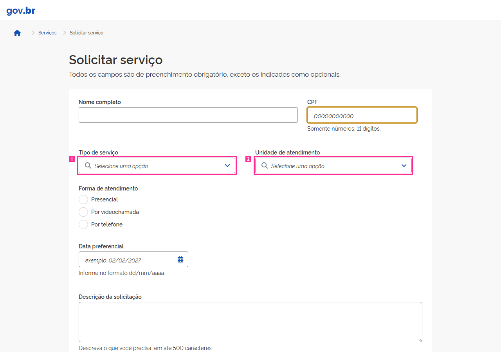

[a mesma tela sem o contorno](img/R-03-tela-sem-marca.png)

**Medido** (não é julgamento):
- foco depois dos passos: &lt;input#cpf&gt; "00000000000" (não é elemento deste cartão)
- &lt;input#servico&gt; "Selecione uma opção": border-top-color rgb(136, 136, 136); box-shadow none; color rgb(51, 51, 51); outline-color rgb(51, 51, 51); outline-style none; outline-width 3px
- &lt;input#unidade&gt; "Selecione uma opção": border-top-color rgb(136, 136, 136); box-shadow none; color rgb(51, 51, 51); outline-color rgb(51, 51, 51); outline-style none; outline-width 3px

*Avisos da preparação do cartão: sem-evidencia.*

**Defeitos da lista que parecem próximos** (só uma pista; pode ser outro da lista, ou nenhum):
- **A-04** — COMPARTILHADA pelos dois selects. O campo de texto do select não mostra indicador de foco: a borda e o box-shadow com que o DS desenha o foco dos campos foram suprimidos (e o outline segue none). Nome, CPF, data e descrição mostram o indicador.
- **A-08** — COMPARTILHADA pelos dois selects. Depois do envio vazio o texto de erro aparece sob o select, mas o campo não o referencia: não há aria-describedby. Os outros seis campos obrigatórios referenciam o próprio texto de erro. A unidade existe só neste estado, embora o campo exista desde o primeiro paint — por isso não é `conditional`.
- **P-02** — Camada de página (D-83) · não sorteada · área de rodapé. A página não tem área de rodapé: nenhum componente Footer do DS e nenhuma região de rodapé (footer ou contentinfo), em estado algum. A âncora é o documento porque a área ausente não tem elemento.

**Sua resposta** (copie a linha e complete):

```
R-03: fato  descumpre  defeito  quem-escreveu
```

---

## R-04

**O que o cartão diz que acontece:** Com foco por teclado (Tab), os campos Tipo de serviço e Unidade de atendimento não mostram indicador: outline none, box-shadow none e borda inalterada rgb(136,136,136). A regra da página '.campo-servico .br-input input:focus-visible, .campo-unidade .br-input input:focus-visible { box-shadow:none; outline:none }' anula o foco do DS, que aparece nos demais campos (box-shadow 2px rgb(194,133,12)).

**Correção que o cartão sugere:** Indicador de foco visível em todo controle operável por teclado, como nos demais campos do DS.

**Regra citada:** WCAG 2.2 · wcag:2.4.7 · Focus Visible · nível AA

**Onde:**
- `<input#servico> "Selecione uma opção"` — seletor `body>div:nth-of-type(1)>div>main>form>div:nth-of-type(3)>div:nth-of-type(1)>div>div:nth-of-type(1)>div>input`
- `<input#unidade> "Selecione uma opção"` — seletor `body>div:nth-of-type(1)>div>main>form>div:nth-of-type(3)>div:nth-of-type(2)>div>div:nth-of-type(1)>div>input`
- seletor escrito no cartão: `#servico, #unidade`

**Como chegar ao estado** (janela 1280×900):
1. clicar em #cpf
2. Tab (foco em #servico)
3. Tab (foco em #unidade)

**Na página congelada, depois desses passos** (refeitos automaticamente, como estão escritos, em janela 1280×900):
- passo 1 ("clicar em #cpf"): feito
- passo 2 ("Tab (foco em #servico)"): feito
- passo 3 ("Tab (foco em #unidade)"): feito


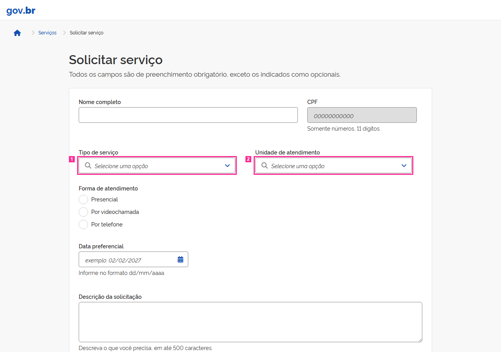

[a mesma tela sem o contorno](img/R-04-tela-sem-marca.png)

**Medido** (não é julgamento):
- foco depois dos passos: &lt;input#unidade&gt; "Selecione uma opção" (é o elemento 2 do cartão)
- &lt;input#servico&gt; "Selecione uma opção": border-top-color rgb(136, 136, 136); box-shadow none; outline-color rgb(51, 51, 51); outline-style none; outline-width 3px
- &lt;input#unidade&gt; "Selecione uma opção": border-top-color rgb(136, 136, 136); box-shadow none; outline-color rgb(51, 51, 51); outline-style none; outline-width 3px

**Defeitos da lista que parecem próximos** (só uma pista; pode ser outro da lista, ou nenhum):
- **A-04** — COMPARTILHADA pelos dois selects. O campo de texto do select não mostra indicador de foco: a borda e o box-shadow com que o DS desenha o foco dos campos foram suprimidos (e o outline segue none). Nome, CPF, data e descrição mostram o indicador.
- **A-08** — COMPARTILHADA pelos dois selects. Depois do envio vazio o texto de erro aparece sob o select, mas o campo não o referencia: não há aria-describedby. Os outros seis campos obrigatórios referenciam o próprio texto de erro. A unidade existe só neste estado, embora o campo exista desde o primeiro paint — por isso não é `conditional`.
- **P-02** — Camada de página (D-83) · não sorteada · área de rodapé. A página não tem área de rodapé: nenhum componente Footer do DS e nenhuma região de rodapé (footer ou contentinfo), em estado algum. A âncora é o documento porque a área ausente não tem elemento.

**Sua resposta** (copie a linha e complete):

```
R-04: fato  descumpre  defeito  quem-escreveu
```

---

## R-05

**O que o cartão diz que acontece:** Botões de mês anterior/seguinte do calendário contêm apenas ícone (sem aria-hidden) e não têm nome acessível.

**Correção que o cartão sugere:** Nome acessível não vazio (ex.: aria-label "Mês anterior"/"Próximo mês").

**Regra citada:** e-MAG 3.1 · emag:2.2 · Garantir que os objetos programáveis sejam acessíveis
> Scripts and dynamic content must remain accessible. Provide alternatives when direct access is not possible.

**Onde:**
- `<button>` — seletor `body>div:nth-of-type(2)>div:nth-of-type(1)>span:nth-of-type(1)>button`
- `<button>` — seletor `body>div:nth-of-type(2)>div:nth-of-type(1)>span:nth-of-type(2)>button`
- seletor escrito no cartão: `.flatpickr-prev-month > button, .flatpickr-next-month > button`

**Como chegar ao estado** (janela 1280×900):
1. click #data-preferencial-btn

**Na página congelada, depois desses passos** (refeitos automaticamente, como estão escritos, em janela 1280×900):
- passo 1 ("click #data-preferencial-btn"): feito


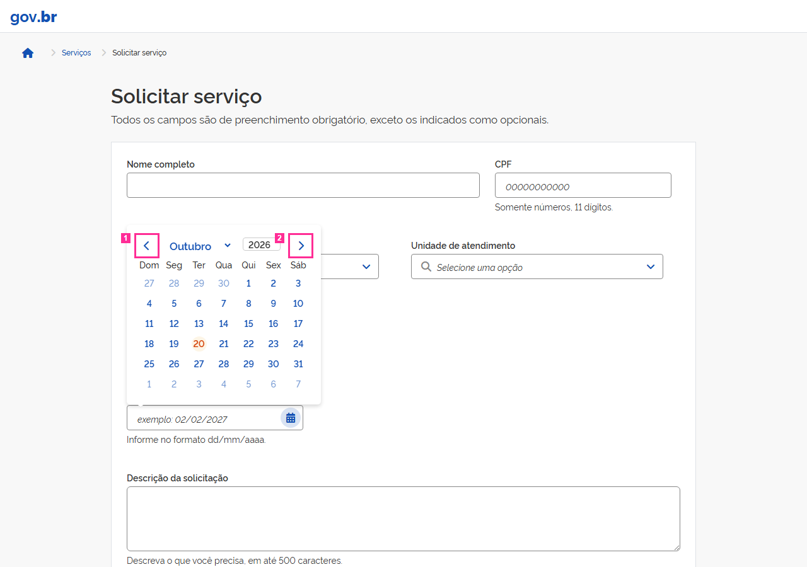

[a mesma tela sem o contorno](img/R-05-tela-sem-marca.png)

**Medido** (não é julgamento):
- foco depois dos passos: &lt;button#data-preferencial-btn&gt; "Abrir calendário" (não é elemento deste cartão)
- &lt;button.br-button.circle&gt;: aria-hidden ausente; aria-label ausente
- &lt;button.br-button.circle&gt;: aria-hidden ausente; aria-label ausente

**Defeitos da lista que parecem próximos** (só uma pista; pode ser outro da lista, ou nenhum):
- **P-02** — Camada de página (D-83) · não sorteada · área de rodapé. A página não tem área de rodapé: nenhum componente Footer do DS e nenhuma região de rodapé (footer ou contentinfo), em estado algum. A âncora é o documento porque a área ausente não tem elemento.

**Sua resposta** (copie a linha e complete):

```
R-05: fato  descumpre  defeito  quem-escreveu
```

---

## R-06

**O que o cartão diz que acontece:** br-button aplicado a &lt;div&gt;

**Correção que o cartão sugere:** Elemento &lt;button&gt;

**Regra citada:** base de regras do DS 3.7.0 (id mascarado, D-87)
> 'A anatomia implementada do componente deve corresponder à diretriz oficial de Design' (required) — a tag raiz é anatomia.
> A anatomia implementada do componente deve corresponder à diretriz oficial de Design. *(força declarada na base: obrigatorio)*

**Onde:**
- `<div> "Fechar a mensagem"` — seletor `body>div:nth-of-type(1)>div>main>form>div:nth-of-type(1)>div>div:nth-of-type(1)>div`
- seletor escrito no cartão: `#main-content > form > div:nth-of-type(1) > div > div:nth-of-type(1) > div`

**Como chegar ao estado** (janela 1280×900):
1. abrir o endereço da tela e esperar `.linhas-anteriores tr`
2. clicar em `.acao-enviar`
3. esperar `.mensagem-retorno` aparecer
4. clicar em `.acao-cancelar`
5. esperar `.dialogo-descarte` aparecer

**Na página congelada, depois desses passos** (refeitos automaticamente, como estão escritos, em janela 1280×900):
- passo 1 ("abrir o endereço da tela e esperar `.linhas-anteriores tr`"): feito
- passo 2 ("clicar em `.acao-enviar`"): feito
- passo 3 ("esperar `.mensagem-retorno` aparecer"): feito
- passo 4 ("clicar em `.acao-cancelar`"): feito
- passo 5 ("esperar `.dialogo-descarte` aparecer"): feito

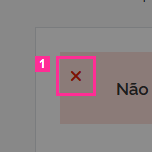

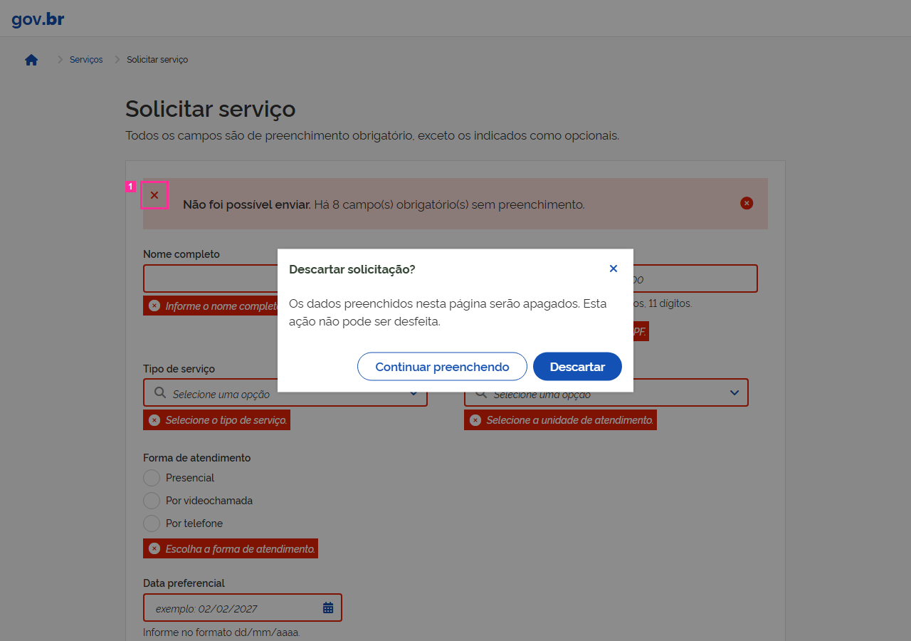

[a mesma tela sem o contorno](img/R-06-tela-sem-marca.png)

**Medido** (não é julgamento):
- foco depois dos passos: &lt;button.br-button.secondary&gt; "Continuar preenchendo" (não é elemento deste cartão)
- &lt;div.br-button.circle&gt; "Fechar a mensagem": a alegação não nomeia atributo nem propriedade de CSS

**Defeitos da lista que parecem próximos** (só uma pista; pode ser outro da lista, ou nenhum):
- **A-06** — O botão Fechar da mensagem de retorno é um &lt;div role="button" tabindex="0"&gt; com tratadores de Enter e Espaço, no lugar do &lt;button&gt; nativo do exemplo oficial. Continua operável por teclado e nomeado — o defeito é só o elemento.
- **A-11** — Na mensagem de retorno o botão Fechar está à esquerda e o ícone semântico à direita — o inverso da anatomia do componente.
- **P-02** — Camada de página (D-83) · não sorteada · área de rodapé. A página não tem área de rodapé: nenhum componente Footer do DS e nenhuma região de rodapé (footer ou contentinfo), em estado algum. A âncora é o documento porque a área ausente não tem elemento.

**Sua resposta** (copie a linha e complete):

```
R-06: fato  descumpre  defeito  quem-escreveu
```

---

## R-07

**O que o cartão diz que acontece:** A mensagem de erro geral tem estrutura invertida em relação ao componente Mensagem do DS: o botão Fechar (div role='button') vem primeiro e aparece à esquerda; o ícone de status vem por último, à direita. A mensagem de sucesso da mesma tela segue o DS: ícone, conteúdo, &lt;button&gt; Fechar à direita.

**Correção que o cartão sugere:** Mensagem conforme o componente br-message do DS: ícone de status à esquerda, conteúdo, botão Fechar (&lt;button&gt;) à direita, como na mensagem de sucesso.

**Regra citada:** nenhuma (o cartão não cita regra; julgue pela norma pública que o fato implicaria, se houver).

**Onde:**
- `<div> "Não foi possível enviar. Há 8 campo(s) obrigatór"` — seletor `body>div:nth-of-type(1)>div>main>form>div:nth-of-type(1)>div`
- seletor escrito no cartão: `.br-message.danger.mensagem-retorno`

**Como chegar ao estado** (janela 1280×900):
1. clicar em Enviar (.acao-enviar) com o formulário vazio

**Na página congelada, depois desses passos** (refeitos automaticamente, como estão escritos, em janela 1280×900):
- passo 1 ("clicar em Enviar (.acao-enviar) com o formulário vazio"): feito

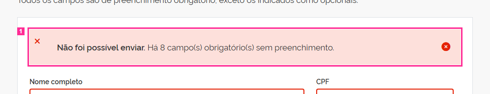


[a mesma tela sem o contorno](img/R-07-tela-sem-marca.png)

**Medido** (não é julgamento):
- foco depois dos passos: &lt;div.content&gt; "Não foi possível enviar. Há 8 campo(s) o" (dentro do elemento 1 do cartão)
- &lt;div.br-message.danger&gt; "Não foi possível enviar. Há 8 campo(s) o": role ausente

*Avisos da preparação do cartão: regra-incerta.*

**Defeitos da lista que parecem próximos** (só uma pista; pode ser outro da lista, ou nenhum):
- **A-11** — Na mensagem de retorno o botão Fechar está à esquerda e o ícone semântico à direita — o inverso da anatomia do componente.
- **P-02** — Camada de página (D-83) · não sorteada · área de rodapé. A página não tem área de rodapé: nenhum componente Footer do DS e nenhuma região de rodapé (footer ou contentinfo), em estado algum. A âncora é o documento porque a área ausente não tem elemento.

**Sua resposta** (copie a linha e complete):

```
R-07: fato  descumpre  defeito  quem-escreveu
```

---

## R-08

**O que o cartão diz que acontece:** Na mensagem de erro, o botão Fechar é &lt;div class="br-button circle small" role="button" tabindex="0"&gt;, não um &lt;button&gt; (na mensagem de sucesso é &lt;button&gt;).

**Correção que o cartão sugere:** Botão Fechar implementado com o componente Button (&lt;button type="button" class="br-button"&gt;).

**Regra citada:** base de regras do DS 3.7.0 (texto literal; id mascarado, D-87)
> 5 | Botão Fechar | Componente Button | Opcional. *(força declarada na base: permitido (opcional))*

**Onde:**
- `<div> "Fechar a mensagem"` — seletor `body>div:nth-of-type(1)>div>main>form>div:nth-of-type(1)>div>div:nth-of-type(1)>div`
- seletor escrito no cartão: `.mensagem-retorno .close > div.br-button`

**Como chegar ao estado** (janela 1280×900):
1. click button.acao-enviar (formulário vazio)

**Na página congelada, depois desses passos** (refeitos automaticamente, como estão escritos, em janela 1280×900):
- passo 1 ("click button.acao-enviar (formulário vazio)"): feito

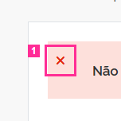


[a mesma tela sem o contorno](img/R-08-tela-sem-marca.png)

**Medido** (não é julgamento):
- foco depois dos passos: &lt;div.content&gt; "Não foi possível enviar. Há 8 campo(s) o" (não é elemento deste cartão)
- &lt;div.br-button.circle&gt; "Fechar a mensagem": role "button"; tabindex "0"

**Defeitos da lista que parecem próximos** (só uma pista; pode ser outro da lista, ou nenhum):
- **A-06** — O botão Fechar da mensagem de retorno é um &lt;div role="button" tabindex="0"&gt; com tratadores de Enter e Espaço, no lugar do &lt;button&gt; nativo do exemplo oficial. Continua operável por teclado e nomeado — o defeito é só o elemento.
- **A-11** — Na mensagem de retorno o botão Fechar está à esquerda e o ícone semântico à direita — o inverso da anatomia do componente.
- **P-02** — Camada de página (D-83) · não sorteada · área de rodapé. A página não tem área de rodapé: nenhum componente Footer do DS e nenhuma região de rodapé (footer ou contentinfo), em estado algum. A âncora é o documento porque a área ausente não tem elemento.

**Sua resposta** (copie a linha e complete):

```
R-08: fato  descumpre  defeito  quem-escreveu
```

---

## R-09

**O que o cartão diz que acontece:** As opções das listas de Tipo de serviço e Unidade (role='option', de filhos apresentacionais) contêm input type='radio' focável. O [ferramenta citada] aponta 'Element has focusable descendants' nas 4 opções de Tipo de serviço com a lista aberta; a lista de Unidade tem a mesma marcação.

**Correção que o cartão sugere:** Elementos de papel option sem descendentes interativos ou focáveis.

**Regra citada:** axe-core 4.11.4 · axe:nested-interactive · Interactive controls must not be nested
> Ensure interactive controls are not nested as they are not always announced by screen readers or can cause focus problems for assistive technologies
> etiquetas: EN-301-549, EN-9.4.1.2, RGAA-7.1.1, RGAAv4, TT6.a, TTv5, cat.keyboard, wcag2a, wcag412

**Onde:**
- `<div> "Emissão de certidão"` — seletor `body>div:nth-of-type(1)>div>main>form>div:nth-of-type(3)>div:nth-of-type(1)>div>div:nth-of-type(2)>div:nth-of-type(1)`
- `<div> "Atualização cadastral"` — seletor `body>div:nth-of-type(1)>div>main>form>div:nth-of-type(3)>div:nth-of-type(1)>div>div:nth-of-type(2)>div:nth-of-type(2)`
- `<div> "Agendamento de perícia"` — seletor `body>div:nth-of-type(1)>div>main>form>div:nth-of-type(3)>div:nth-of-type(1)>div>div:nth-of-type(2)>div:nth-of-type(3)`
- `<div> "Segunda via de documento"` — seletor `body>div:nth-of-type(1)>div>main>form>div:nth-of-type(3)>div:nth-of-type(1)>div>div:nth-of-type(2)>div:nth-of-type(4)`
- `<div> "Agência Centro"` — seletor `body>div:nth-of-type(1)>div>main>form>div:nth-of-type(3)>div:nth-of-type(2)>div>div:nth-of-type(2)>div:nth-of-type(1)`
- `<div> "Agência Norte"` — seletor `body>div:nth-of-type(1)>div>main>form>div:nth-of-type(3)>div:nth-of-type(2)>div>div:nth-of-type(2)>div:nth-of-type(2)`
- `<div> "Agência Sul"` — seletor `body>div:nth-of-type(1)>div>main>form>div:nth-of-type(3)>div:nth-of-type(2)>div>div:nth-of-type(2)>div:nth-of-type(3)`
- `<div> "Posto de atendimento móvel"` — seletor `body>div:nth-of-type(1)>div>main>form>div:nth-of-type(3)>div:nth-of-type(2)>div>div:nth-of-type(2)>div:nth-of-type(4)`
- seletor escrito no cartão: `.br-select .br-list [role=option]`

**Como chegar ao estado** (janela 1280×900):
1. clicar em #servico (abre a lista)

**Na página congelada, depois desses passos** (refeitos automaticamente, como estão escritos, em janela 1280×900):
- passo 1 ("clicar em #servico (abre a lista)"): feito

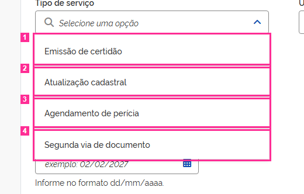

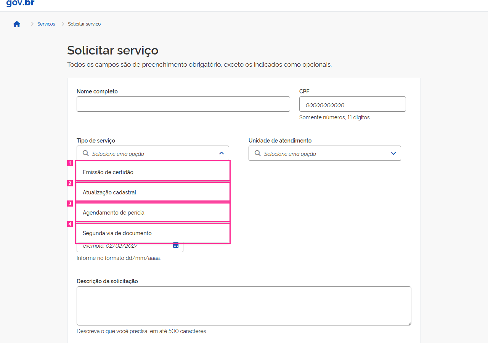

[a mesma tela sem o contorno](img/R-09-tela-sem-marca.png)

**Medido** (não é julgamento):
- foco depois dos passos: &lt;input#servico&gt; "Selecione uma opção" (não é elemento deste cartão)
- &lt;div.br-item&gt; "Emissão de certidão": role "option"
- &lt;div.br-item&gt; "Atualização cadastral": role "option"
- &lt;div.br-item&gt; "Agendamento de perícia": role "option"
- &lt;div.br-item&gt; "Segunda via de documento": role "option"
- &lt;div.br-item&gt; "Agência Centro": role "option"
- &lt;div.br-item&gt; "Agência Norte": role "option"
- &lt;div.br-item&gt; "Agência Sul": role "option"
- &lt;div.br-item&gt; "Posto de atendimento móvel": role "option"

**Defeitos da lista que parecem próximos** (só uma pista; pode ser outro da lista, ou nenhum):
- **P-02** — Camada de página (D-83) · não sorteada · área de rodapé. A página não tem área de rodapé: nenhum componente Footer do DS e nenhuma região de rodapé (footer ou contentinfo), em estado algum. A âncora é o documento porque a área ausente não tem elemento.

**Sua resposta** (copie a linha e complete):

```
R-09: fato  descumpre  defeito  quem-escreveu
```

---

## R-10

**O que o cartão diz que acontece:** O botão 'Selecione o arquivo' tem aria-hidden='true' mas é focável (tabindex='1'). O input file #documentos tem display:none, então o único controle de upload fica oculto para leitores de tela, e o foco cai num elemento sem nome nem papel.

**Correção que o cartão sugere:** Elemento focável não pode ter aria-hidden='true'. O controle de upload precisa ser exposto com nome e papel, associado ao rótulo 'Documentos comprobatórios (opcional)'.

**Regra citada:** axe-core 4.11.4 · axe:aria-hidden-focus · ARIA hidden element must not be focusable or contain focusable elements
> Ensure aria-hidden elements are not focusable nor contain focusable elements
> etiquetas: EN-301-549, EN-9.4.1.2, RGAA-10.8.1, RGAAv4, TT6.a, TTv5, cat.name-role-value, wcag2a, wcag412

**Onde:**
- `<button> "Selecione o arquivo"` — seletor `body>div:nth-of-type(1)>div>main>form>div:nth-of-type(6)>div>button`
- seletor escrito no cartão: `.upload-button`

**Como chegar ao estado** (janela 1280×900):
1. abrir a página (estado inicial)

**Na página congelada, depois desses passos** (refeitos automaticamente, como estão escritos, em janela 1280×900):
- nenhum passo no cartão: página no estado inicial


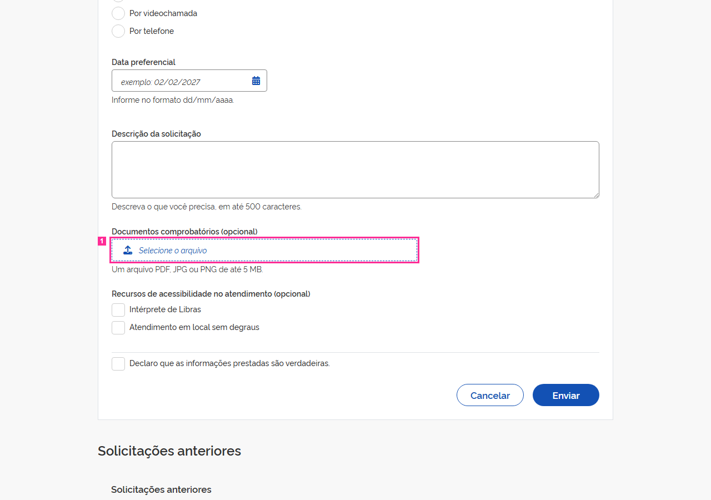

[a mesma tela sem o contorno](img/R-10-tela-sem-marca.png)

**Medido** (não é julgamento):
- foco depois dos passos: &lt;body&gt; (nenhum elemento focado) (não é elemento deste cartão)
- &lt;button.upload-button&gt; "Selecione o arquivo": aria-hidden "true"; tabindex "1"

**Defeitos da lista que parecem próximos** (só uma pista; pode ser outro da lista, ou nenhum):
- **A-02** — O botão do upload tem tabindex=1: o primeiro Tab da página cai nele, antes do atalho para o conteúdo e de todos os campos que o precedem no formulário.
- **A-10** — O upload aceita arrastar e soltar (comportamento do core.js), mas o texto de apoio informa só formato e tamanho — não diz que o arquivo pode ser arrastado.
- **P-02** — Camada de página (D-83) · não sorteada · área de rodapé. A página não tem área de rodapé: nenhum componente Footer do DS e nenhuma região de rodapé (footer ou contentinfo), em estado algum. A âncora é o documento porque a área ausente não tem elemento.

**Sua resposta** (copie a linha e complete):

```
R-10: fato  descumpre  defeito  quem-escreveu
```

---

## Lista de defeitos da tela

Use o id (ex.: `A-01`) na 3ª resposta.

- **A-01** (estado: dialogo-aberto) — Ao fechar o diálogo de descarte (X, Continuar preenchendo ou Esc) o foco não volta ao botão Cancelar que o abriu: cai em &lt;body&gt;. Abrir o diálogo leva o foco para dentro dele, como deve.
- **A-02** (estado: sempre) — O botão do upload tem tabindex=1: o primeiro Tab da página cai nele, antes do atalho para o conteúdo e de todos os campos que o precedem no formulário.
- **A-03** (estado: dialogo-aberto) — O texto do diálogo usa #334333 — a cor de texto do DS (#333333) com o canal verde acrescido de 16 —, valor que não corresponde a token algum.
- **A-04** (estado: sempre) — COMPARTILHADA pelos dois selects. O campo de texto do select não mostra indicador de foco: a borda e o box-shadow com que o DS desenha o foco dos campos foram suprimidos (e o outline segue none). Nome, CPF, data e descrição mostram o indicador.
- **A-05** (estado: sempre) — A tabela de solicitações anteriores não tem &lt;caption&gt;; o título visível é um div da barra superior do componente, fora do &lt;table&gt;.
- **A-06** (estado: apos-envio-vazio) — O botão Fechar da mensagem de retorno é um &lt;div role="button" tabindex="0"&gt; com tratadores de Enter e Espaço, no lugar do &lt;button&gt; nativo do exemplo oficial. Continua operável por teclado e nomeado — o defeito é só o elemento.
- **A-07** (estado: sempre) — Os links de página são âncoras adjacentes soltas dentro do &lt;nav&gt;, sem o &lt;ul&gt;/&lt;li&gt; do exemplo oficial: nada além de espaço os separa.
- **A-08** (estado: apos-envio-vazio) — COMPARTILHADA pelos dois selects. Depois do envio vazio o texto de erro aparece sob o select, mas o campo não o referencia: não há aria-describedby. Os outros seis campos obrigatórios referenciam o próprio texto de erro. A unidade existe só neste estado, embora o campo exista desde o primeiro paint — por isso não é `conditional`.
- **A-09** (estado: sempre) — md). O &lt;label&gt; de "Presencial" não tem for: o radio fica sem nome acessível e clicar no texto não o marca. As outras duas opções estão associadas.
- **A-10** (estado: sempre) — O upload aceita arrastar e soltar (comportamento do core.js), mas o texto de apoio informa só formato e tamanho — não diz que o arquivo pode ser arrastado.
- **A-11** (estado: apos-envio-vazio) — Na mensagem de retorno o botão Fechar está à esquerda e o ícone semântico à direita — o inverso da anatomia do componente.
- **A-12** (estado: sempre) — A página ativa da paginação é marcada só pela classe `active`: nenhum link carrega aria-current="page", o estado que o próprio DS escreve em tempo de execução. A trilha de navegação da mesma tela marca a página atual com aria-current.
- **P-01** (estado: sempre) — Camada de página (D-83) · não sorteada · área de cabeçalho. A região de cabeçalho da página é um &lt;header&gt; que contém só a marca gov.br (um link); o componente Header do DS não é usado nessa área.
- **P-02** (estado: sempre) — Camada de página (D-83) · não sorteada · área de rodapé. A página não tem área de rodapé: nenhum componente Footer do DS e nenhuma região de rodapé (footer ou contentinfo), em estado algum. A âncora é o documento porque a área ausente não tem elemento.

## Modelo para copiar no comentário

```
R-01: 
R-02: 
R-03: 
R-04: 
R-05: 
R-06: 
R-07: 
R-08: 
R-09: 
R-10: 
```
