# Casos para julgar — Tela Solicitar serviço

10 casos. Leia antes o [LEIAME](LEIAME.md) (5 min). Cada caso leva uns 3 a 4 minutos.

Responda num comentário do Linear com uma linha por caso (modelo no fim desta página).

## R-01

**O que o cartão diz que acontece:** Ao receber foco por teclado, os campos "Tipo de serviço" e "Unidade de atendimento" não exibem indicador: outline none, box-shadow none e borda inalterada (1px #888), também no .br-input/.input-group; os demais campos mostram borda/sombra #c2850c.

**Correção que o cartão sugere:** Indicador de foco visível em todo componente operável por teclado (padrão do DS: contorno de foco amarelo-ouro).

**Regra citada:** WCAG 2.2 · wcag:2.4.7 · Focus Visible · nível AA

**Onde:**
- `<input#servico> "Selecione uma opção"` — seletor `body>div:nth-of-type(1)>div>main>form>div:nth-of-type(3)>div:nth-of-type(1)>div>div:nth-of-type(1)>div>input`
- `<input#unidade> "Selecione uma opção"` — seletor `body>div:nth-of-type(1)>div>main>form>div:nth-of-type(3)>div:nth-of-type(2)>div>div:nth-of-type(1)>div>input`
- seletor escrito no cartão: `#servico, #unidade`

**Como chegar ao estado** (janela 1280×900):
1. clique em #cpf
2. tecla Tab (foco em #servico)

**Na página congelada, depois desses passos** (refeitos automaticamente, como estão escritos, em janela 1280×900):
- passo 1 ("clique em #cpf"): feito
- passo 2 ("tecla Tab (foco em #servico)"): feito


[a mesma tela sem o contorno](img/R-01-tela-sem-marca.png)

**Medido** (não é julgamento):
- foco depois dos passos: &lt;input#servico&gt; "Selecione uma opção" (é o elemento 1 do cartão)
- &lt;input#servico&gt; "Selecione uma opção": border-top-color rgb(136, 136, 136); box-shadow none; outline-color rgb(51, 51, 51); outline-style none; outline-width 3px
- &lt;input#unidade&gt; "Selecione uma opção": border-top-color rgb(136, 136, 136); box-shadow none; outline-color rgb(51, 51, 51); outline-style none; outline-width 3px

**Evidências que o cartão traz:**
- captura de tela page-2026-10-21T15-35-50-600Z.png
- estilos calculados via Playwright

**Defeitos da lista que parecem próximos** (só uma pista; pode ser outro da lista, ou nenhum):
- **A-04** — COMPARTILHADA pelos dois selects. O campo de texto do select não mostra indicador de foco: a borda e o box-shadow com que o DS desenha o foco dos campos foram suprimidos (e o outline segue none). Nome, CPF, data e descrição mostram o indicador.
- **A-08** — COMPARTILHADA pelos dois selects. Depois do envio vazio o texto de erro aparece sob o select, mas o campo não o referencia: não há aria-describedby. Os outros seis campos obrigatórios referenciam o próprio texto de erro. A unidade existe só neste estado, embora o campo exista desde o primeiro paint — por isso não é `conditional`.
- **P-02** — Camada de página (D-83) · não sorteada · área de rodapé. A página não tem área de rodapé: nenhum componente Footer do DS e nenhuma região de rodapé (footer ou contentinfo), em estado algum. A âncora é o documento porque a área ausente não tem elemento.

**Sua resposta** (copie a linha e complete):

```
R-01: fato  descumpre  defeito  quem-escreveu
```

---

## R-02

**O que o cartão diz que acontece:** O botão "Selecione o arquivo" tem aria-hidden="true" mas é focável (tabindex="1"); o leitor de tela recebe foco num elemento oculto da árvore de acessibilidade, e o input file real (#documentos) não está no percurso de teclado.

**Correção que o cartão sugere:** Elemento focável não pode estar com aria-hidden; o controle de upload operável por teclado deve ser exposto com nome e papel.

**Regra citada:** axe-core 4.11.4 · axe:aria-hidden-focus · ARIA hidden element must not be focusable or contain focusable elements
> Ensure aria-hidden elements are not focusable nor contain focusable elements
> etiquetas: EN-301-549, EN-9.4.1.2, RGAA-10.8.1, RGAAv4, TT6.a, TTv5, cat.name-role-value, wcag2a, wcag412

**Onde:**
- `<button> "Selecione o arquivo"` — seletor `body>div:nth-of-type(1)>div>main>form>div:nth-of-type(6)>div>button`
- seletor escrito no cartão: `.upload-button`

**Como chegar ao estado** (janela 1280×900):
1. abrir a página (estado inicial)

**Na página congelada, depois desses passos** (refeitos automaticamente, como estão escritos, em janela 1280×900):
- nenhum passo no cartão: página no estado inicial

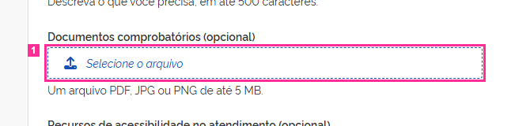


[a mesma tela sem o contorno](img/R-02-tela-sem-marca.png)

**Medido** (não é julgamento):
- foco depois dos passos: &lt;body&gt; (nenhum elemento focado) (não é elemento deste cartão)
- &lt;button.upload-button&gt; "Selecione o arquivo": aria-hidden "true"; tabindex "1"

**Defeitos da lista que parecem próximos** (só uma pista; pode ser outro da lista, ou nenhum):
- **A-02** — O botão do upload tem tabindex=1: o primeiro Tab da página cai nele, antes do atalho para o conteúdo e de todos os campos que o precedem no formulário.
- **A-10** — O upload aceita arrastar e soltar (comportamento do core.js), mas o texto de apoio informa só formato e tamanho — não diz que o arquivo pode ser arrastado.
- **P-02** — Camada de página (D-83) · não sorteada · área de rodapé. A página não tem área de rodapé: nenhum componente Footer do DS e nenhuma região de rodapé (footer ou contentinfo), em estado algum. A âncora é o documento porque a área ausente não tem elemento.

**Sua resposta** (copie a linha e complete):

```
R-02: fato  descumpre  defeito  quem-escreveu
```

---

## R-03

**O que o cartão diz que acontece:** Ao exibir a mensagem (erro após envio vazio e também sucesso após envio válido), o foco vai para .content (role=alert, tabindex=-1), não para o botão Fechar.

**Correção que o cartão sugere:** No momento da exibição da mensagem, o foco deve estar no botão Fechar.

**Regra citada:** base de regras do DS 3.7.0 (texto literal; id mascarado, D-87)
> No momento da exibição da mensagem, o foco do navegador deve estar sobre o botão fechar, quando houver. *(força declarada na base: obrigatorio)*

**Onde:**
- `<div> "Não foi possível enviar. Há 8 campo(s) obrigatór"` — seletor `body>div:nth-of-type(1)>div>main>form>div:nth-of-type(1)>div`
- seletor escrito no cartão: `.mensagem-retorno`

**Como chegar ao estado** (janela 1280×900):
1. clicar em Enviar (.acao-enviar) com o formulário vazio

**Na página congelada, depois desses passos** (refeitos automaticamente, como estão escritos, em janela 1280×900):
- passo 1 ("clicar em Enviar (.acao-enviar) com o formulário vazio"): feito


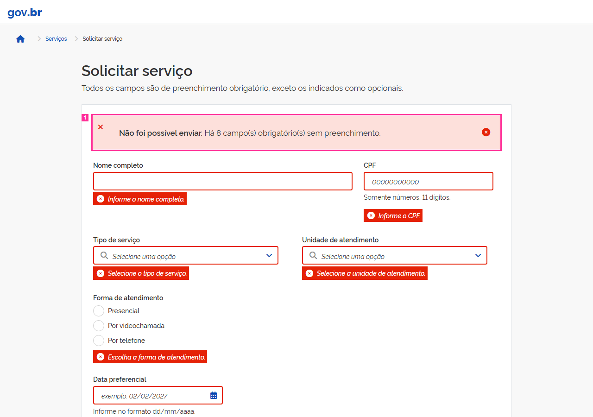

[a mesma tela sem o contorno](img/R-03-tela-sem-marca.png)

**Medido** (não é julgamento):
- foco depois dos passos: &lt;div.content&gt; "Não foi possível enviar. Há 8 campo(s) o" (dentro do elemento 1 do cartão)
- &lt;div.br-message.danger&gt; "Não foi possível enviar. Há 8 campo(s) o": role ausente; tabindex ausente

**Defeitos da lista que parecem próximos** (só uma pista; pode ser outro da lista, ou nenhum):
- **A-11** — Na mensagem de retorno o botão Fechar está à esquerda e o ícone semântico à direita — o inverso da anatomia do componente.
- **P-02** — Camada de página (D-83) · não sorteada · área de rodapé. A página não tem área de rodapé: nenhum componente Footer do DS e nenhuma região de rodapé (footer ou contentinfo), em estado algum. A âncora é o documento porque a área ausente não tem elemento.

**Sua resposta** (copie a linha e complete):

```
R-03: fato  descumpre  defeito  quem-escreveu
```

---

## R-04

**O que o cartão diz que acontece:** O círculo/quadrado visível dos rádios e caixas de seleção (label::before, 24×24) tem borda 1px rgb(204,204,204) sobre fundo branco: contraste ≈1,6:1.

**Correção que o cartão sugere:** Contorno necessário para identificar o controle com contraste mínimo de 3:1 com as cores adjacentes (DS usa a cor de borda #888 dos demais campos).

**Regra citada:** WCAG 2.2 · wcag:1.4.11 · Non-text Contrast · nível AA

**Onde:**
- `<label> "Declaro que as informações prestadas são verdade"` — seletor `body>div:nth-of-type(1)>div>main>form>div:nth-of-type(7)>div>label`
- `<label> "Presencial"` — seletor `body>div:nth-of-type(1)>div>main>form>fieldset:nth-of-type(1)>div:nth-of-type(1)>label`
- `<label> "Por videochamada"` — seletor `body>div:nth-of-type(1)>div>main>form>fieldset:nth-of-type(1)>div:nth-of-type(2)>label`
- `<label> "Por telefone"` — seletor `body>div:nth-of-type(1)>div>main>form>fieldset:nth-of-type(1)>div:nth-of-type(3)>label`
- `<label> "Intérprete de Libras"` — seletor `body>div:nth-of-type(1)>div>main>form>fieldset:nth-of-type(2)>div:nth-of-type(1)>label`
- `<label> "Atendimento em local sem degraus"` — seletor `body>div:nth-of-type(1)>div>main>form>fieldset:nth-of-type(2)>div:nth-of-type(2)>label`
- seletor escrito no cartão: `.grupo-forma .br-radio label, .grupo-recursos .br-checkbox label, .campo-declaracao .br-checkbox label`

**Como chegar ao estado** (janela 1280×900):
1. abrir a página (estado inicial)

**Na página congelada, depois desses passos** (refeitos automaticamente, como estão escritos, em janela 1280×900):
- nenhum passo no cartão: página no estado inicial

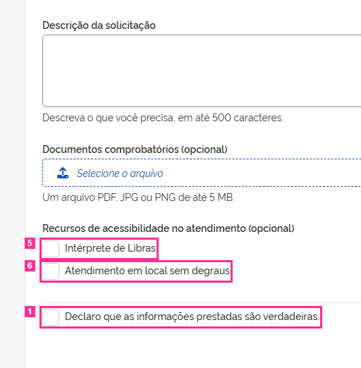

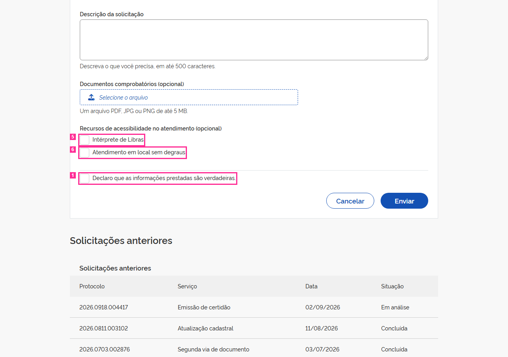

[a mesma tela sem o contorno](img/R-04-tela-sem-marca.png)

**Medido** (não é julgamento):
- foco depois dos passos: &lt;body&gt; (nenhum elemento focado) (não é elemento deste cartão)
- &lt;label&gt; "Declaro que as informações prestadas são": background-color rgba(0, 0, 0, 0); border-top-color rgb(51, 51, 51); color rgb(51, 51, 51); ::before background-color rgb(255, 255, 255); ::before border-top-color rgb(204, 204, 204); ::before color rgb(51, 51, 51)
- &lt;label&gt; "Presencial": background-color rgba(0, 0, 0, 0); border-top-color rgb(51, 51, 51); color rgb(51, 51, 51); ::before background-color rgb(255, 255, 255); ::before border-top-color rgb(204, 204, 204); ::before color rgb(51, 51, 51)
- &lt;label&gt; "Por videochamada": background-color rgba(0, 0, 0, 0); border-top-color rgb(51, 51, 51); color rgb(51, 51, 51); ::before background-color rgb(255, 255, 255); ::before border-top-color rgb(204, 204, 204); ::before color rgb(51, 51, 51)
- &lt;label&gt; "Por telefone": background-color rgba(0, 0, 0, 0); border-top-color rgb(51, 51, 51); color rgb(51, 51, 51); ::before background-color rgb(255, 255, 255); ::before border-top-color rgb(204, 204, 204); ::before color rgb(51, 51, 51)
- &lt;label&gt; "Intérprete de Libras": background-color rgba(0, 0, 0, 0); border-top-color rgb(51, 51, 51); color rgb(51, 51, 51); ::before background-color rgb(255, 255, 255); ::before border-top-color rgb(204, 204, 204); ::before color rgb(51, 51, 51)
- &lt;label&gt; "Atendimento em local sem degraus": background-color rgba(0, 0, 0, 0); border-top-color rgb(51, 51, 51); color rgb(51, 51, 51); ::before background-color rgb(255, 255, 255); ::before border-top-color rgb(204, 204, 204); ::before color rgb(51, 51, 51)

**Evidências que o cartão traz:**
- estilos calculados via Playwright (getComputedStyle(label,"::before").border)

**Defeitos da lista que parecem próximos** (só uma pista; pode ser outro da lista, ou nenhum):
- **A-09** — md). O &lt;label&gt; de "Presencial" não tem for: o radio fica sem nome acessível e clicar no texto não o marca. As outras duas opções estão associadas.
- **P-02** — Camada de página (D-83) · não sorteada · área de rodapé. A página não tem área de rodapé: nenhum componente Footer do DS e nenhuma região de rodapé (footer ou contentinfo), em estado algum. A âncora é o documento porque a área ausente não tem elemento.

**Sua resposta** (copie a linha e complete):

```
R-04: fato  descumpre  defeito  quem-escreveu
```

---

## R-05

**O que o cartão diz que acontece:** Ao fechar a mensagem de erro pelo botão Fechar (Enter), a mensagem é removida e o foco vai para BODY.

**Correção que o cartão sugere:** Após o fechamento, o foco deve voltar ao local original no fluxo de navegação.

**Regra citada:** base de regras do DS 3.7.0 (texto literal; id mascarado, D-87)
> É importante que após o fechamento da mensagem, o foco do navegador volte ao local original no fluxo de navegação. *(força declarada na base: recomendado)*

**Onde:**
- `<div> "Fechar a mensagem"` — seletor `body>div:nth-of-type(1)>div>main>form>div:nth-of-type(1)>div>div:nth-of-type(1)>div`
- seletor escrito no cartão: `.mensagem-retorno .close [role=button]`

**Como chegar ao estado** (janela 1280×900):
1. clicar em Enviar (.acao-enviar) com o formulário vazio
2. focar o botão 'Fechar a mensagem'
3. pressionar Enter

**Na página congelada, depois desses passos** (refeitos automaticamente, como estão escritos, em janela 1280×900):
- passo 1 ("clicar em Enviar (.acao-enviar) com o formulário vazio"): feito
- passo 2 ("focar o botão 'Fechar a mensagem'"): feito
- passo 3 ("pressionar Enter"): feito

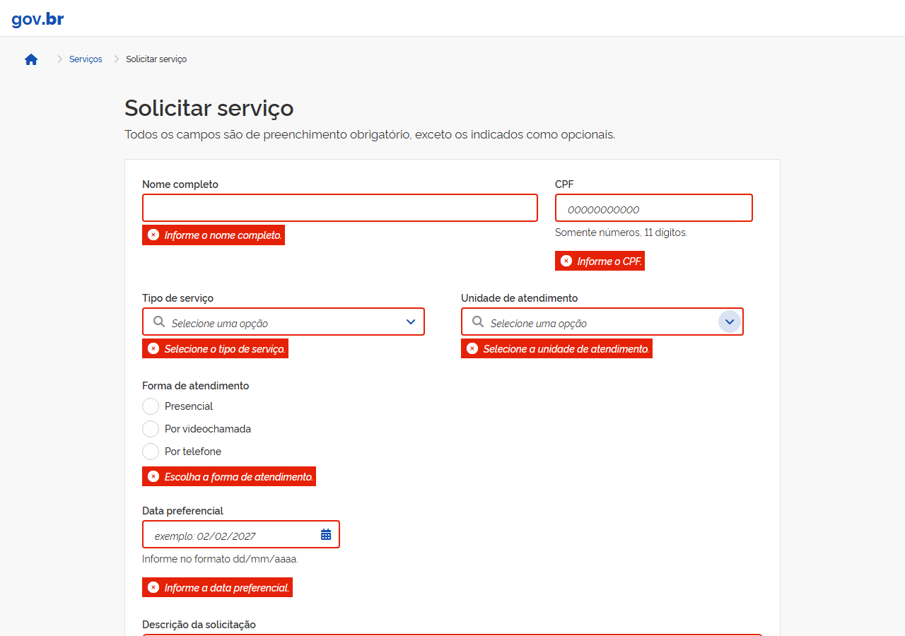

[a mesma tela sem o contorno](img/R-05-tela-sem-marca.png)

**Medido** (não é julgamento):
- foco depois dos passos: &lt;body&gt; (nenhum elemento focado) (não é elemento deste cartão)
- elemento 1: não existe na página neste estado

*Avisos da preparação do cartão: sem-evidencia.*

**Defeitos da lista que parecem próximos** (só uma pista; pode ser outro da lista, ou nenhum):
- **A-06** — O botão Fechar da mensagem de retorno é um &lt;div role="button" tabindex="0"&gt; com tratadores de Enter e Espaço, no lugar do &lt;button&gt; nativo do exemplo oficial. Continua operável por teclado e nomeado — o defeito é só o elemento.
- **A-11** — Na mensagem de retorno o botão Fechar está à esquerda e o ícone semântico à direita — o inverso da anatomia do componente.
- **P-02** — Camada de página (D-83) · não sorteada · área de rodapé. A página não tem área de rodapé: nenhum componente Footer do DS e nenhuma região de rodapé (footer ou contentinfo), em estado algum. A âncora é o documento porque a área ausente não tem elemento.

**Sua resposta** (copie a linha e complete):

```
R-05: fato  descumpre  defeito  quem-escreveu
```

---

## R-06

**O que o cartão diz que acontece:** Os botões de mês anterior/seguinte do calendário contêm apenas ícone, sem aria-label, title ou texto: nome acessível vazio.

**Correção que o cartão sugere:** Nome acessível não vazio (ex.: 'Mês anterior', 'Próximo mês').

**Regra citada:** e-MAG 3.1 · emag:2.2 · Garantir que os objetos programáveis sejam acessíveis
> Scripts and dynamic content must remain accessible. Provide alternatives when direct access is not possible.

**Onde:**
- `<button>` — seletor `body>div:nth-of-type(2)>div:nth-of-type(1)>span:nth-of-type(1)>button`
- `<button>` — seletor `body>div:nth-of-type(2)>div:nth-of-type(1)>span:nth-of-type(2)>button`
- seletor escrito no cartão: `.flatpickr-prev-month button, .flatpickr-next-month button`

**Como chegar ao estado** (janela 1280×900):
1. clicar no botão 'Abrir calendário' (#data-preferencial-btn)

**Na página congelada, depois desses passos** (refeitos automaticamente, como estão escritos, em janela 1280×900):
- passo 1 ("clicar no botão 'Abrir calendário' (#data-preferencial-btn)"): feito

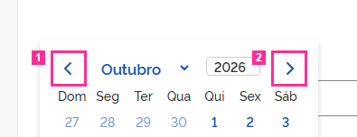

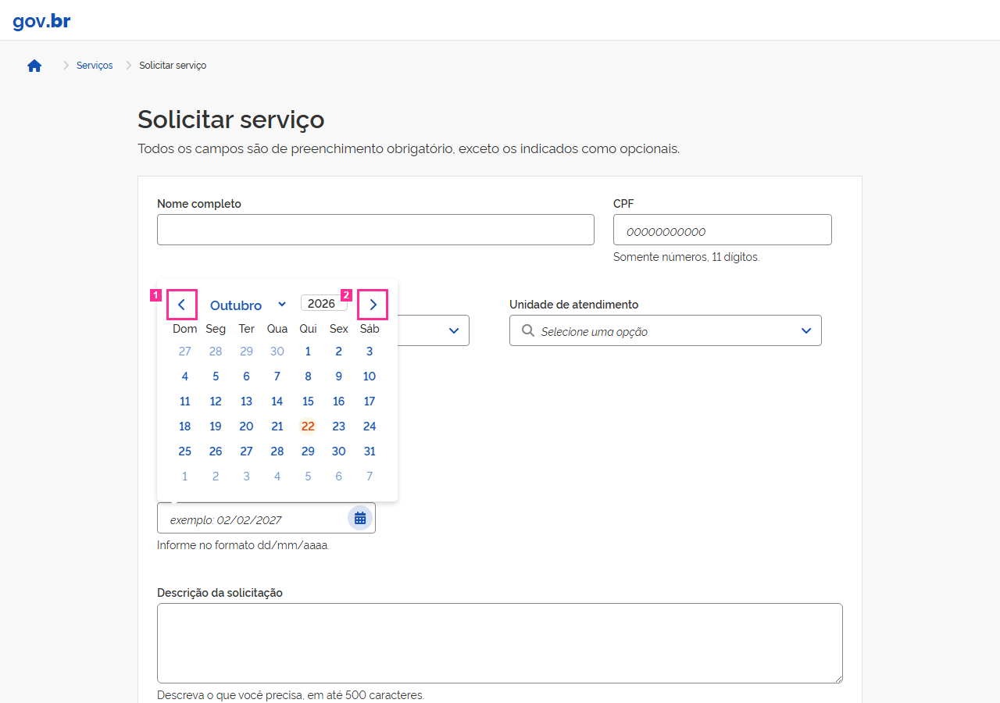

[a mesma tela sem o contorno](img/R-06-tela-sem-marca.png)

**Medido** (não é julgamento):
- foco depois dos passos: &lt;button#data-preferencial-btn&gt; "Abrir calendário" (não é elemento deste cartão)
- &lt;button.br-button.circle&gt;: aria-label ausente; title ausente
- &lt;button.br-button.circle&gt;: aria-label ausente; title ausente

**Defeitos da lista que parecem próximos** (só uma pista; pode ser outro da lista, ou nenhum):
- **P-02** — Camada de página (D-83) · não sorteada · área de rodapé. A página não tem área de rodapé: nenhum componente Footer do DS e nenhuma região de rodapé (footer ou contentinfo), em estado algum. A âncora é o documento porque a área ausente não tem elemento.

**Sua resposta** (copie a linha e complete):

```
R-06: fato  descumpre  defeito  quem-escreveu
```

---

## R-07

**O que o cartão diz que acontece:** Na mensagem de erro, o botão Fechar é um &lt;div class='br-button circle small' role='button' tabindex='0'&gt;, enquanto o DS (e a própria mensagem de sucesso) usa &lt;button type='button'&gt;.

**Correção que o cartão sugere:** br-button aplicado a &lt;button&gt;.

**Regra citada:** base de regras do DS 3.7.0 (id mascarado, D-87)
> 'A anatomia implementada do componente deve corresponder à diretriz oficial de Design' (required) — a tag raiz é anatomia.
> A anatomia implementada do componente deve corresponder à diretriz oficial de Design. *(força declarada na base: obrigatorio)*

**Onde:**
- `<div> "Fechar a mensagem"` — seletor `body>div:nth-of-type(1)>div>main>form>div:nth-of-type(1)>div>div:nth-of-type(1)>div`
- seletor escrito no cartão: `.mensagem-retorno .close [role=button]`

**Como chegar ao estado** (janela 1280×900):
1. clicar em Enviar (.acao-enviar) com o formulário vazio

**Na página congelada, depois desses passos** (refeitos automaticamente, como estão escritos, em janela 1280×900):
- passo 1 ("clicar em Enviar (.acao-enviar) com o formulário vazio"): feito


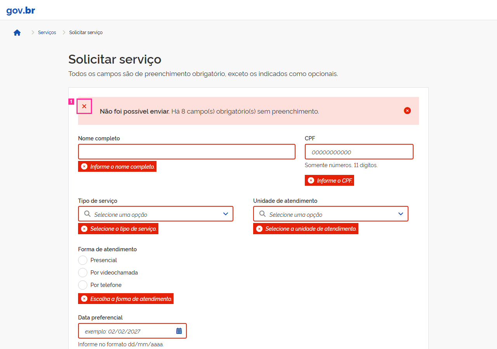

[a mesma tela sem o contorno](img/R-07-tela-sem-marca.png)

**Medido** (não é julgamento):
- foco depois dos passos: &lt;div.content&gt; "Não foi possível enviar. Há 8 campo(s) o" (não é elemento deste cartão)
- &lt;div.br-button.circle&gt; "Fechar a mensagem": role "button"; tabindex "0"

**Defeitos da lista que parecem próximos** (só uma pista; pode ser outro da lista, ou nenhum):
- **A-06** — O botão Fechar da mensagem de retorno é um &lt;div role="button" tabindex="0"&gt; com tratadores de Enter e Espaço, no lugar do &lt;button&gt; nativo do exemplo oficial. Continua operável por teclado e nomeado — o defeito é só o elemento.
- **A-11** — Na mensagem de retorno o botão Fechar está à esquerda e o ícone semântico à direita — o inverso da anatomia do componente.
- **P-02** — Camada de página (D-83) · não sorteada · área de rodapé. A página não tem área de rodapé: nenhum componente Footer do DS e nenhuma região de rodapé (footer ou contentinfo), em estado algum. A âncora é o documento porque a área ausente não tem elemento.

**Sua resposta** (copie a linha e complete):

```
R-07: fato  descumpre  defeito  quem-escreveu
```

---

## R-08

**O que o cartão diz que acontece:** tabindex="1" no botão de upload: o primeiro Tab após o carregamento leva ao botão de upload (meio do formulário), antes do link "Ir para o conteúdo", do cabeçalho e dos campos anteriores.

**Correção que o cartão sugere:** Ordem de foco que preserve o sentido: sem tabindex positivo (tabindex="0" ou nativo).

**Regra citada:** WCAG 2.2 · wcag:2.4.3 · Focus Order · nível A

**Onde:**
- `<button> "Selecione o arquivo"` — seletor `body>div:nth-of-type(1)>div>main>form>div:nth-of-type(6)>div>button`
- seletor escrito no cartão: `.upload-button`

**Como chegar ao estado** (janela 1280×900):
1. tecla Tab a partir do carregamento

**Na página congelada, depois desses passos** (refeitos automaticamente, como estão escritos, em janela 1280×900):
- passo 1 ("tecla Tab a partir do carregamento"): feito


[a mesma tela sem o contorno](img/R-08-tela-sem-marca.png)

**Medido** (não é julgamento):
- foco depois dos passos: &lt;button.upload-button.focus-visible&gt; "Selecione o arquivo" (é o elemento 1 do cartão)
- &lt;button.upload-button.focus-visible&gt; "Selecione o arquivo": tabindex "1"

**Evidências que o cartão traz:**
- inspeção Playwright: activeElement após 1º Tab = button.upload-button[tabindex="1"]

**Defeitos da lista que parecem próximos** (só uma pista; pode ser outro da lista, ou nenhum):
- **A-02** — O botão do upload tem tabindex=1: o primeiro Tab da página cai nele, antes do atalho para o conteúdo e de todos os campos que o precedem no formulário.
- **A-10** — O upload aceita arrastar e soltar (comportamento do core.js), mas o texto de apoio informa só formato e tamanho — não diz que o arquivo pode ser arrastado.
- **P-02** — Camada de página (D-83) · não sorteada · área de rodapé. A página não tem área de rodapé: nenhum componente Footer do DS e nenhuma região de rodapé (footer ou contentinfo), em estado algum. A âncora é o documento porque a área ausente não tem elemento.

**Sua resposta** (copie a linha e complete):

```
R-08: fato  descumpre  defeito  quem-escreveu
```

---

## R-09

**O que o cartão diz que acontece:** Elemento interativo apenas com ícone, sem nome acessível (br-button)

**Correção que o cartão sugere:** Nome acessível não vazio — por conteúdo, aria-labelledby, aria-label ou title

**Regra citada:** e-MAG 3.1 · emag:2.2 · Garantir que os objetos programáveis sejam acessíveis
> Scripts and dynamic content must remain accessible. Provide alternatives when direct access is not possible.

**Onde:**
- `<button>` — seletor `body>div:nth-of-type(2)>div:nth-of-type(1)>span:nth-of-type(1)>button`
- seletor escrito no cartão: `div:nth-of-type(2) > div:nth-of-type(1) > span:nth-of-type(1) > button`

**Como chegar ao estado** (janela 1280×900):
1. abrir o endereço da tela e esperar `.linhas-anteriores tr`
2. clicar em `.acao-enviar`
3. esperar `.mensagem-retorno` aparecer
4. clicar em `.acao-cancelar`
5. esperar `.dialogo-descarte` aparecer

**Na página congelada, depois desses passos** (refeitos automaticamente, como estão escritos, em janela 1280×900):
- passo 1 ("abrir o endereço da tela e esperar `.linhas-anteriores tr`"): feito
- passo 2 ("clicar em `.acao-enviar`"): feito
- passo 3 ("esperar `.mensagem-retorno` aparecer"): feito
- passo 4 ("clicar em `.acao-cancelar`"): feito
- passo 5 ("esperar `.dialogo-descarte` aparecer"): feito

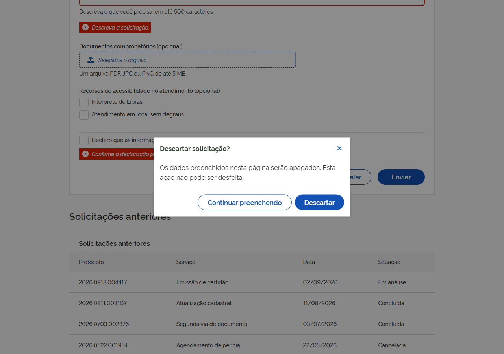

[a mesma tela sem o contorno](img/R-09-tela-sem-marca.png)

**Medido** (não é julgamento):
- foco depois dos passos: &lt;button.br-button.secondary&gt; "Continuar preenchendo" (não é elemento deste cartão)
- &lt;button.br-button.circle&gt;: aria-label ausente; aria-labelledby ausente; title ausente

**Defeitos da lista que parecem próximos** (só uma pista; pode ser outro da lista, ou nenhum):
- **P-02** — Camada de página (D-83) · não sorteada · área de rodapé. A página não tem área de rodapé: nenhum componente Footer do DS e nenhuma região de rodapé (footer ou contentinfo), em estado algum. A âncora é o documento porque a área ausente não tem elemento.

**Sua resposta** (copie a linha e complete):

```
R-09: fato  descumpre  defeito  quem-escreveu
```

---

## R-10

**O que o cartão diz que acontece:** Cor de texto do diálogo: rgb(51, 67, 51) (#334333), fora dos tokens de cor do DS (regra .dialogo-descarte { color: rgb(51,67,51) }).

**Correção que o cartão sugere:** Cor de texto de um token registrado do gov.br DS.

**Regra citada:** base de regras do DS 3.7.0 (id mascarado, D-87)
> 'Interfaces governamentais devem usar as cores predefinidas do Design System' (required) — uma cor fora do registro de tokens é exatamente o que essa regra proíbe.
> Interfaces digitais do governo devem utilizar sempre as cores pré-definidas. *(força declarada na base: obrigatorio)*
> Componentes devem consumir tokens oficiais corretamente e sem duplicação desnecessária. *(força declarada na base: obrigatorio)*

**Onde:**
- `<div> "Descartar solicitação? Os dados preenchidos nest"` — seletor `body>div:nth-of-type(1)>div>div>div`
- seletor escrito no cartão: `.dialogo-descarte`

**Como chegar ao estado** (janela 1280×900):
1. preencher #nome com 'Maria Teste'
2. clicar em Cancelar (.acao-cancelar)

**Na página congelada, depois desses passos** (refeitos automaticamente, como estão escritos, em janela 1280×900):
- passo 1 ("preencher #nome com 'Maria Teste'"): feito
- passo 2 ("clicar em Cancelar (.acao-cancelar)"): feito

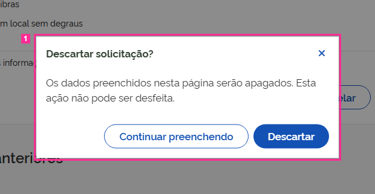

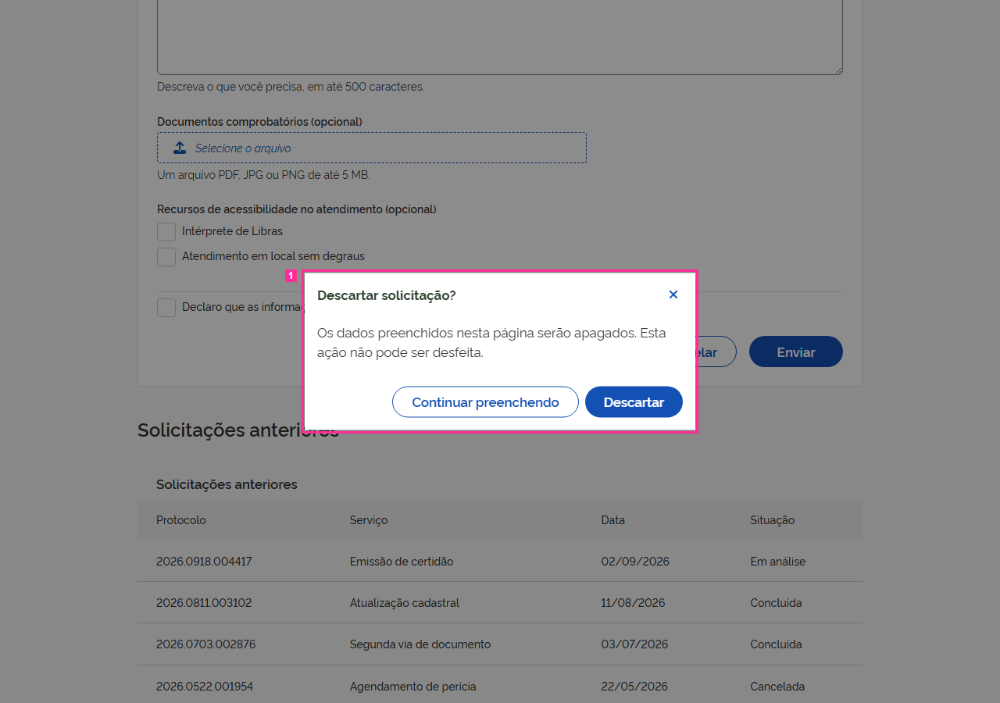

[a mesma tela sem o contorno](img/R-10-tela-sem-marca.png)

**Medido** (não é julgamento):
- foco depois dos passos: &lt;button.br-button.secondary&gt; "Continuar preenchendo" (dentro do elemento 1 do cartão)
- &lt;div.br-modal.medium&gt; "Descartar solicitação? Os dados preenchi": color rgb(51, 67, 51)

**Defeitos da lista que parecem próximos** (só uma pista; pode ser outro da lista, ou nenhum):
- **A-01** — Ao fechar o diálogo de descarte (X, Continuar preenchendo ou Esc) o foco não volta ao botão Cancelar que o abriu: cai em &lt;body&gt;. Abrir o diálogo leva o foco para dentro dele, como deve.
- **A-03** — O texto do diálogo usa #334333 — a cor de texto do DS (#333333) com o canal verde acrescido de 16 —, valor que não corresponde a token algum.
- **P-02** — Camada de página (D-83) · não sorteada · área de rodapé. A página não tem área de rodapé: nenhum componente Footer do DS e nenhuma região de rodapé (footer ou contentinfo), em estado algum. A âncora é o documento porque a área ausente não tem elemento.

**Sua resposta** (copie a linha e complete):

```
R-10: fato  descumpre  defeito  quem-escreveu
```

---

## Lista de defeitos da tela

Use o id (ex.: `A-01`) na 3ª resposta.

- **A-01** (estado: dialogo-aberto) — Ao fechar o diálogo de descarte (X, Continuar preenchendo ou Esc) o foco não volta ao botão Cancelar que o abriu: cai em &lt;body&gt;. Abrir o diálogo leva o foco para dentro dele, como deve.
- **A-02** (estado: sempre) — O botão do upload tem tabindex=1: o primeiro Tab da página cai nele, antes do atalho para o conteúdo e de todos os campos que o precedem no formulário.
- **A-03** (estado: dialogo-aberto) — O texto do diálogo usa #334333 — a cor de texto do DS (#333333) com o canal verde acrescido de 16 —, valor que não corresponde a token algum.
- **A-04** (estado: sempre) — COMPARTILHADA pelos dois selects. O campo de texto do select não mostra indicador de foco: a borda e o box-shadow com que o DS desenha o foco dos campos foram suprimidos (e o outline segue none). Nome, CPF, data e descrição mostram o indicador.
- **A-05** (estado: sempre) — A tabela de solicitações anteriores não tem &lt;caption&gt;; o título visível é um div da barra superior do componente, fora do &lt;table&gt;.
- **A-06** (estado: apos-envio-vazio) — O botão Fechar da mensagem de retorno é um &lt;div role="button" tabindex="0"&gt; com tratadores de Enter e Espaço, no lugar do &lt;button&gt; nativo do exemplo oficial. Continua operável por teclado e nomeado — o defeito é só o elemento.
- **A-07** (estado: sempre) — Os links de página são âncoras adjacentes soltas dentro do &lt;nav&gt;, sem o &lt;ul&gt;/&lt;li&gt; do exemplo oficial: nada além de espaço os separa.
- **A-08** (estado: apos-envio-vazio) — COMPARTILHADA pelos dois selects. Depois do envio vazio o texto de erro aparece sob o select, mas o campo não o referencia: não há aria-describedby. Os outros seis campos obrigatórios referenciam o próprio texto de erro. A unidade existe só neste estado, embora o campo exista desde o primeiro paint — por isso não é `conditional`.
- **A-09** (estado: sempre) — md). O &lt;label&gt; de "Presencial" não tem for: o radio fica sem nome acessível e clicar no texto não o marca. As outras duas opções estão associadas.
- **A-10** (estado: sempre) — O upload aceita arrastar e soltar (comportamento do core.js), mas o texto de apoio informa só formato e tamanho — não diz que o arquivo pode ser arrastado.
- **A-11** (estado: apos-envio-vazio) — Na mensagem de retorno o botão Fechar está à esquerda e o ícone semântico à direita — o inverso da anatomia do componente.
- **A-12** (estado: sempre) — A página ativa da paginação é marcada só pela classe `active`: nenhum link carrega aria-current="page", o estado que o próprio DS escreve em tempo de execução. A trilha de navegação da mesma tela marca a página atual com aria-current.
- **P-01** (estado: sempre) — Camada de página (D-83) · não sorteada · área de cabeçalho. A região de cabeçalho da página é um &lt;header&gt; que contém só a marca gov.br (um link); o componente Header do DS não é usado nessa área.
- **P-02** (estado: sempre) — Camada de página (D-83) · não sorteada · área de rodapé. A página não tem área de rodapé: nenhum componente Footer do DS e nenhuma região de rodapé (footer ou contentinfo), em estado algum. A âncora é o documento porque a área ausente não tem elemento.

## Modelo para copiar no comentário

```
R-01: 
R-02: 
R-03: 
R-04: 
R-05: 
R-06: 
R-07: 
R-08: 
R-09: 
R-10: 
```
