# Casos para julgar — Tela Solicitar serviço

10 casos. Leia antes o [LEIAME](LEIAME.md) (5 min). Cada caso leva uns 3 a 4 minutos.

Responda num comentário do Linear com uma linha por caso (modelo no fim desta página).

## R-01

**O que o cartão diz que acontece:** Cancelar abre o modal 'Descartar solicitação?' (foco em 'Continuar preenchendo', com foco preso no modal). Ao fechar com Esc ou com 'Continuar preenchendo' (e também após 'Descartar'), o modal é removido e o foco vai para &lt;body&gt;, sem voltar ao botão Cancelar.

**Correção que o cartão sugere:** Ao fechar o diálogo, o foco deve voltar ao controle que o abriu (ou a um ponto lógico do formulário).

**Regra citada:** WCAG 2.2 · wcag:2.4.3 · Focus Order · nível A

**Onde:**
- `<button> "Cancelar"` — seletor `body>div:nth-of-type(1)>div>main>form>div:nth-of-type(8)>button:nth-of-type(1)`
- seletor escrito no cartão: `.acao-cancelar`

**Como chegar ao estado** (janela 1280×900):
1. clicar em Cancelar (.acao-cancelar)
2. pressionar Escape

**Na página congelada, depois desses passos** (refeitos automaticamente, como estão escritos, em janela 1280×900):
- passo 1 ("clicar em Cancelar (.acao-cancelar)"): feito
- passo 2 ("pressionar Escape"): feito

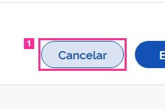

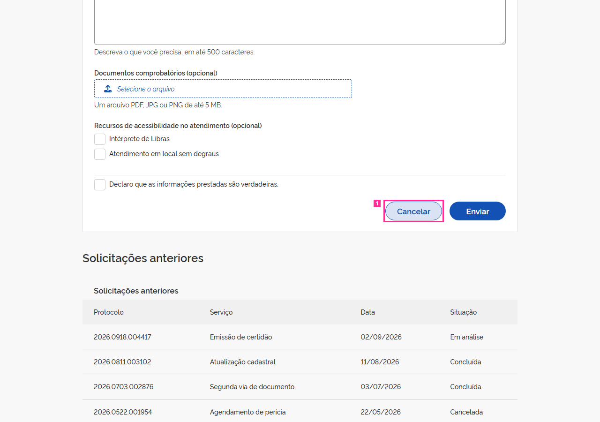

[a mesma tela sem o contorno](img/R-01-tela-sem-marca.png)

**Medido** (não é julgamento):
- foco depois dos passos: &lt;body&gt; (nenhum elemento focado) (não é elemento deste cartão)
- &lt;button.br-button.secondary&gt; "Cancelar": a alegação não nomeia atributo nem propriedade de CSS

**Defeitos da lista que parecem próximos** (só uma pista; pode ser outro da lista, ou nenhum):
- **A-01** — Ao fechar o diálogo de descarte (X, Continuar preenchendo ou Esc) o foco não volta ao botão Cancelar que o abriu: cai em &lt;body&gt;. Abrir o diálogo leva o foco para dentro dele, como deve.
- **A-03** — O texto do diálogo usa #334333 — a cor de texto do DS (#333333) com o canal verde acrescido de 16 —, valor que não corresponde a token algum.
- **P-02** — Camada de página (D-83) · não sorteada · área de rodapé. A página não tem área de rodapé: nenhum componente Footer do DS e nenhuma região de rodapé (footer ou contentinfo), em estado algum. A âncora é o documento porque a área ausente não tem elemento.

**Sua resposta** (copie a linha e complete):

```
R-01: fato  descumpre  defeito  quem-escreveu
```

---

## R-02

**O que o cartão diz que acontece:** Form elements must have labels

**Correção que o cartão sugere:** (o cartão não sugere correção)

**Regra citada:** axe-core 4.11.4 · axe:label · Form elements must have labels
> Ensure every form element has a label
> etiquetas: ACT, EN-301-549, EN-9.4.1.2, RGAA-11.1.1, RGAAv4, TT5.c, TTv5, cat.forms, section508, section508.22.n, wcag2a, wcag412

**Onde:**
- `<input#forma-presencial>` — seletor `body>div:nth-of-type(1)>div>main>form>fieldset:nth-of-type(1)>div:nth-of-type(1)>input`
- seletor escrito no cartão: `#forma-presencial`

**Como chegar ao estado** (janela 1280×900):
1. abrir o endereço da tela e esperar `.linhas-anteriores tr`
2. clicar em `.acao-enviar`
3. esperar `.mensagem-retorno` aparecer
4. clicar em `.acao-cancelar`
5. esperar `.dialogo-descarte` aparecer

**Na página congelada, depois desses passos** (refeitos automaticamente, como estão escritos, em janela 1280×900):
- passo 1 ("abrir o endereço da tela e esperar `.linhas-anteriores tr`"): feito
- passo 2 ("clicar em `.acao-enviar`"): feito
- passo 3 ("esperar `.mensagem-retorno` aparecer"): feito
- passo 4 ("clicar em `.acao-cancelar`"): feito
- passo 5 ("esperar `.dialogo-descarte` aparecer"): feito

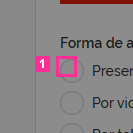

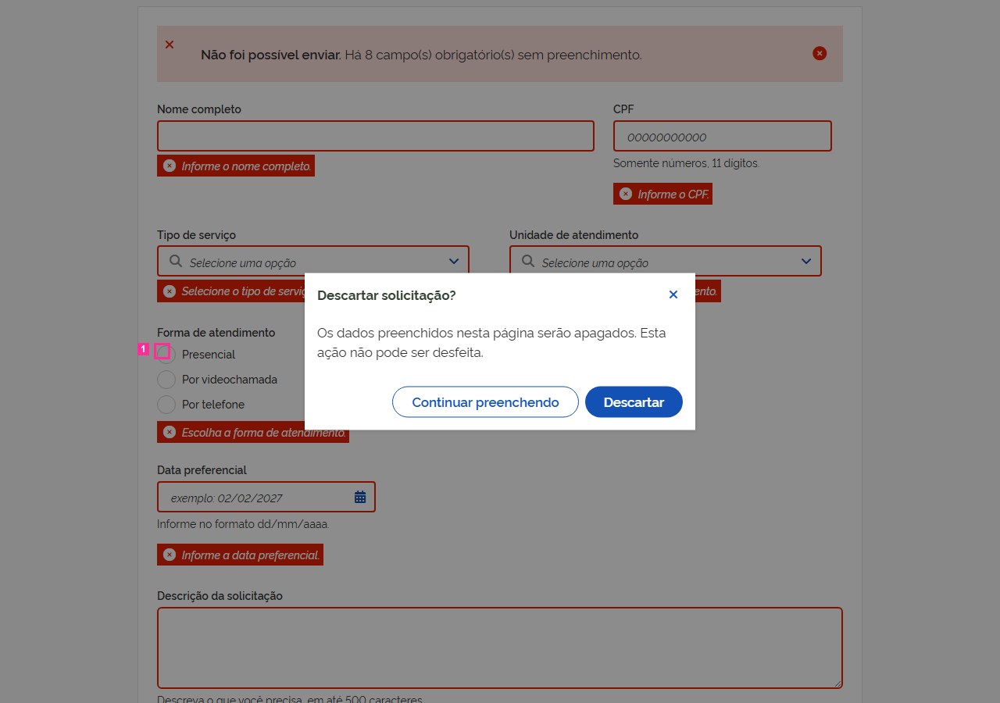

[a mesma tela sem o contorno](img/R-02-tela-sem-marca.png)

**Medido** (não é julgamento):
- foco depois dos passos: &lt;button.br-button.secondary&gt; "Continuar preenchendo" (não é elemento deste cartão)
- &lt;input#forma-presencial&gt; "presencial": a alegação não nomeia atributo nem propriedade de CSS

**Defeitos da lista que parecem próximos** (só uma pista; pode ser outro da lista, ou nenhum):
- **A-09** — md). O &lt;label&gt; de "Presencial" não tem for: o radio fica sem nome acessível e clicar no texto não o marca. As outras duas opções estão associadas.
- **P-02** — Camada de página (D-83) · não sorteada · área de rodapé. A página não tem área de rodapé: nenhum componente Footer do DS e nenhuma região de rodapé (footer ou contentinfo), em estado algum. A âncora é o documento porque a área ausente não tem elemento.

**Sua resposta** (copie a linha e complete):

```
R-02: fato  descumpre  defeito  quem-escreveu
```

---

## R-03

**O que o cartão diz que acontece:** A página atual da paginação é indicada só pelo estilo (classe active, fundo rgb(12,50,111)); o link não tem aria-current='page'. Ao ir para a página 2, a classe active passa para o link 2, ainda sem aria-current.

**Correção que o cartão sugere:** A página atual deve ser determinável programaticamente (aria-current='page' no item ativo).

**Regra citada:** WCAG 2.2 · wcag:1.3.1 · Info and Relationships · nível A

**Onde:**
- `<a> "Página 1"` — seletor `body>div:nth-of-type(1)>div>main>section>div>div:nth-of-type(2)>nav>a:nth-of-type(1)`
- seletor escrito no cartão: `.paginacao-anteriores .page.active`

**Como chegar ao estado** (janela 1280×900):
1. abrir a página (estado inicial)

**Na página congelada, depois desses passos** (refeitos automaticamente, como estão escritos, em janela 1280×900):
- nenhum passo no cartão: página no estado inicial

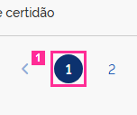

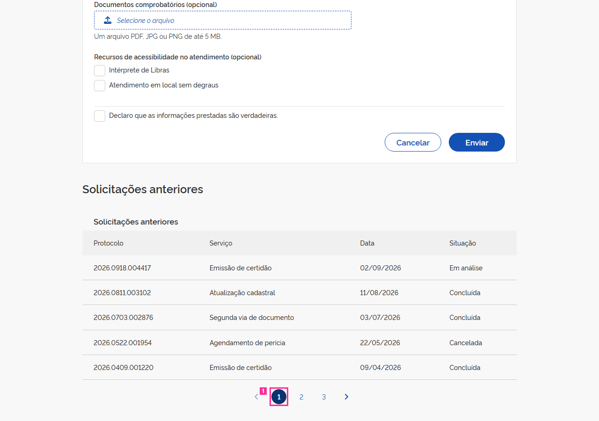

[a mesma tela sem o contorno](img/R-03-tela-sem-marca.png)

**Medido** (não é julgamento):
- foco depois dos passos: &lt;body&gt; (nenhum elemento focado) (não é elemento deste cartão)
- &lt;a.page.active&gt; "Página 1": aria-current ausente

*Avisos da preparação do cartão: sem-evidencia.*

**Defeitos da lista que parecem próximos** (só uma pista; pode ser outro da lista, ou nenhum):
- **A-05** — A tabela de solicitações anteriores não tem &lt;caption&gt;; o título visível é um div da barra superior do componente, fora do &lt;table&gt;.
- **A-07** — Os links de página são âncoras adjacentes soltas dentro do &lt;nav&gt;, sem o &lt;ul&gt;/&lt;li&gt; do exemplo oficial: nada além de espaço os separa.
- **A-12** — A página ativa da paginação é marcada só pela classe `active`: nenhum link carrega aria-current="page", o estado que o próprio DS escreve em tempo de execução. A trilha de navegação da mesma tela marca a página atual com aria-current.
- **P-02** — Camada de página (D-83) · não sorteada · área de rodapé. A página não tem área de rodapé: nenhum componente Footer do DS e nenhuma região de rodapé (footer ou contentinfo), em estado algum. A âncora é o documento porque a área ausente não tem elemento.

**Sua resposta** (copie a linha e complete):

```
R-03: fato  descumpre  defeito  quem-escreveu
```

---

## R-04

**O que o cartão diz que acontece:** Ao receber foco pelo teclado, os campos 'Tipo de serviço' e 'Unidade de atendimento' ficam com outline-style:none, box-shadow:none e borda inalterada rgb(136,136,136), por causa da regra da folha da tela '.campo-servico .br-input input:focus(-visible), .campo-unidade ... { box-shadow:none; outline:none; border-color: var(--border-color-alternative) !important }'. Não há indicador visível (a captura confirma). Os demais campos mostram box-shadow 0 0 0 2px rgb(194,133,12).

**Correção que o cartão sugere:** Indicador de foco visível em todo componente operável por teclado (padrão do DS: realce --focus).

**Regra citada:** WCAG 2.2 · wcag:2.4.7 · Focus Visible · nível AA

**Onde:**
- `<input#servico> "Selecione uma opção"` — seletor `body>div:nth-of-type(1)>div>main>form>div:nth-of-type(3)>div:nth-of-type(1)>div>div:nth-of-type(1)>div>input`
- `<input#unidade> "Selecione uma opção"` — seletor `body>div:nth-of-type(1)>div>main>form>div:nth-of-type(3)>div:nth-of-type(2)>div>div:nth-of-type(1)>div>input`
- seletor escrito no cartão: `#servico, #unidade`

**Como chegar ao estado** (janela 1280×900):
1. Tab x9 até #servico (ordem: .upload-button, skiplink, marca, home, Serviços, crumb atual, #nome, #cpf, #servico)
2. Tab até #unidade

**Na página congelada, depois desses passos** (refeitos automaticamente, como estão escritos, em janela 1280×900):
- passo 1 ("Tab x9 até #servico (ordem: .upload-button, skiplink, marca, home, Serviços, crumb atual, #nome, #cpf, #servico)"): feito
- passo 2 ("Tab até #unidade"): 1× Tab

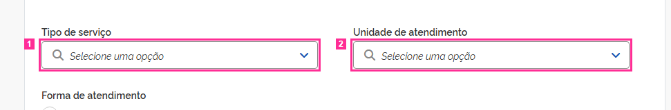

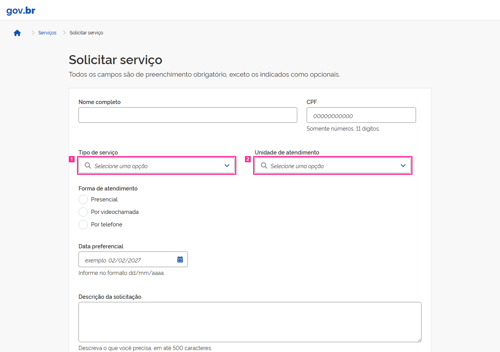

[a mesma tela sem o contorno](img/R-04-tela-sem-marca.png)

**Medido** (não é julgamento):
- foco depois dos passos: &lt;input#unidade&gt; "Selecione uma opção" (é o elemento 2 do cartão)
- &lt;input#servico&gt; "Selecione uma opção": border-top-color rgb(136, 136, 136); box-shadow none; outline-color rgb(51, 51, 51); outline-style none; outline-width 3px
- &lt;input#unidade&gt; "Selecione uma opção": border-top-color rgb(136, 136, 136); box-shadow none; outline-color rgb(51, 51, 51); outline-style none; outline-width 3px

*Avisos da preparação do cartão: sem-evidencia.*

**Defeitos da lista que parecem próximos** (só uma pista; pode ser outro da lista, ou nenhum):
- **A-04** — COMPARTILHADA pelos dois selects. O campo de texto do select não mostra indicador de foco: a borda e o box-shadow com que o DS desenha o foco dos campos foram suprimidos (e o outline segue none). Nome, CPF, data e descrição mostram o indicador.
- **A-08** — COMPARTILHADA pelos dois selects. Depois do envio vazio o texto de erro aparece sob o select, mas o campo não o referencia: não há aria-describedby. Os outros seis campos obrigatórios referenciam o próprio texto de erro. A unidade existe só neste estado, embora o campo exista desde o primeiro paint — por isso não é `conditional`.
- **P-02** — Camada de página (D-83) · não sorteada · área de rodapé. A página não tem área de rodapé: nenhum componente Footer do DS e nenhuma região de rodapé (footer ou contentinfo), em estado algum. A âncora é o documento porque a área ausente não tem elemento.

**Sua resposta** (copie a linha e complete):

```
R-04: fato  descumpre  defeito  quem-escreveu
```

---

## R-05

**O que o cartão diz que acontece:** Quando a mensagem de retorno é exibida após o envio, o foco vai para .mensagem-retorno .content (role=alert, tabindex=-1), e não para o botão 'Fechar a mensagem'.

**Correção que o cartão sugere:** No momento da exibição da mensagem, o foco deve estar no botão fechar.

**Regra citada:** base de regras do DS 3.7.0 (texto literal; id mascarado, D-87)
> No momento da exibição da mensagem, o foco do navegador deve estar sobre o botão fechar, quando houver. *(força declarada na base: obrigatorio)*

**Onde:**
- `<div> "Não foi possível enviar. Há 8 campo(s) obrigatór"` — seletor `body>div:nth-of-type(1)>div>main>form>div:nth-of-type(1)>div`
- seletor escrito no cartão: `.mensagem-retorno`

**Como chegar ao estado** (janela 1280×900):
1. click .acao-enviar (formulário vazio)

**Na página congelada, depois desses passos** (refeitos automaticamente, como estão escritos, em janela 1280×900):
- passo 1 ("click .acao-enviar (formulário vazio)"): feito


[a mesma tela sem o contorno](img/R-05-tela-sem-marca.png)

**Medido** (não é julgamento):
- foco depois dos passos: &lt;div.content&gt; "Não foi possível enviar. Há 8 campo(s) o" (dentro do elemento 1 do cartão)
- &lt;div.br-message.danger&gt; "Não foi possível enviar. Há 8 campo(s) o": role ausente; tabindex ausente

**Defeitos da lista que parecem próximos** (só uma pista; pode ser outro da lista, ou nenhum):
- **A-06** — O botão Fechar da mensagem de retorno é um &lt;div role="button" tabindex="0"&gt; com tratadores de Enter e Espaço, no lugar do &lt;button&gt; nativo do exemplo oficial. Continua operável por teclado e nomeado — o defeito é só o elemento.
- **A-11** — Na mensagem de retorno o botão Fechar está à esquerda e o ícone semântico à direita — o inverso da anatomia do componente.
- **P-02** — Camada de página (D-83) · não sorteada · área de rodapé. A página não tem área de rodapé: nenhum componente Footer do DS e nenhuma região de rodapé (footer ou contentinfo), em estado algum. A âncora é o documento porque a área ausente não tem elemento.

**Sua resposta** (copie a linha e complete):

```
R-05: fato  descumpre  defeito  quem-escreveu
```

---

## R-06

**O que o cartão diz que acontece:** O botão 'Selecione o arquivo' tem aria-hidden='true', mas é focável (tabindex='1') e é o único controle operável do upload (input#documentos tem display:none); leitores de tela não o expõem.

**Correção que o cartão sugere:** Elemento focável e operável não pode estar com aria-hidden; o controle de upload deve ser exposto com nome acessível.

**Regra citada:** axe-core 4.11.4 · axe:aria-hidden-focus · ARIA hidden element must not be focusable or contain focusable elements
> Ensure aria-hidden elements are not focusable nor contain focusable elements
> etiquetas: EN-301-549, EN-9.4.1.2, RGAA-10.8.1, RGAAv4, TT6.a, TTv5, cat.name-role-value, wcag2a, wcag412

**Onde:**
- `<button> "Selecione o arquivo"` — seletor `body>div:nth-of-type(1)>div>main>form>div:nth-of-type(6)>div>button`
- seletor escrito no cartão: `.upload-button`

**Como chegar ao estado** (janela 1280×900):
1. abrir a página (estado inicial)

**Na página congelada, depois desses passos** (refeitos automaticamente, como estão escritos, em janela 1280×900):
- nenhum passo no cartão: página no estado inicial


[a mesma tela sem o contorno](img/R-06-tela-sem-marca.png)

**Medido** (não é julgamento):
- foco depois dos passos: &lt;body&gt; (nenhum elemento focado) (não é elemento deste cartão)
- &lt;button.upload-button&gt; "Selecione o arquivo": aria-hidden "true"; tabindex "1"

**Defeitos da lista que parecem próximos** (só uma pista; pode ser outro da lista, ou nenhum):
- **A-02** — O botão do upload tem tabindex=1: o primeiro Tab da página cai nele, antes do atalho para o conteúdo e de todos os campos que o precedem no formulário.
- **A-10** — O upload aceita arrastar e soltar (comportamento do core.js), mas o texto de apoio informa só formato e tamanho — não diz que o arquivo pode ser arrastado.
- **P-02** — Camada de página (D-83) · não sorteada · área de rodapé. A página não tem área de rodapé: nenhum componente Footer do DS e nenhuma região de rodapé (footer ou contentinfo), em estado algum. A âncora é o documento porque a área ausente não tem elemento.

**Sua resposta** (copie a linha e complete):

```
R-06: fato  descumpre  defeito  quem-escreveu
```

---

## R-07

**O que o cartão diz que acontece:** O radio 'Presencial' não tem nome acessível: o &lt;label&gt;Presencial&lt;/label&gt; irmão não tem atributo for (os outros dois radios têm for); não há aria-label/aria-labelledby. Clicar no texto 'Presencial' não marca a opção. Após o envio, o [ferramenta citada] aponta também label-title-only (só aria-describedby).

**Correção que o cartão sugere:** Rótulo programaticamente associado ao input (label for="forma-presencial"), como nas demais opções.

**Regra citada:** axe-core 4.11.4 · axe:label · Form elements must have labels
> Ensure every form element has a label
> etiquetas: ACT, EN-301-549, EN-9.4.1.2, RGAA-11.1.1, RGAAv4, TT5.c, TTv5, cat.forms, section508, section508.22.n, wcag2a, wcag412

**Onde:**
- `<input#forma-presencial>` — seletor `body>div:nth-of-type(1)>div>main>form>fieldset:nth-of-type(1)>div:nth-of-type(1)>input`
- seletor escrito no cartão: `#forma-presencial`

**Como chegar ao estado** (janela 1280×900):
1. abrir a página (estado inicial)

**Na página congelada, depois desses passos** (refeitos automaticamente, como estão escritos, em janela 1280×900):
- nenhum passo no cartão: página no estado inicial

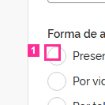

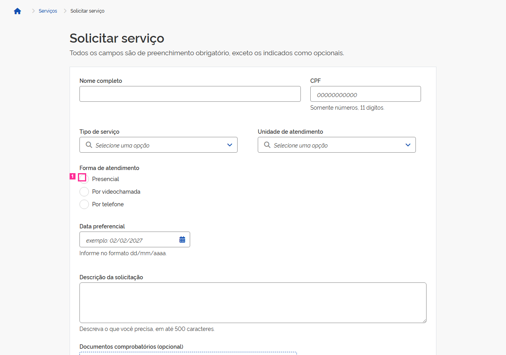

[a mesma tela sem o contorno](img/R-07-tela-sem-marca.png)

**Medido** (não é julgamento):
- foco depois dos passos: &lt;body&gt; (nenhum elemento focado) (não é elemento deste cartão)
- &lt;input#forma-presencial&gt; "presencial": aria-describedby ausente; aria-label ausente; aria-labelledby ausente; for ausente; title ausente

**Defeitos da lista que parecem próximos** (só uma pista; pode ser outro da lista, ou nenhum):
- **A-09** — md). O &lt;label&gt; de "Presencial" não tem for: o radio fica sem nome acessível e clicar no texto não o marca. As outras duas opções estão associadas.
- **P-02** — Camada de página (D-83) · não sorteada · área de rodapé. A página não tem área de rodapé: nenhum componente Footer do DS e nenhuma região de rodapé (footer ou contentinfo), em estado algum. A âncora é o documento porque a área ausente não tem elemento.

**Sua resposta** (copie a linha e complete):

```
R-07: fato  descumpre  defeito  quem-escreveu
```

---

## R-08

**O que o cartão diz que acontece:** tabindex="1" no botão de upload: o primeiro Tab desde o carregamento leva ao botão 'Selecione o arquivo' (no meio do formulário), antes do link 'Ir para o conteúdo', do cabeçalho e dos campos anteriores; o Tab seguinte volta ao topo.

**Correção que o cartão sugere:** Ordem de foco que siga a sequência visual e de leitura (sem tabindex positivo); o atalho 'Ir para o conteúdo' deve ser o primeiro elemento focável.

**Regra citada:** WCAG 2.2 · wcag:2.4.3 · Focus Order · nível A

**Onde:**
- `<button> "Selecione o arquivo"` — seletor `body>div:nth-of-type(1)>div>main>form>div:nth-of-type(6)>div>button`
- seletor escrito no cartão: `.upload-button`

**Como chegar ao estado** (janela 1280×900):
1. Tab

**Na página congelada, depois desses passos** (refeitos automaticamente, como estão escritos, em janela 1280×900):
- passo 1 ("Tab"): feito

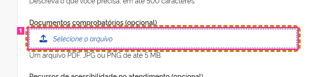

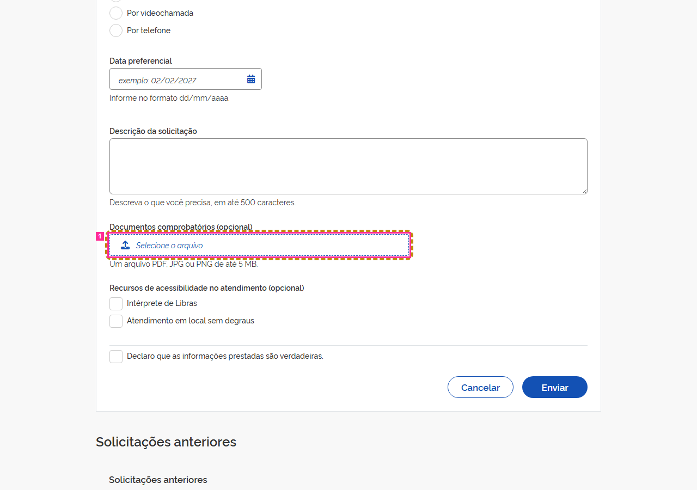

[a mesma tela sem o contorno](img/R-08-tela-sem-marca.png)

**Medido** (não é julgamento):
- foco depois dos passos: &lt;button.upload-button.focus-visible&gt; "Selecione o arquivo" (é o elemento 1 do cartão)
- &lt;button.upload-button.focus-visible&gt; "Selecione o arquivo": tabindex "1"

*Avisos da preparação do cartão: sem-evidencia.*

**Defeitos da lista que parecem próximos** (só uma pista; pode ser outro da lista, ou nenhum):
- **A-02** — O botão do upload tem tabindex=1: o primeiro Tab da página cai nele, antes do atalho para o conteúdo e de todos os campos que o precedem no formulário.
- **A-10** — O upload aceita arrastar e soltar (comportamento do core.js), mas o texto de apoio informa só formato e tamanho — não diz que o arquivo pode ser arrastado.
- **P-02** — Camada de página (D-83) · não sorteada · área de rodapé. A página não tem área de rodapé: nenhum componente Footer do DS e nenhuma região de rodapé (footer ou contentinfo), em estado algum. A âncora é o documento porque a área ausente não tem elemento.

**Sua resposta** (copie a linha e complete):

```
R-08: fato  descumpre  defeito  quem-escreveu
```

---

## R-09

**O que o cartão diz que acontece:** No calendário aberto, os botões de mês anterior e seguinte contêm só um ícone &lt;i&gt; e não têm aria-label nem texto: o nome acessível fica vazio.

**Correção que o cartão sugere:** Botões com nome acessível (ex.: 'Mês anterior', 'Próximo mês').

**Regra citada:** axe-core 4.11.4 · axe:button-name · Buttons must have discernible text
> Ensure buttons have discernible text
> etiquetas: ACT, EN-301-549, EN-9.4.1.2, RGAA-11.9.1, RGAAv4, TT6.a, TTv5, cat.name-role-value, section508, section508.22.a, wcag2a, wcag412

**Onde:**
- `<button>` — seletor `body>div:nth-of-type(2)>div:nth-of-type(1)>span:nth-of-type(1)>button`
- `<button>` — seletor `body>div:nth-of-type(2)>div:nth-of-type(1)>span:nth-of-type(2)>button`
- seletor escrito no cartão: `.flatpickr-prev-month button, .flatpickr-next-month button`

**Como chegar ao estado** (janela 1280×900):
1. clicar no botão do calendário (#data-preferencial-btn)

**Na página congelada, depois desses passos** (refeitos automaticamente, como estão escritos, em janela 1280×900):
- passo 1 ("clicar no botão do calendário (#data-preferencial-btn)"): feito


[a mesma tela sem o contorno](img/R-09-tela-sem-marca.png)

**Medido** (não é julgamento):
- foco depois dos passos: &lt;button#data-preferencial-btn&gt; "Abrir calendário" (não é elemento deste cartão)
- &lt;button.br-button.circle&gt;: aria-label ausente
- &lt;button.br-button.circle&gt;: aria-label ausente

**Defeitos da lista que parecem próximos** (só uma pista; pode ser outro da lista, ou nenhum):
- **P-02** — Camada de página (D-83) · não sorteada · área de rodapé. A página não tem área de rodapé: nenhum componente Footer do DS e nenhuma região de rodapé (footer ou contentinfo), em estado algum. A âncora é o documento porque a área ausente não tem elemento.

**Sua resposta** (copie a linha e complete):

```
R-09: fato  descumpre  defeito  quem-escreveu
```

---

## R-10

**O que o cartão diz que acontece:** Com o calendário da Data preferencial aberto, os botões de mês anterior/seguinte contêm apenas ícone &lt;i class="fas fa-chevron-left/right"&gt; sem aria-hidden e não têm aria-label nem texto: o nome acessível é vazio.

**Correção que o cartão sugere:** Botões somente com ícone devem ter nome acessível (ex.: aria-label="Mês anterior"/"Próximo mês").

**Regra citada:** axe-core 4.11.4 · axe:button-name · Buttons must have discernible text
> Ensure buttons have discernible text
> etiquetas: ACT, EN-301-549, EN-9.4.1.2, RGAA-11.9.1, RGAAv4, TT6.a, TTv5, cat.name-role-value, section508, section508.22.a, wcag2a, wcag412

**Onde:**
- `<button>` — seletor `body>div:nth-of-type(2)>div:nth-of-type(1)>span:nth-of-type(1)>button`
- `<button>` — seletor `body>div:nth-of-type(2)>div:nth-of-type(1)>span:nth-of-type(2)>button`
- seletor escrito no cartão: `.flatpickr-prev-month > button, .flatpickr-next-month > button`

**Como chegar ao estado** (janela 1280×900):
1. click #data-preferencial-btn (calendário aberto)

**Na página congelada, depois desses passos** (refeitos automaticamente, como estão escritos, em janela 1280×900):
- passo 1 ("click #data-preferencial-btn (calendário aberto)"): feito


[a mesma tela sem o contorno](img/R-10-tela-sem-marca.png)

**Medido** (não é julgamento):
- foco depois dos passos: &lt;button#data-preferencial-btn&gt; "Abrir calendário" (não é elemento deste cartão)
- &lt;button.br-button.circle&gt;: aria-hidden ausente; aria-label ausente
- &lt;button.br-button.circle&gt;: aria-hidden ausente; aria-label ausente

**Defeitos da lista que parecem próximos** (só uma pista; pode ser outro da lista, ou nenhum):
- **P-02** — Camada de página (D-83) · não sorteada · área de rodapé. A página não tem área de rodapé: nenhum componente Footer do DS e nenhuma região de rodapé (footer ou contentinfo), em estado algum. A âncora é o documento porque a área ausente não tem elemento.

**Sua resposta** (copie a linha e complete):

```
R-10: fato  descumpre  defeito  quem-escreveu
```

---

## Lista de defeitos da tela

Use o id (ex.: `A-01`) na 3ª resposta.

- **A-01** (estado: dialogo-aberto) — Ao fechar o diálogo de descarte (X, Continuar preenchendo ou Esc) o foco não volta ao botão Cancelar que o abriu: cai em &lt;body&gt;. Abrir o diálogo leva o foco para dentro dele, como deve.
- **A-02** (estado: sempre) — O botão do upload tem tabindex=1: o primeiro Tab da página cai nele, antes do atalho para o conteúdo e de todos os campos que o precedem no formulário.
- **A-03** (estado: dialogo-aberto) — O texto do diálogo usa #334333 — a cor de texto do DS (#333333) com o canal verde acrescido de 16 —, valor que não corresponde a token algum.
- **A-04** (estado: sempre) — COMPARTILHADA pelos dois selects. O campo de texto do select não mostra indicador de foco: a borda e o box-shadow com que o DS desenha o foco dos campos foram suprimidos (e o outline segue none). Nome, CPF, data e descrição mostram o indicador.
- **A-05** (estado: sempre) — A tabela de solicitações anteriores não tem &lt;caption&gt;; o título visível é um div da barra superior do componente, fora do &lt;table&gt;.
- **A-06** (estado: apos-envio-vazio) — O botão Fechar da mensagem de retorno é um &lt;div role="button" tabindex="0"&gt; com tratadores de Enter e Espaço, no lugar do &lt;button&gt; nativo do exemplo oficial. Continua operável por teclado e nomeado — o defeito é só o elemento.
- **A-07** (estado: sempre) — Os links de página são âncoras adjacentes soltas dentro do &lt;nav&gt;, sem o &lt;ul&gt;/&lt;li&gt; do exemplo oficial: nada além de espaço os separa.
- **A-08** (estado: apos-envio-vazio) — COMPARTILHADA pelos dois selects. Depois do envio vazio o texto de erro aparece sob o select, mas o campo não o referencia: não há aria-describedby. Os outros seis campos obrigatórios referenciam o próprio texto de erro. A unidade existe só neste estado, embora o campo exista desde o primeiro paint — por isso não é `conditional`.
- **A-09** (estado: sempre) — md). O &lt;label&gt; de "Presencial" não tem for: o radio fica sem nome acessível e clicar no texto não o marca. As outras duas opções estão associadas.
- **A-10** (estado: sempre) — O upload aceita arrastar e soltar (comportamento do core.js), mas o texto de apoio informa só formato e tamanho — não diz que o arquivo pode ser arrastado.
- **A-11** (estado: apos-envio-vazio) — Na mensagem de retorno o botão Fechar está à esquerda e o ícone semântico à direita — o inverso da anatomia do componente.
- **A-12** (estado: sempre) — A página ativa da paginação é marcada só pela classe `active`: nenhum link carrega aria-current="page", o estado que o próprio DS escreve em tempo de execução. A trilha de navegação da mesma tela marca a página atual com aria-current.
- **P-01** (estado: sempre) — Camada de página (D-83) · não sorteada · área de cabeçalho. A região de cabeçalho da página é um &lt;header&gt; que contém só a marca gov.br (um link); o componente Header do DS não é usado nessa área.
- **P-02** (estado: sempre) — Camada de página (D-83) · não sorteada · área de rodapé. A página não tem área de rodapé: nenhum componente Footer do DS e nenhuma região de rodapé (footer ou contentinfo), em estado algum. A âncora é o documento porque a área ausente não tem elemento.

## Modelo para copiar no comentário

```
R-01: 
R-02: 
R-03: 
R-04: 
R-05: 
R-06: 
R-07: 
R-08: 
R-09: 
R-10: 
```
