# Casos para julgar — Tela Processos

10 casos. Leia antes o [LEIAME](LEIAME.md) (5 min). Cada caso leva uns 3 a 4 minutos.

Responda num comentário do Linear com uma linha por caso (modelo no fim desta página).

## R-01

**O que o cartão diz que acontece:** Os 7 checkboxes da tabela (1 de 'selecionar todos' no cabeçalho e 6 nas linhas) não têm &lt;label&gt;, aria-label nem aria-labelledby: nome acessível vazio.

**Correção que o cartão sugere:** Cada checkbox deve ter nome acessível (ex.: 'Selecionar todos', 'Selecionar processo 00000.000011/2026-00').

**Regra citada:** WCAG 2.2 · wcag:4.1.2 · Name, Role, Value · nível A

**Outras normas que o cartão cita para o mesmo fato** (só contam se a regra citada não valer para ele):
- REF1: WCAG 2.2 · wcag:1.3.1 · Info and Relationships · nível A

**Onde:**
- `<input>` — seletor `body>pnip-root>main>pnip-mpa>pnip-mpa-processos>div>div:nth-of-type(2)>div>div:nth-of-type(3)>div:nth-of-type(2)>table>tbody>tr:nth-of-type(2)>td:nth-of-type(2)>input`
- `<input>` — seletor `body>pnip-root>main>pnip-mpa>pnip-mpa-processos>div>div:nth-of-type(2)>div>div:nth-of-type(3)>div:nth-of-type(2)>table>tbody>tr:nth-of-type(3)>td:nth-of-type(2)>input`
- `<input>` — seletor `body>pnip-root>main>pnip-mpa>pnip-mpa-processos>div>div:nth-of-type(2)>div>div:nth-of-type(3)>div:nth-of-type(2)>table>tbody>tr:nth-of-type(4)>td:nth-of-type(2)>input`
- `<input>` — seletor `body>pnip-root>main>pnip-mpa>pnip-mpa-processos>div>div:nth-of-type(2)>div>div:nth-of-type(3)>div:nth-of-type(2)>table>tbody>tr:nth-of-type(6)>td:nth-of-type(2)>input`
- `<input>` — seletor `body>pnip-root>main>pnip-mpa>pnip-mpa-processos>div>div:nth-of-type(2)>div>div:nth-of-type(3)>div:nth-of-type(2)>table>tbody>tr:nth-of-type(7)>td:nth-of-type(2)>input`
- `<input>` — seletor `body>pnip-root>main>pnip-mpa>pnip-mpa-processos>div>div:nth-of-type(2)>div>div:nth-of-type(3)>div:nth-of-type(2)>table>tbody>tr:nth-of-type(9)>td:nth-of-type(2)>input`
- `<input>` — seletor `body>pnip-root>main>pnip-mpa>pnip-mpa-processos>div>div:nth-of-type(2)>div>div:nth-of-type(3)>div:nth-of-type(2)>table>thead>tr>th:nth-of-type(2)>input`
- seletor escrito no cartão: `table input[type="checkbox"]`

**Como chegar ao estado** (janela 1280×900):
1. abrir a página (estado inicial)

**Na página congelada, depois desses passos** (refeitos automaticamente, como estão escritos, em janela 1280×900):
- nenhum passo no cartão: página no estado inicial

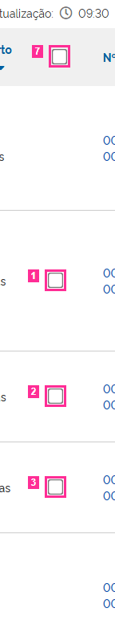

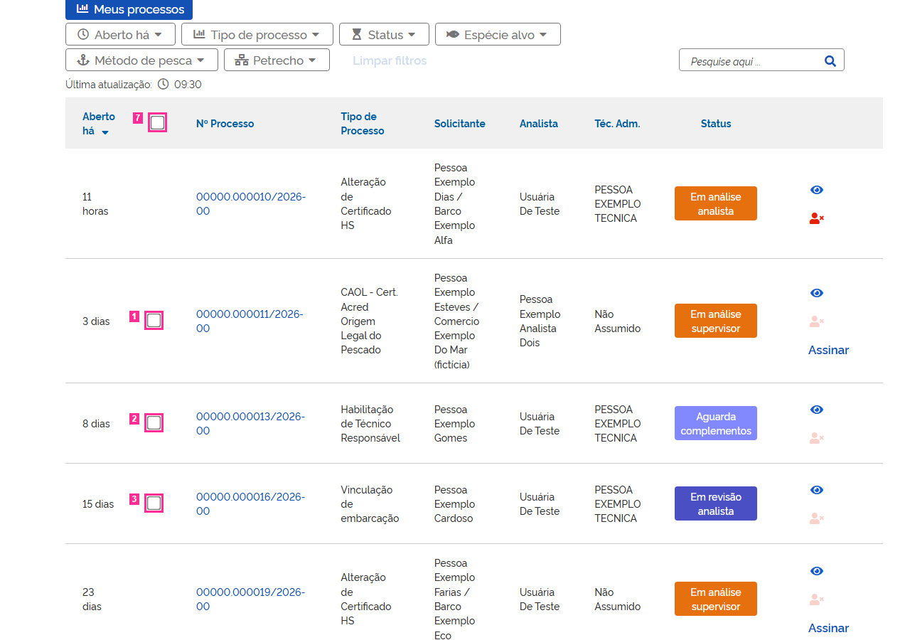

[a mesma tela sem o contorno](img/R-01-tela-sem-marca.png)

**Medido** (não é julgamento):
- foco depois dos passos: &lt;body&gt; (nenhum elemento focado) (não é elemento deste cartão)
- &lt;input&gt; "on": aria-label ausente; aria-labelledby ausente
- &lt;input&gt; "on": aria-label ausente; aria-labelledby ausente
- &lt;input&gt; "on": aria-label ausente; aria-labelledby ausente
- &lt;input&gt; "on": aria-label ausente; aria-labelledby ausente
- &lt;input&gt; "on": aria-label ausente; aria-labelledby ausente
- &lt;input&gt; "on": aria-label ausente; aria-labelledby ausente
- &lt;input&gt; "on": aria-label ausente; aria-labelledby ausente

**Evidências que o cartão traz:**
- [ferramenta citada]: label

**Defeitos da lista que parecem próximos** (só uma pista; pode ser outro da lista, ou nenhum):
- **D-04** — Checkboxes de seleção da tabela — um no cabeçalho (coluna sem texto) e um em cada uma das 6 linhas selecionáveis: &lt;input type="checkbox"&gt; sem &lt;label&gt;, aria-label, aria-labelledby ou title; labels.length = 0 e nome "" na árvore. Estão no Tab (operáveis), sem nome.
- **D-07** — A tabela de processos não tem &lt;caption&gt; nem aria-label/aria-labelledby (nome "" na árvore); o h2 "Processos" fica fora do contêiner da tabela, sem associação. A norma pede caption que identifique a tabela (os exemplos oficiais da Table 3.7.0 trazem caption).
- **D-11** — Nenhum salto para o conteúdo: 0 âncoras "#…" e 0 .br-skiplink nas 2 paradas; o primeiro ponto de Tab é o botão Menu do cabeçalho. Casco da aplicação: **exposto** (adendo § E; C-04, B-01).
- **D-12** — Um só título visível na página, &lt;h2&gt; "Processos"; nenhum &lt;h1&gt; (light DOM e shadow roots), nas 2 paradas. Ausência global, ancorada na raiz. **exposto** (casco: ordem de títulos, como C-05).

**Sua resposta** (copie a linha e complete):

```
R-01: fato  descumpre  defeito  quem-escreveu
```

---

## R-02

**O que o cartão diz que acontece:** No detalhe certificacao-caol, os cards usam h5 sem os níveis intermediários (heading-order).

**Correção que o cartão sugere:** Níveis de cabeçalho sem saltos.

**Regra citada:** e-MAG 3.1 · emag:1.3 · Utilizar corretamente os níveis de cabeçalho
> Heading hierarchy (H1–H6) must be logical. H1 for primary content, subsequent levels for subordinate sections. Do not skip levels.
> Recomendação 1.3 – Utilizar corretamente os níveis de cabeçalho. *(força declarada na base: recomendado)*

**Onde:**
- `Seletor não resolvido` — seletor `unresolved:.col-4:nth-child(1) > .mb-2.br-card > .card-content > h5, .col-4:nth-child(2) > .mb-2.br-card > .card-content > h5`
- seletor escrito no cartão: `.col-4:nth-child(1) > .mb-2.br-card > .card-content > h5, .col-4:nth-child(2) > .mb-2.br-card > .card-content > h5`

**Como chegar ao estado** (janela 1280×900):
1. load http://screens:3300/pnip-d/portal-mpa/processos?mock-perfil=mpa
2. click Ver processo (linha 2, aba Tramitando)

**Na página congelada, depois desses passos** (refeitos automaticamente, como estão escritos, em janela 1280×900):
- passo 1 ("load http://screens:3300/pnip-d/portal-mpa/processos?mock-perfil=mpa"): não sei refazer este passo automaticamente; a imagem mostra o estado antes dele

**Atenção: refeitos como estão escritos, os passos não chegam ao estado que o cartão descreve** (ver acima). As imagens e a medida são do estado a que eles chegam.


[a mesma tela sem o contorno](img/R-02-tela-sem-marca.png)

**Medido** (não é julgamento):
- foco depois dos passos: &lt;body&gt; (nenhum elemento focado) (não é elemento deste cartão)
- elemento 1: não existe na página neste estado

**Sua resposta** (copie a linha e complete):

```
R-02: fato  descumpre  defeito  quem-escreveu
```

---

## R-03

**O que o cartão diz que acontece:** Os diálogos usam SweetAlert2 em vez do br-modal do DS, com valores fora dos tokens: botão de fechar com font-family monospace e border-radius 5px; botões de ação com border-radius 20px e margens de 10px.

**Correção que o cartão sugere:** Diálogos com o componente Modal do DS e tokens de tipografia, raio e espaçamento.

**Regra citada:** base de regras do DS 3.7.0 (excerto herdado da base anterior; id mascarado, D-87)
> Componentes devem consumir tokens oficiais corretamente e sem duplicação desnecessária. *(força declarada na base: obrigatorio)*

**Onde:**
- `Seletor não resolvido` — seletor `unresolved:.swal2-popup`
- seletor escrito no cartão: `.swal2-popup`

**Como chegar ao estado** (janela 1280×900):
1. click "Assinar" da linha 2 (tbody tr:nth-child(2) br-button[title=Assinar] &gt;&gt;&gt; button)

**Na página congelada, depois desses passos** (refeitos automaticamente, como estão escritos, em janela 1280×900):
- passo 1 ("click "Assinar" da linha 2 (tbody tr:nth-child(2) br-button[title=Assinar] &gt;&gt;&gt; button)"): não achei ""Assinar" da linha 2 (tbody tr:nth-child(2) br-button[title=Assinar] &gt;&gt;&gt; button)" na página

**Atenção: refeitos como estão escritos, os passos não chegam ao estado que o cartão descreve** (ver acima). As imagens e a medida são do estado a que eles chegam.


[a mesma tela sem o contorno](img/R-03-tela-sem-marca.png)

**Medido** (não é julgamento):
- foco depois dos passos: &lt;body&gt; (nenhum elemento focado) (não é elemento deste cartão)
- elemento 1: não existe na página neste estado

**Sua resposta** (copie a linha e complete):

```
R-03: fato  descumpre  defeito  quem-escreveu
```

---

## R-04

**O que o cartão diz que acontece:** Campo com placeholder "Pesquise aqui ..." e nenhum rótulo associado (sem &lt;label&gt; com texto, aria-labelledby com texto ou aria-label); o host &lt;br-input&gt; não recebeu label/aria-label da página: o placeholder faz o papel do rótulo

**Correção que o cartão sugere:** Um rótulo associado ao campo (&lt;label for&gt;/&lt;label&gt; ancestral, aria-labelledby ou aria-label); o placeholder não substitui o rótulo

**Regra citada:** e-MAG 3.1 · emag:6.2 · Associar etiquetas aos seus campos
> Every form input must have a programmatically associated label via: (a) &lt;label&gt; element with for attribute matching the input's id, (b) aria-label attribute, or (c) aria-labelledby pointing to a visible label element. Placeholder text is NOT a substitute for a label — it disappears on input and is not consistently announced by all screen readers.
> Recomendação 6.2 – Associar etiquetas aos seus campos. *(força declarada na base: recomendado)*

**Onde:**
- `<input#search> "Pesquise aqui ..." [shadow]` — seletor `body>pnip-root>main>pnip-mpa>pnip-mpa-processos>div>div:nth-of-type(2)>div>div:nth-of-type(2)>div:nth-of-type(2)>pnip-search-table-utils>div>div>div>br-input >>> div>input`
- seletor escrito no cartão: `#search >>> #search`

**Como chegar ao estado** (janela 1280×900):
1. abrir o endereço da tela e esperar `main .br-table tbody tr`
2. clicar em `govbr-custom-pagination nav &gt; div:nth-of-type(1) br-select-pnip input#total`
3. esperar `govbr-custom-pagination nav &gt; div:nth-of-type(1) br-select-pnip .br-list .br-item` aparecer

**Na página congelada, depois desses passos** (refeitos automaticamente, como estão escritos, em janela 1280×900):
- passo 1 ("abrir o endereço da tela e esperar `main .br-table tbody tr`"): feito
- passo 2 ("clicar em `govbr-custom-pagination nav &gt; div:nth-of-type(1) br-select-pnip input#total`"): feito
- passo 3 ("esperar `govbr-custom-pagination nav &gt; div:nth-of-type(1) br-select-pnip .br-list .br-item` aparecer"): feito


[a mesma tela sem o contorno](img/R-04-tela-sem-marca.png)

**Medido** (não é julgamento):
- foco depois dos passos: &lt;input#total&gt; "Selecione" (não é elemento deste cartão)
- elemento 1: não existe na página neste estado

**Defeitos da lista que parecem próximos** (só uma pista; pode ser outro da lista, ou nenhum):
- **D-05** — Campo de pesquisa da lista: o &lt;br-input&gt; recebeu `placeholder="Pesquise aqui ..."` mas não `label`, e o input interno (id search) fica com labels.length = 0, sem aria-label nem aria-labelledby; o nome acessível é o placeholder. Os seletores "Exibir" e "Página" da mesma tela têm rótulo associado.
- **D-11** — Nenhum salto para o conteúdo: 0 âncoras "#…" e 0 .br-skiplink nas 2 paradas; o primeiro ponto de Tab é o botão Menu do cabeçalho. Casco da aplicação: **exposto** (adendo § E; C-04, B-01).
- **D-12** — Um só título visível na página, &lt;h2&gt; "Processos"; nenhum &lt;h1&gt; (light DOM e shadow roots), nas 2 paradas. Ausência global, ancorada na raiz. **exposto** (casco: ordem de títulos, como C-05).

**Sua resposta** (copie a linha e complete):

```
R-04: fato  descumpre  defeito  quem-escreveu
```

---

## R-05

**O que o cartão diz que acontece:** Campo de busca identificado apenas pelo placeholder "Pesquise aqui ..." (sem label visível), que desaparece ao digitar.

**Correção que o cartão sugere:** Rótulo visível e persistente associado ao campo.

**Regra citada:** WCAG 2.2 · wcag:3.3.2 · Labels or Instructions · nível A

**Onde:**
- `<br-input#search> "Pesquise aqui ..."` — seletor `body>pnip-root>main>pnip-mpa>pnip-mpa-processos>div>div:nth-of-type(2)>div>div:nth-of-type(2)>div:nth-of-type(2)>pnip-search-table-utils>div>div>div>br-input`
- seletor escrito no cartão: `br-input#search`

**Como chegar ao estado** (janela 1280×900):
1. abrir a página (estado inicial)

**Na página congelada, depois desses passos** (refeitos automaticamente, como estão escritos, em janela 1280×900):
- nenhum passo no cartão: página no estado inicial

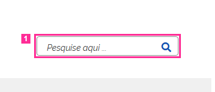

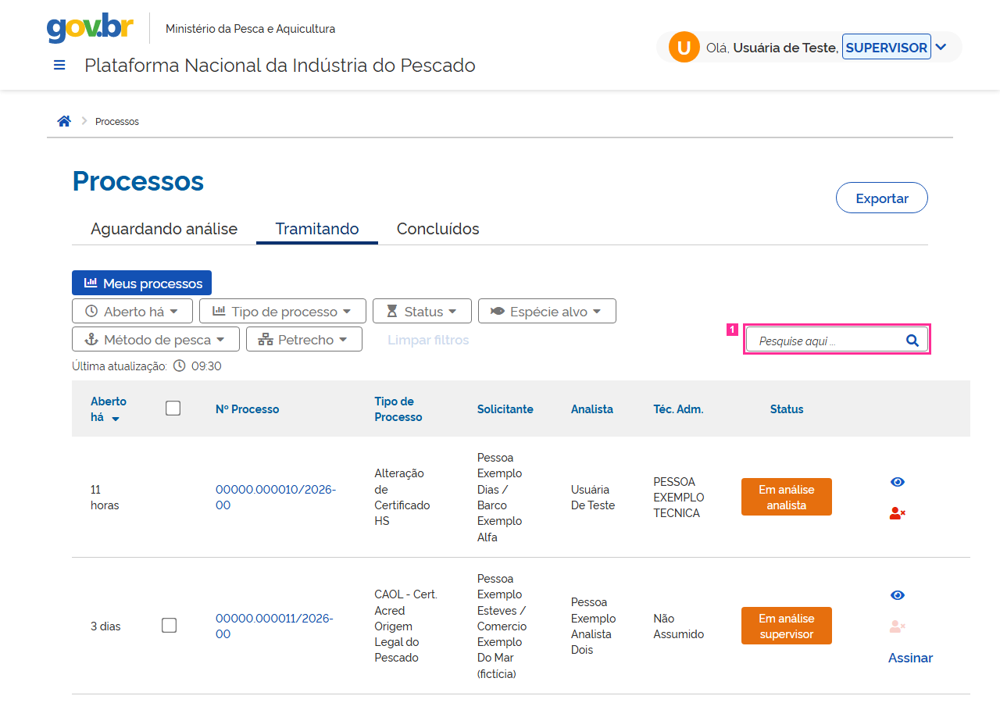

[a mesma tela sem o contorno](img/R-05-tela-sem-marca.png)

**Medido** (não é julgamento):
- foco depois dos passos: &lt;body&gt; (nenhum elemento focado) (não é elemento deste cartão)
- &lt;br-input#search&gt; "Pesquise aqui ...": placeholder "Pesquise aqui ..."

**Defeitos da lista que parecem próximos** (só uma pista; pode ser outro da lista, ou nenhum):
- **D-11** — Nenhum salto para o conteúdo: 0 âncoras "#…" e 0 .br-skiplink nas 2 paradas; o primeiro ponto de Tab é o botão Menu do cabeçalho. Casco da aplicação: **exposto** (adendo § E; C-04, B-01).
- **D-12** — Um só título visível na página, &lt;h2&gt; "Processos"; nenhum &lt;h1&gt; (light DOM e shadow roots), nas 2 paradas. Ausência global, ancorada na raiz. **exposto** (casco: ordem de títulos, como C-05).

**Sua resposta** (copie a linha e complete):

```
R-05: fato  descumpre  defeito  quem-escreveu
```

---

## R-06

**O que o cartão diz que acontece:** Form elements must have labels

**Correção que o cartão sugere:** (o cartão não sugere correção)

**Regra citada:** axe-core 4.11.4 · axe:label · Form elements must have labels
> Ensure every form element has a label
> etiquetas: ACT, EN-301-549, EN-9.4.1.2, RGAA-11.1.1, RGAAv4, TT5.c, TTv5, cat.forms, section508, section508.22.n, wcag2a, wcag412

**Onde:**
- `<input>` — seletor `body>pnip-root>main>pnip-mpa>pnip-mpa-processos>div>div:nth-of-type(2)>div>div:nth-of-type(3)>div:nth-of-type(2)>table>tbody>tr:nth-of-type(2)>td:nth-of-type(2)>input`
- seletor escrito no cartão: `tr:nth-child(2) > td:nth-child(2) > input[type="checkbox"]`

**Como chegar ao estado** (janela 1280×900):
1. abrir o endereço da tela e esperar `main .br-table tbody tr`
2. clicar em `govbr-custom-pagination nav &gt; div:nth-of-type(1) br-select-pnip input#total`
3. esperar `govbr-custom-pagination nav &gt; div:nth-of-type(1) br-select-pnip .br-list .br-item` aparecer

**Na página congelada, depois desses passos** (refeitos automaticamente, como estão escritos, em janela 1280×900):
- passo 1 ("abrir o endereço da tela e esperar `main .br-table tbody tr`"): feito
- passo 2 ("clicar em `govbr-custom-pagination nav &gt; div:nth-of-type(1) br-select-pnip input#total`"): feito
- passo 3 ("esperar `govbr-custom-pagination nav &gt; div:nth-of-type(1) br-select-pnip .br-list .br-item` aparecer"): feito

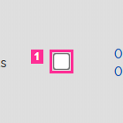

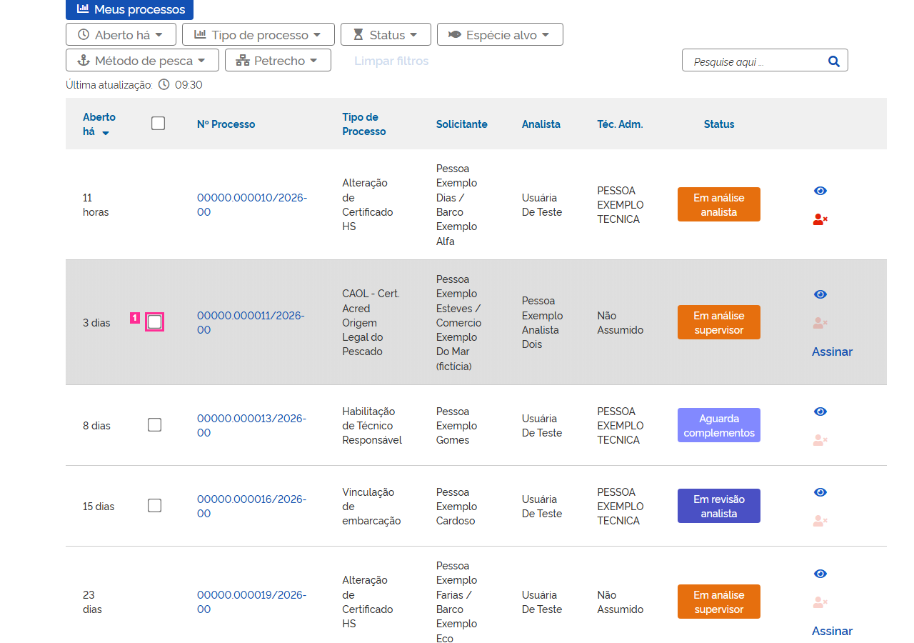

[a mesma tela sem o contorno](img/R-06-tela-sem-marca.png)

**Medido** (não é julgamento):
- foco depois dos passos: &lt;input#total&gt; "Selecione" (não é elemento deste cartão)
- &lt;input&gt; "on": a alegação não nomeia atributo nem propriedade de CSS

**Defeitos da lista que parecem próximos** (só uma pista; pode ser outro da lista, ou nenhum):
- **D-04** — Checkboxes de seleção da tabela — um no cabeçalho (coluna sem texto) e um em cada uma das 6 linhas selecionáveis: &lt;input type="checkbox"&gt; sem &lt;label&gt;, aria-label, aria-labelledby ou title; labels.length = 0 e nome "" na árvore. Estão no Tab (operáveis), sem nome.
- **D-07** — A tabela de processos não tem &lt;caption&gt; nem aria-label/aria-labelledby (nome "" na árvore); o h2 "Processos" fica fora do contêiner da tabela, sem associação. A norma pede caption que identifique a tabela (os exemplos oficiais da Table 3.7.0 trazem caption).
- **D-11** — Nenhum salto para o conteúdo: 0 âncoras "#…" e 0 .br-skiplink nas 2 paradas; o primeiro ponto de Tab é o botão Menu do cabeçalho. Casco da aplicação: **exposto** (adendo § E; C-04, B-01).
- **D-12** — Um só título visível na página, &lt;h2&gt; "Processos"; nenhum &lt;h1&gt; (light DOM e shadow roots), nas 2 paradas. Ausência global, ancorada na raiz. **exposto** (casco: ordem de títulos, como C-05).

**Sua resposta** (copie a linha e complete):

```
R-06: fato  descumpre  defeito  quem-escreveu
```

---

## R-07

**O que o cartão diz que acontece:** &lt;button type=button href="javascript:void(0)"&gt; com &lt;p&gt; dentro: atributo href e conteúdo de bloco não permitidos em button

**Correção que o cartão sugere:** HTML válido para button

**Regra citada:** e-MAG 3.1 · emag:1.1 · Respeitar os padrões web
> Follow W3C standards for HTML, XML, XHTML, and CSS. Code must be semantically correct and valid.
> Recomendação 1.1 – Respeitar os Padrões Web. *(força declarada na base: recomendado)*

**Onde:**
- `<button> "Sair"` — seletor `body>pnip-root>pnip-header>div>div>div>button`
- seletor escrito no cartão: `#avatar-menu > button`

**Como chegar ao estado** (janela 1280×900):
1. clicar em #avatar-dropdown-trigger

**Na página congelada, depois desses passos** (refeitos automaticamente, como estão escritos, em janela 1280×900):
- passo 1 ("clicar em #avatar-dropdown-trigger"): feito

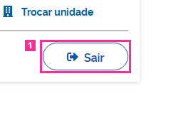

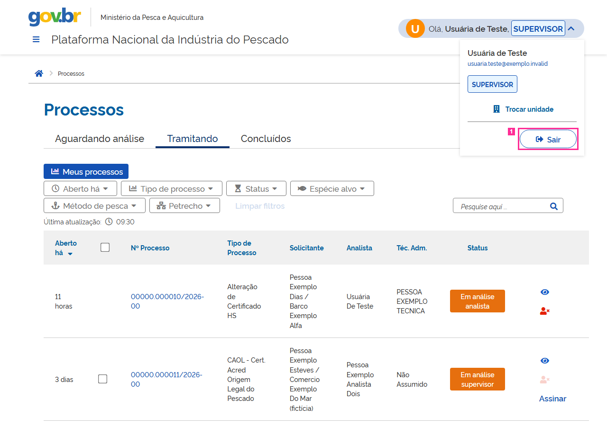

[a mesma tela sem o contorno](img/R-07-tela-sem-marca.png)

**Medido** (não é julgamento):
- foco depois dos passos: &lt;button#avatar-dropdown-trigger&gt; "Avatar com dropdown" (não é elemento deste cartão)
- &lt;button.br-item.dropdown-button&gt; "Sair": href "javascript:void(0)"

**Evidências que o cartão traz:**
- P-08

**Defeitos da lista que parecem próximos** (só uma pista; pode ser outro da lista, ou nenhum):
- **D-11** — Nenhum salto para o conteúdo: 0 âncoras "#…" e 0 .br-skiplink nas 2 paradas; o primeiro ponto de Tab é o botão Menu do cabeçalho. Casco da aplicação: **exposto** (adendo § E; C-04, B-01).
- **D-12** — Um só título visível na página, &lt;h2&gt; "Processos"; nenhum &lt;h1&gt; (light DOM e shadow roots), nas 2 paradas. Ausência global, ancorada na raiz. **exposto** (casco: ordem de títulos, como C-05).

**Sua resposta** (copie a linha e complete):

```
R-07: fato  descumpre  defeito  quem-escreveu
```

---

## R-08

**O que o cartão diz que acontece:** Campo com placeholder "Pesquise aqui ..." e nenhum rótulo associado (sem &lt;label&gt; com texto, aria-labelledby com texto ou aria-label); o host &lt;br-input&gt; não recebeu label/aria-label da página: o placeholder faz o papel do rótulo

**Correção que o cartão sugere:** Um rótulo associado ao campo (&lt;label for&gt;/&lt;label&gt; ancestral, aria-labelledby ou aria-label); o placeholder não substitui o rótulo

**Regra citada:** e-MAG 3.1 · emag:6.2 · Associar etiquetas aos seus campos
> Every form input must have a programmatically associated label via: (a) &lt;label&gt; element with for attribute matching the input's id, (b) aria-label attribute, or (c) aria-labelledby pointing to a visible label element. Placeholder text is NOT a substitute for a label — it disappears on input and is not consistently announced by all screen readers.
> Recomendação 6.2 – Associar etiquetas aos seus campos. *(força declarada na base: recomendado)*

**Onde:**
- `<input#search> "Pesquise aqui ..." [shadow]` — seletor `body>pnip-root>main>pnip-mpa>pnip-mpa-processos>div>div:nth-of-type(2)>div>div:nth-of-type(2)>div:nth-of-type(2)>pnip-search-table-utils>div>div>div>br-input >>> div>input`
- seletor escrito no cartão: `#search >>> #search`

**Como chegar ao estado** (janela 1280×900):
1. abrir o endereço da tela e esperar `main .br-table tbody tr`
2. clicar em `govbr-custom-pagination nav &gt; div:nth-of-type(1) br-select-pnip input#total`
3. esperar `govbr-custom-pagination nav &gt; div:nth-of-type(1) br-select-pnip .br-list .br-item` aparecer

**Na página congelada, depois desses passos** (refeitos automaticamente, como estão escritos, em janela 1280×900):
- passo 1 ("abrir o endereço da tela e esperar `main .br-table tbody tr`"): feito
- passo 2 ("clicar em `govbr-custom-pagination nav &gt; div:nth-of-type(1) br-select-pnip input#total`"): feito
- passo 3 ("esperar `govbr-custom-pagination nav &gt; div:nth-of-type(1) br-select-pnip .br-list .br-item` aparecer"): feito

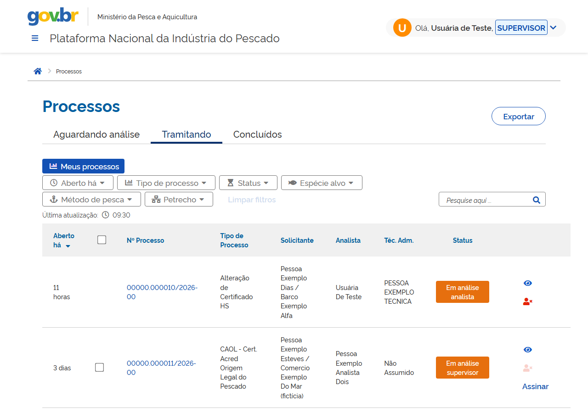

[a mesma tela sem o contorno](img/R-08-tela-sem-marca.png)

**Medido** (não é julgamento):
- foco depois dos passos: &lt;input#total&gt; "Selecione" (não é elemento deste cartão)
- elemento 1: não existe na página neste estado

**Defeitos da lista que parecem próximos** (só uma pista; pode ser outro da lista, ou nenhum):
- **D-05** — Campo de pesquisa da lista: o &lt;br-input&gt; recebeu `placeholder="Pesquise aqui ..."` mas não `label`, e o input interno (id search) fica com labels.length = 0, sem aria-label nem aria-labelledby; o nome acessível é o placeholder. Os seletores "Exibir" e "Página" da mesma tela têm rótulo associado.
- **D-11** — Nenhum salto para o conteúdo: 0 âncoras "#…" e 0 .br-skiplink nas 2 paradas; o primeiro ponto de Tab é o botão Menu do cabeçalho. Casco da aplicação: **exposto** (adendo § E; C-04, B-01).
- **D-12** — Um só título visível na página, &lt;h2&gt; "Processos"; nenhum &lt;h1&gt; (light DOM e shadow roots), nas 2 paradas. Ausência global, ancorada na raiz. **exposto** (casco: ordem de títulos, como C-05).

**Sua resposta** (copie a linha e complete):

```
R-08: fato  descumpre  defeito  quem-escreveu
```

---

## R-09

**O que o cartão diz que acontece:** O diálogo de desassociação foi aberto pelo teclado (foco no botão e Enter). Ao fechá-lo com Escape ou com "Não", o foco vai para &lt;body&gt; em vez de voltar ao botão que o abriu.

**Correção que o cartão sugere:** Ao fechar o diálogo, o foco volta ao controle que o abriu.

**Regra citada:** WCAG 2.2 · wcag:2.4.3 · Focus Order · nível A

**Onde:**
- `<br-button>` — seletor `body>pnip-root>main>pnip-mpa>pnip-mpa-processos>div>div:nth-of-type(2)>div>div:nth-of-type(3)>div:nth-of-type(2)>table>tbody>tr:nth-of-type(1)>td:nth-of-type(9)>br-button:nth-of-type(2)`
- seletor escrito no cartão: `tbody tr:nth-child(1) br-button[title="Desassociar processo do analista responsável"]`

**Como chegar ao estado** (janela 1280×900):
1. load http://screens:3300/pnip-d/portal-mpa/processos?mock-perfil=mpa
2. focus botão Desassociar (linha 1)
3. press Enter
4. press Escape

**Na página congelada, depois desses passos** (refeitos automaticamente, como estão escritos, em janela 1280×900):
- passo 1 ("load http://screens:3300/pnip-d/portal-mpa/processos?mock-perfil=mpa"): não sei refazer este passo automaticamente; a imagem mostra o estado antes dele

**Atenção: refeitos como estão escritos, os passos não chegam ao estado que o cartão descreve** (ver acima). As imagens e a medida são do estado a que eles chegam.

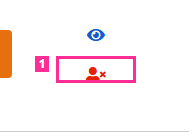

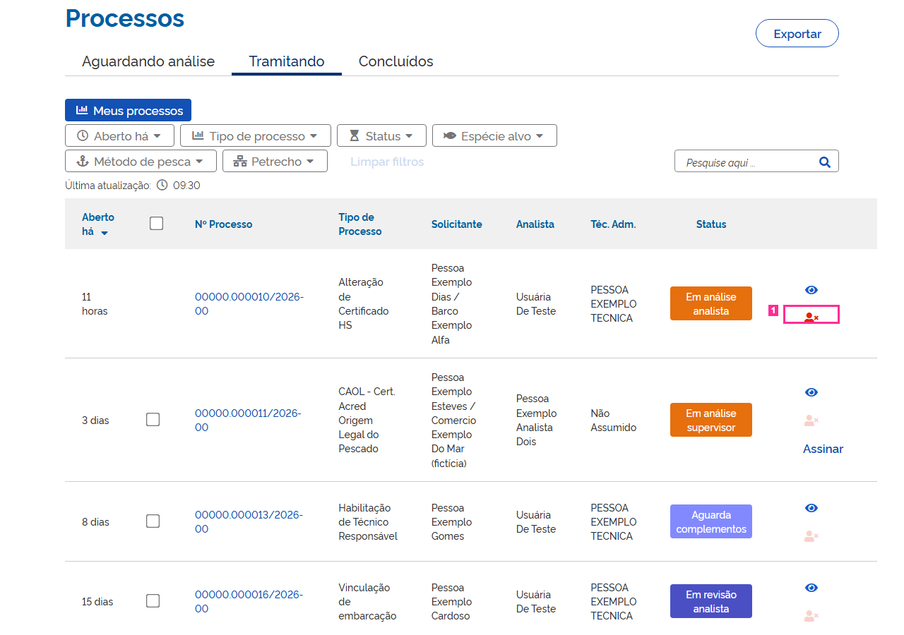

[a mesma tela sem o contorno](img/R-09-tela-sem-marca.png)

**Medido** (não é julgamento):
- foco depois dos passos: &lt;body&gt; (nenhum elemento focado) (não é elemento deste cartão)
- &lt;br-button&gt;: a alegação não nomeia atributo nem propriedade de CSS

**Defeitos da lista que parecem próximos** (só uma pista; pode ser outro da lista, ou nenhum):
- **D-01** — Botões de ação das linhas da tabela "Ver processo" (9) e "Desassociar processo do analista responsável" (9; 8 desabilitados): &lt;br-button&gt; sem `label` e sem `circle`. O &lt;button&gt; interno é br-button middle de 72×40 px com raio de pílula (não circular), sem nenhum texto visível — só o ícone projetado (eye, user-times) — e o nome acessível vem só do `title`. A norma exige rótulo visível em todo Button não circular. Na mesma coluna o "Assinar" tem texto visível.
- **D-07** — A tabela de processos não tem &lt;caption&gt; nem aria-label/aria-labelledby (nome "" na árvore); o h2 "Processos" fica fora do contêiner da tabela, sem associação. A norma pede caption que identifique a tabela (os exemplos oficiais da Table 3.7.0 trazem caption).
- **D-11** — Nenhum salto para o conteúdo: 0 âncoras "#…" e 0 .br-skiplink nas 2 paradas; o primeiro ponto de Tab é o botão Menu do cabeçalho. Casco da aplicação: **exposto** (adendo § E; C-04, B-01).
- **D-12** — Um só título visível na página, &lt;h2&gt; "Processos"; nenhum &lt;h1&gt; (light DOM e shadow roots), nas 2 paradas. Ausência global, ancorada na raiz. **exposto** (casco: ordem de títulos, como C-05).

**Sua resposta** (copie a linha e complete):

```
R-09: fato  descumpre  defeito  quem-escreveu
```

---

## R-10

**O que o cartão diz que acontece:** &lt;iframe&gt; sem src, vazio, 1160×500px no fim do conteúdo, sem title, aria-label ou aria-labelledby.

**Correção que o cartão sugere:** Iframe com title que descreva o conteúdo (ou removido se não tem função).

**Regra citada:** WCAG 2.2 · wcag:4.1.2 · Name, Role, Value · nível A

**Onde:**
- `<iframe>` — seletor `body>pnip-root>main>pnip-mpa>pnip-mpa-processos>iframe`
- seletor escrito no cartão: `iframe`

**Como chegar ao estado** (janela 1280×900):
1. carregar http://screens:3300/pnip-d/portal-mpa/processos?mock-perfil=mpa (aba Tramitando ativa por padrão)

**Na página congelada, depois desses passos** (refeitos automaticamente, como estão escritos, em janela 1280×900):
- passo 1 ("carregar http://screens:3300/pnip-d/portal-mpa/processos?mock-perfil=mpa (aba Tramitando ativa por padrão)"): não sei refazer este passo automaticamente; a imagem mostra o estado antes dele

**Atenção: refeitos como estão escritos, os passos não chegam ao estado que o cartão descreve** (ver acima). As imagens e a medida são do estado a que eles chegam.

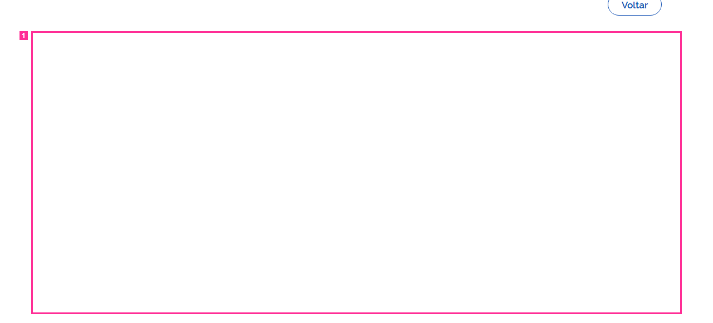

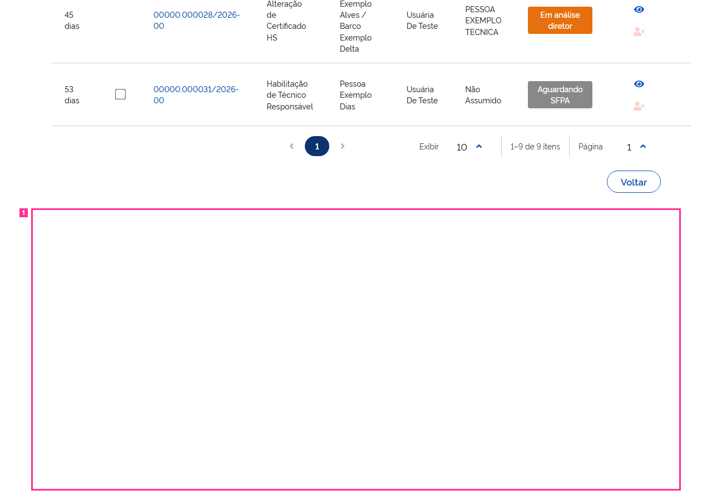

[a mesma tela sem o contorno](img/R-10-tela-sem-marca.png)

**Medido** (não é julgamento):
- foco depois dos passos: &lt;body&gt; (nenhum elemento focado) (não é elemento deste cartão)
- &lt;iframe&gt;: aria-label ausente; aria-labelledby ausente; title ausente

**Defeitos da lista que parecem próximos** (só uma pista; pode ser outro da lista, ou nenhum):
- **D-10** — &lt;iframe&gt; vazio no fim do componente (sem src, documento about:blank sem conteúdo, 1160×500 px, sem title, name nem aria-label; papel Iframe com nome "" na árvore): é ponto de Tab depois do "Voltar" e, focado, nada muda na tela (outline none, sem sombra, :focus-visible falso). Depois dele o Tab real alterna iframe ↔ body (E-01); Shift+Tab sai para o "Voltar".
- **D-11** — Nenhum salto para o conteúdo: 0 âncoras "#…" e 0 .br-skiplink nas 2 paradas; o primeiro ponto de Tab é o botão Menu do cabeçalho. Casco da aplicação: **exposto** (adendo § E; C-04, B-01).
- **D-12** — Um só título visível na página, &lt;h2&gt; "Processos"; nenhum &lt;h1&gt; (light DOM e shadow roots), nas 2 paradas. Ausência global, ancorada na raiz. **exposto** (casco: ordem de títulos, como C-05).

**Sua resposta** (copie a linha e complete):

```
R-10: fato  descumpre  defeito  quem-escreveu
```

---

## Lista de defeitos da tela

Use o id (ex.: `D-01`) na 3ª resposta.

- **D-01** (estado: inicial) — Botões de ação das linhas da tabela "Ver processo" (9) e "Desassociar processo do analista responsável" (9; 8 desabilitados): &lt;br-button&gt; sem `label` e sem `circle`. O &lt;button&gt; interno é br-button middle de 72×40 px com raio de pílula (não circular), sem nenhum texto visível — só o ícone projetado (eye, user-times) — e o nome acessível vem só do `title`. A norma exige rótulo visível em todo Button não circular. Na mesma coluna o "Assinar" tem texto visível.
- **D-02** (estado: inicial) — Números de processo da coluna "Nº Processo": &lt;a role="button" style="cursor:pointer"&gt; sem href nem tabindex. Não são focáveis (fora do Tab real; a árvore do Chromium não os marca focusable), mas o clique navega: nas linhas 2, 3, 4, 6, 7 e 9 abre a sub-rota …/documentos do processo, que o "Ver processo" da mesma linha não abre (ele vai à rota do processo sem /documentos). Nas linhas 1, 5 e 8 o destino cai em /login com recarga — artefato do mock (adendo § C) —, mas o controle é o mesmo e igualmente inalcançável por teclado.
- **D-03** (estado: inicial) — Etiquetas interativas "Meus processos" e os seis filtros ("Aberto há", "Tipo de processo", "Status", "Espécie alvo", "Método de pesca", "Petrecho"): &lt;span class="br-tag interaction"&gt; com cursor:pointer, sem role, sem tabindex (tabIndex -1), papel generic e nome "" na árvore. O clique liga/desliga o filtro "Meus processos" (a lista passa de 9 para 10 linhas) ou abre a lista de opções do filtro; nenhuma é alcançada por Tab nem acionável por teclado, e nenhuma expõe estado (aria-pressed/aria-expanded). Os exemplos oficiais da Tag 3.7.0 só usam button e input+label como elementos interativos.
- **D-04** (estado: inicial) — Checkboxes de seleção da tabela — um no cabeçalho (coluna sem texto) e um em cada uma das 6 linhas selecionáveis: &lt;input type="checkbox"&gt; sem &lt;label&gt;, aria-label, aria-labelledby ou title; labels.length = 0 e nome "" na árvore. Estão no Tab (operáveis), sem nome.
- **D-05** (estado: inicial) — Campo de pesquisa da lista: o &lt;br-input&gt; recebeu `placeholder="Pesquise aqui ..."` mas não `label`, e o input interno (id search) fica com labels.length = 0, sem aria-label nem aria-labelledby; o nome acessível é o placeholder. Os seletores "Exibir" e "Página" da mesma tela têm rótulo associado.
- **D-06** (estado: inicial) — Etiquetas de status da coluna "Status": texto branco (text-secondary-01, 14 px/500) sobre bg-orange-vivid-40 #e66f0e = 3,16:1 (5 linhas), bg-indigo-vivid-40 #8289ff = 3,01:1 (1) e bg-secondary-06 #888888 = 3,54:1 (2) — 8 de 9 abaixo de 4,5:1 (cores da paleta, combinação autoral). O status "Em revisão analista" sobre indigo-vivid-60 passa (6,49:1, controle K-08). O texto do status vem do mock; a combinação de cores é do componente da página.
- **D-07** (estado: inicial) — A tabela de processos não tem &lt;caption&gt; nem aria-label/aria-labelledby (nome "" na árvore); o h2 "Processos" fica fora do contêiner da tabela, sem associação. A norma pede caption que identifique a tabela (os exemplos oficiais da Table 3.7.0 trazem caption).
- **D-08** (estado: inicial) — Cabeçalho da coluna de ações (Ver processo / Desassociar / Assinar): &lt;th scope="col"&gt; vazio, columnheader sem nome na árvore — as células de ação ficam sem cabeçalho identificável. Precedente B-26 (D-61).
- **D-10** (estado: inicial) — &lt;iframe&gt; vazio no fim do componente (sem src, documento about:blank sem conteúdo, 1160×500 px, sem title, name nem aria-label; papel Iframe com nome "" na árvore): é ponto de Tab depois do "Voltar" e, focado, nada muda na tela (outline none, sem sombra, :focus-visible falso). Depois dele o Tab real alterna iframe ↔ body (E-01); Shift+Tab sai para o "Voltar".
- **D-11** (estado: sempre) — Nenhum salto para o conteúdo: 0 âncoras "#…" e 0 .br-skiplink nas 2 paradas; o primeiro ponto de Tab é o botão Menu do cabeçalho. Casco da aplicação: **exposto** (adendo § E; C-04, B-01).
- **D-12** (estado: sempre) — Um só título visível na página, &lt;h2&gt; "Processos"; nenhum &lt;h1&gt; (light DOM e shadow roots), nas 2 paradas. Ausência global, ancorada na raiz. **exposto** (casco: ordem de títulos, como C-05).
- **D-13** (estado: sempre) — &lt;title&gt;PNIP&lt;/title&gt; nas 2 paradas: nomeia só o sistema, não o conteúdo principal ("Processos"). **exposto** (casco; B-25, C-06).
- **D-14** (estado: sempre) — Inicial do avatar "U" branco sobre #ff8c00 = 2,33:1 (24,2 px/700). **exposto** (casco; B-14, C-07).

## Modelo para copiar no comentário

```
R-01: 
R-02: 
R-03: 
R-04: 
R-05: 
R-06: 
R-07: 
R-08: 
R-09: 
R-10: 
```
