# Casos para julgar — Tela Cadastrar país importador

10 casos. Leia antes o [LEIAME](LEIAME.md) (5 min). Cada caso leva uns 3 a 4 minutos.

Responda num comentário do Linear com uma linha por caso (modelo no fim desta página).

## R-01

**O que o cartão diz que acontece:** Os rótulos 'Limpar Campos' e 'Salvar País' têm a inicial maiúscula em mais de uma palavra.

**Correção que o cartão sugere:** Só a primeira letra do rótulo em maiúscula: 'Limpar campos', 'Salvar país'.

**Regra citada:** base de regras do DS 3.7.0 (texto literal; id mascarado, D-87)
> Apenas a primeira letra do rótulo deve ser maiúscula. *(força declarada na base: obrigatorio)*

**Onde:**
- `<button#btn-limpar> "Limpar Campos"` — seletor `body>main>div:nth-of-type(2)>form>div:nth-of-type(5)>button:nth-of-type(2)`
- `<button#btn-salvar> "Salvar País"` — seletor `body>main>div:nth-of-type(2)>form>div:nth-of-type(5)>button:nth-of-type(3)`
- seletor escrito no cartão: `#btn-limpar, #btn-salvar`

**Como chegar ao estado** (janela 1280×900):
1. abrir a página (estado inicial)

**Na página congelada, depois desses passos** (refeitos automaticamente, como estão escritos, em janela 1280×900):
- nenhum passo no cartão: página no estado inicial

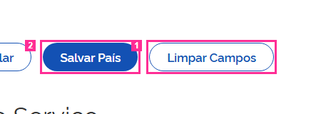

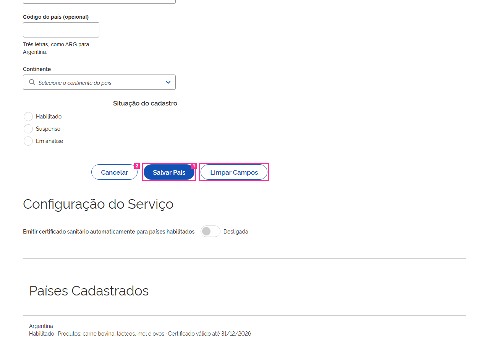

[a mesma tela sem o contorno](img/R-01-tela-sem-marca.png)

**Medido** (não é julgamento):
- foco depois dos passos: &lt;body&gt; (nenhum elemento focado) (não é elemento deste cartão)
- &lt;button#btn-limpar&gt; "Limpar Campos": a alegação não nomeia atributo nem propriedade de CSS
- &lt;button#btn-salvar&gt; "Salvar País": a alegação não nomeia atributo nem propriedade de CSS

**Evidências que o cartão traz:**
- browser: textContent dos botões

**Defeitos da lista que parecem próximos** (só uma pista; pode ser outro da lista, ou nenhum):
- **U-01** — Estrato semeada · classe DS · variante secundario-a-direita-do-primario · sorteada (a2-2ac598dc24db). Limpar Campos (secundário) aparece à direita de Salvar País (primário) na barra de ações: `order: 1` na folha da página; DOM e ordem de Tab inalterados (Cancelar → Limpar → Salvar). Medido: x do Limpar 525,1 &gt; borda direita do Salvar 509,1.

**Sua resposta** (copie a linha e complete):

```
R-01: fato  descumpre  defeito  quem-escreveu
```

---

## R-02

**O que o cartão diz que acontece:** O rótulo do grupo de radios "Situação do cadastro" tem text-align: center e width: 100% (regra ".grupo-situacao .rotulo-situacao"): o texto aparece centralizado (x≈296 a 464), enquanto as opções e os rótulos dos outros campos começam em x=60.

**Correção que o cartão sugere:** Rótulo do grupo de radios no topo do componente, alinhado à esquerda.

**Regra citada:** base de regras do DS 3.7.0 (texto literal; id mascarado, D-87)
> O rótulo deve se posicionar no topo do componente alinhado à esquerda. *(força declarada na base: obrigatorio)*

**Onde:**
- `<legend> "Situação do cadastro"` — seletor `body>main>div:nth-of-type(2)>form>fieldset>legend`
- seletor escrito no cartão: `#rad-situacao > legend`

**Como chegar ao estado** (janela 1280×900):
1. abrir a página (estado inicial)

**Na página congelada, depois desses passos** (refeitos automaticamente, como estão escritos, em janela 1280×900):
- nenhum passo no cartão: página no estado inicial

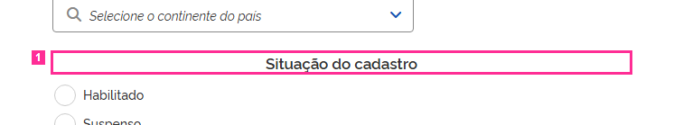

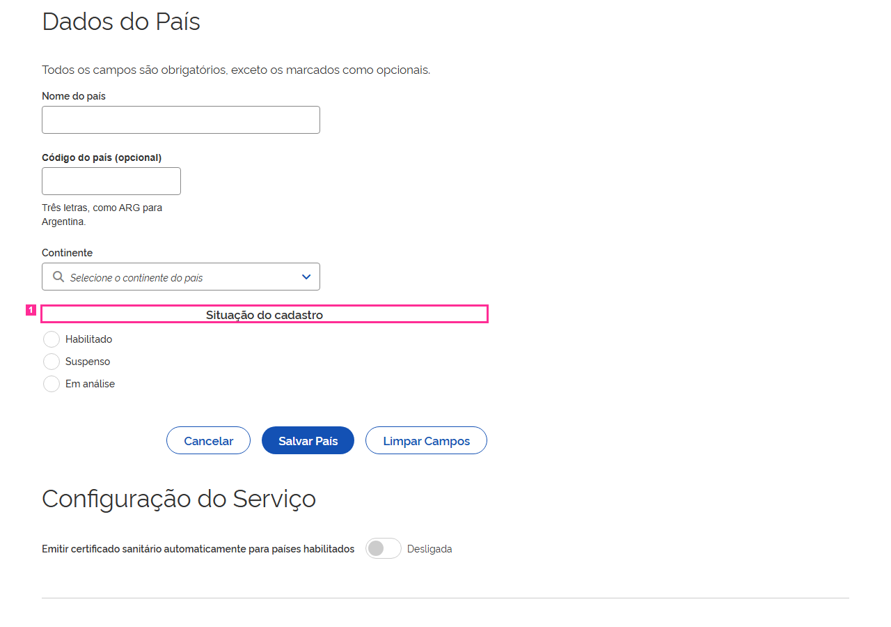

[a mesma tela sem o contorno](img/R-02-tela-sem-marca.png)

**Medido** (não é julgamento):
- foco depois dos passos: &lt;body&gt; (nenhum elemento focado) (não é elemento deste cartão)
- &lt;legend.rotulo-situacao&gt; "Situação do cadastro": a alegação não nomeia atributo nem propriedade de CSS

**Defeitos da lista que parecem próximos** (só uma pista; pode ser outro da lista, ou nenhum):
- **U-05** — Estrato semeada · classe DS · variante legenda-centralizada · sorteada (a2-f838b54da560). A legenda do grupo de opções fica centralizada (legend com `width: 100%; text-align: center`): o texto começa em 296,1 px, centrado no grupo, enquanto as opções começam em 62 px. A caixa da legend continua em 62 px; o desvio é do texto. A 1ª auditoria cega deu a frase como conforme medindo a caixa (EC-062); o 2º auditor cego, no pedido neutro, mediu o texto em 296,09 px e decidiu viola (R-05).

**Sua resposta** (copie a linha e complete):

```
R-02: fato  descumpre  defeito  quem-escreveu
```

---

## R-03

**O que o cartão diz que acontece:** Cada role=option da lista do Continente contém um input radio focável (tabIndex 0)

**Correção que o cartão sugere:** Opções de listbox sem controles interativos aninhados

**Regra citada:** axe-core 4.11.4 · axe:nested-interactive · Interactive controls must not be nested
> Ensure interactive controls are not nested as they are not always announced by screen readers or can cause focus problems for assistive technologies
> etiquetas: EN-301-549, EN-9.4.1.2, RGAA-7.1.1, RGAAv4, TT6.a, TTv5, cat.keyboard, wcag2a, wcag412

**Outras normas que o cartão cita para o mesmo fato** (só contam se a regra citada não valer para ele):
- REF1: WCAG 2.2 · wcag:4.1.2 · Name, Role, Value · nível A

**Onde:**
- `<div> "África"` — seletor `body>main>div:nth-of-type(2)>form>div:nth-of-type(4)>div>div:nth-of-type(2)>div:nth-of-type(1)`
- `<div> "América do Norte"` — seletor `body>main>div:nth-of-type(2)>form>div:nth-of-type(4)>div>div:nth-of-type(2)>div:nth-of-type(2)`
- `<div> "América do Sul"` — seletor `body>main>div:nth-of-type(2)>form>div:nth-of-type(4)>div>div:nth-of-type(2)>div:nth-of-type(3)`
- `<div> "Ásia"` — seletor `body>main>div:nth-of-type(2)>form>div:nth-of-type(4)>div>div:nth-of-type(2)>div:nth-of-type(4)`
- `<div> "Europa"` — seletor `body>main>div:nth-of-type(2)>form>div:nth-of-type(4)>div>div:nth-of-type(2)>div:nth-of-type(5)`
- `<div> "Oceania"` — seletor `body>main>div:nth-of-type(2)>form>div:nth-of-type(4)>div>div:nth-of-type(2)>div:nth-of-type(6)`
- seletor escrito no cartão: `#sel-continente .br-item[role=option]`

**Como chegar ao estado** (janela 1280×900):
1. load
2. click #sel-continente &gt; div:nth-of-type(1) &gt; button

**Na página congelada, depois desses passos** (refeitos automaticamente, como estão escritos, em janela 1280×900):
- passo 1 ("load"): feito
- passo 2 ("click #sel-continente &gt; div:nth-of-type(1) &gt; button"): não achei "#sel-continente &gt; div:nth-of-type(1) &gt; button" na página

**Atenção: refeitos como estão escritos, os passos não chegam ao estado que o cartão descreve** (ver acima). As imagens e a medida são do estado a que eles chegam.

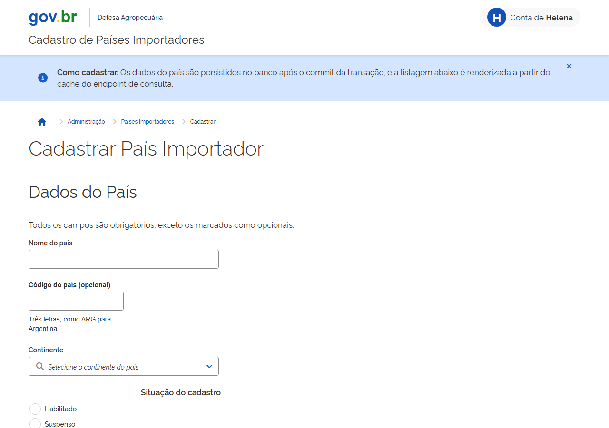

[a mesma tela sem o contorno](img/R-03-tela-sem-marca.png)

**Medido** (não é julgamento):
- foco depois dos passos: &lt;body&gt; (nenhum elemento focado) (não é elemento deste cartão)
- &lt;div.br-item&gt; "África": role "option"; tabindex "-1"
- &lt;div.br-item&gt; "América do Norte": role "option"; tabindex "-1"
- &lt;div.br-item&gt; "América do Sul": role "option"; tabindex "-1"
- &lt;div.br-item&gt; "Ásia": role "option"; tabindex "-1"
- &lt;div.br-item&gt; "Europa": role "option"; tabindex "-1"
- &lt;div.br-item&gt; "Oceania": role "option"; tabindex "-1"

**Sua resposta** (copie a linha e complete):

```
R-03: fato  descumpre  defeito  quem-escreveu
```

---

## R-04

**O que o cartão diz que acontece:** A mensagem de orientação "Como cadastrar." diz: "Os dados do país são persistidos no banco após o commit da transação, e a listagem abaixo é renderizada a partir do cache do endpoint de consulta". Usa jargão técnico (persistidos, banco, commit, transação, cache, endpoint) e não explica como cadastrar.

**Correção que o cartão sugere:** Linguagem simples, sem termos técnicos, que oriente a pessoa usuária sobre o preenchimento.

**Regra citada:** base de regras do DS 3.7.0 (texto literal; id mascarado, D-87)
> Como regra geral, o emprego de termos técnicos deve ser evitado ao máximo. *(força declarada na base: recomendado (desaconselha))*

**Outras normas que o cartão cita para o mesmo fato** (só contam se a regra citada não valer para ele):
- REF1: base de regras do DS 3.7.0 (texto literal; id mascarado, D-87) · [regra citada].7.0-pattern-global-fb4b4b913176

**Onde:**
- `<span> "Os dados do país são persistidos no banco após o"` — seletor `body>main>div:nth-of-type(1)>div:nth-of-type(2)>span:nth-of-type(2)`
- seletor escrito no cartão: `#msg-orientacao .message-body`

**Como chegar ao estado** (janela 1280×900):
1. abrir a página (estado inicial)

**Na página congelada, depois desses passos** (refeitos automaticamente, como estão escritos, em janela 1280×900):
- nenhum passo no cartão: página no estado inicial


[a mesma tela sem o contorno](img/R-04-tela-sem-marca.png)

**Medido** (não é julgamento):
- foco depois dos passos: &lt;body&gt; (nenhum elemento focado) (não é elemento deste cartão)
- &lt;span.message-body&gt; "Os dados do país são persistidos no banc": a alegação não nomeia atributo nem propriedade de CSS

**Defeitos da lista que parecem próximos** (só uma pista; pode ser outro da lista, ou nenhum):
- **U-02** — Estrato semeada · classe DS · variante mensagem-jargao-tecnico · sorteada (a2-d6b3f0e36943). O corpo da mensagem informativa de orientação usa jargão de sistema (persistidos, banco, commit, transação, renderizada, cache, endpoint), sem explicação, no mesmo assunto do cadastro. Medido: 7 termos técnicos.

**Sua resposta** (copie a linha e complete):

```
R-04: fato  descumpre  defeito  quem-escreveu
```

---

## R-05

**O que o cartão diz que acontece:** O botão circular 'Ajuda sobre o cadastro' (40×40 px, ao lado do h1) não tem ícone nem texto visível: seu único conteúdo é um span .sr-only, sem fundo, sem borda e sem pseudo-elementos; na tela aparece como espaço vazio (só o contorno de foco aparece ao receber o foco). O clique também não produziu mudança observável.

**Correção que o cartão sugere:** Botão circular do DS com ícone visível (ex.: fa-question-circle) que identifique a ação para quem enxerga a tela.

**Regra citada:** nenhuma (o cartão não cita regra; julgue pela norma pública que o fato implicaria, se houver).

**Onde:**
- `<button#btn-ajuda> "Ajuda sobre o cadastro"` — seletor `body>main>div:nth-of-type(2)>div>button`
- seletor escrito no cartão: `#btn-ajuda`

**Como chegar ao estado** (janela 1280×900):
1. abrir a página (estado inicial)

**Na página congelada, depois desses passos** (refeitos automaticamente, como estão escritos, em janela 1280×900):
- nenhum passo no cartão: página no estado inicial

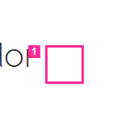

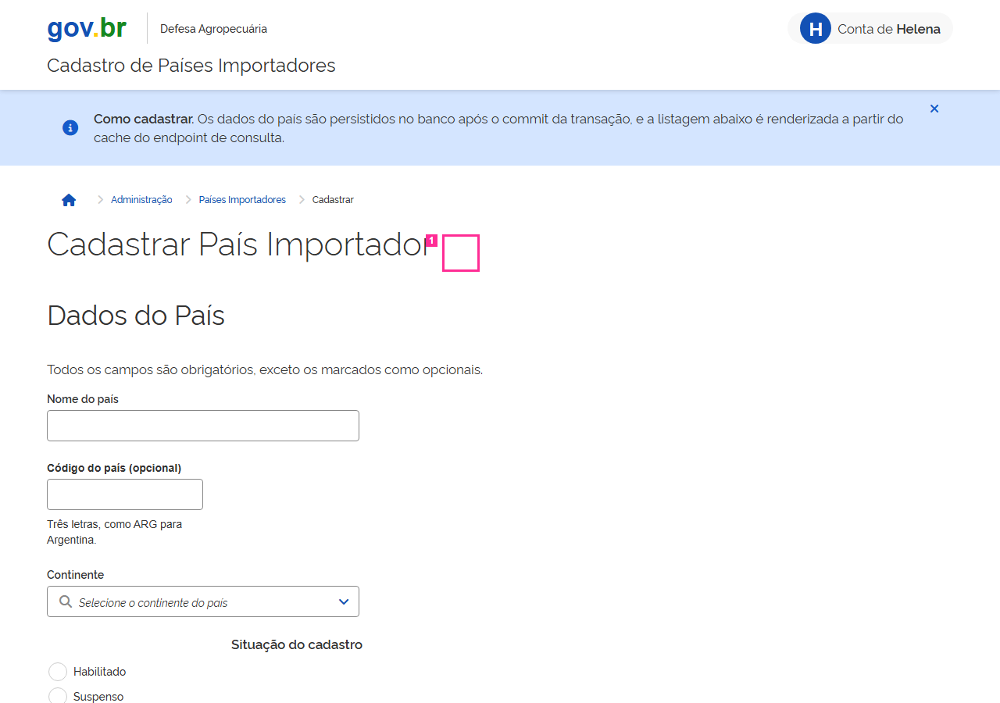

[a mesma tela sem o contorno](img/R-05-tela-sem-marca.png)

**Medido** (não é julgamento):
- foco depois dos passos: &lt;body&gt; (nenhum elemento focado) (não é elemento deste cartão)
- &lt;button#btn-ajuda&gt; "Ajuda sobre o cadastro": background-color rgba(0, 0, 0, 0); border-top-color rgb(19, 81, 180); outline-color rgb(19, 81, 180); outline-style none; outline-width 3px

*Avisos da preparação do cartão: regra-incerta.*

**Defeitos da lista que parecem próximos** (só uma pista; pode ser outro da lista, ou nenhum):
- **U-03** — Estrato semeada · classe DS · variante circular-sem-icone · sorteada (a2-5b47246a41c1). Botão circular de ajuda (40×40) sem ícone: só o texto oculto; nome acessível mantido. Medido: 0 ícone visível, 0 pixel não branco em repouso.

**Sua resposta** (copie a linha e complete):

```
R-05: fato  descumpre  defeito  quem-escreveu
```

---

## R-06

**O que o cartão diz que acontece:** Cada item com role="option" da lista de continentes contém um input type="radio" focável (div.br-radio &gt; input + label): há controle interativo aninhado dentro da opção.

**Correção que o cartão sugere:** As opções do listbox não devem conter descendentes focáveis/interativos.

**Regra citada:** axe-core 4.11.4 · axe:nested-interactive · Interactive controls must not be nested
> Ensure interactive controls are not nested as they are not always announced by screen readers or can cause focus problems for assistive technologies
> etiquetas: EN-301-549, EN-9.4.1.2, RGAA-7.1.1, RGAAv4, TT6.a, TTv5, cat.keyboard, wcag2a, wcag412

**Outras normas que o cartão cita para o mesmo fato** (só contam se a regra citada não valer para ele):
- REF1: WCAG 2.2 · wcag:4.1.2 · Name, Role, Value · nível A

**Onde:**
- `<div> "África"` — seletor `body>main>div:nth-of-type(2)>form>div:nth-of-type(4)>div>div:nth-of-type(2)>div:nth-of-type(1)`
- `<div> "América do Norte"` — seletor `body>main>div:nth-of-type(2)>form>div:nth-of-type(4)>div>div:nth-of-type(2)>div:nth-of-type(2)`
- `<div> "América do Sul"` — seletor `body>main>div:nth-of-type(2)>form>div:nth-of-type(4)>div>div:nth-of-type(2)>div:nth-of-type(3)`
- `<div> "Ásia"` — seletor `body>main>div:nth-of-type(2)>form>div:nth-of-type(4)>div>div:nth-of-type(2)>div:nth-of-type(4)`
- `<div> "Europa"` — seletor `body>main>div:nth-of-type(2)>form>div:nth-of-type(4)>div>div:nth-of-type(2)>div:nth-of-type(5)`
- `<div> "Oceania"` — seletor `body>main>div:nth-of-type(2)>form>div:nth-of-type(4)>div>div:nth-of-type(2)>div:nth-of-type(6)`
- seletor escrito no cartão: `#sel-continente .br-item[role="option"]`

**Como chegar ao estado** (janela 1280×900):
1. load
2. click no botão "Exibir lista"

**Na página congelada, depois desses passos** (refeitos automaticamente, como estão escritos, em janela 1280×900):
- passo 1 ("load"): feito
- passo 2 ("click no botão "Exibir lista""): botão "Exibir lista" casa 2 elementos; usei o primeiro

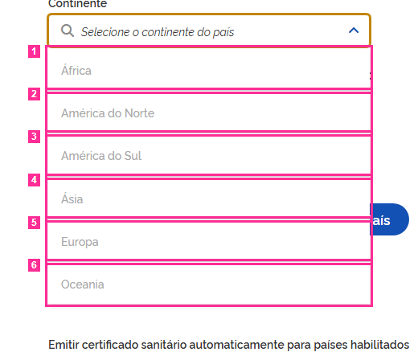

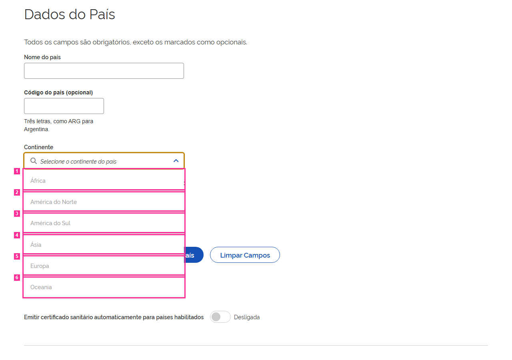

[a mesma tela sem o contorno](img/R-06-tela-sem-marca.png)

**Medido** (não é julgamento):
- foco depois dos passos: &lt;input#continente&gt; "Selecione o continente do país" (não é elemento deste cartão)
- &lt;div.br-item&gt; "África": role "option"
- &lt;div.br-item&gt; "América do Norte": role "option"
- &lt;div.br-item&gt; "América do Sul": role "option"
- &lt;div.br-item&gt; "Ásia": role "option"
- &lt;div.br-item&gt; "Europa": role "option"
- &lt;div.br-item&gt; "Oceania": role "option"

**Sua resposta** (copie a linha e complete):

```
R-06: fato  descumpre  defeito  quem-escreveu
```

---

## R-07

**O que o cartão diz que acontece:** A mensagem "Como cadastrar." diz: "Os dados do país são persistidos no banco após o commit da transação, e a listagem abaixo é renderizada a partir do cache do endpoint de consulta." É jargão técnico e não orienta como cadastrar.

**Correção que o cartão sugere:** Texto em linguagem simples, que explique ao usuário como preencher e salvar o cadastro.

**Regra citada:** e-MAG 3.1 · emag:3.11 · Garantir a leitura e compreensão das informações
> Write clearly at elementary education level. Use short sentences, common vocabulary, and simple structure.
> Recomendação 3.11 – Garantir a leitura e compreensão das informações. *(força declarada na base: recomendado)*

**Onde:**
- `<span> "Os dados do país são persistidos no banco após o"` — seletor `body>main>div:nth-of-type(1)>div:nth-of-type(2)>span:nth-of-type(2)`
- seletor escrito no cartão: `#msg-orientacao .message-body`

**Como chegar ao estado** (janela 1280×900):
1. abrir a página (estado inicial)

**Na página congelada, depois desses passos** (refeitos automaticamente, como estão escritos, em janela 1280×900):
- nenhum passo no cartão: página no estado inicial


[a mesma tela sem o contorno](img/R-07-tela-sem-marca.png)

**Medido** (não é julgamento):
- foco depois dos passos: &lt;body&gt; (nenhum elemento focado) (não é elemento deste cartão)
- &lt;span.message-body&gt; "Os dados do país são persistidos no banc": a alegação não nomeia atributo nem propriedade de CSS

**Defeitos da lista que parecem próximos** (só uma pista; pode ser outro da lista, ou nenhum):
- **U-02** — Estrato semeada · classe DS · variante mensagem-jargao-tecnico · sorteada (a2-d6b3f0e36943). O corpo da mensagem informativa de orientação usa jargão de sistema (persistidos, banco, commit, transação, renderizada, cache, endpoint), sem explicação, no mesmo assunto do cadastro. Medido: 7 termos técnicos.

**Sua resposta** (copie a linha e complete):

```
R-07: fato  descumpre  defeito  quem-escreveu
```

---

## R-08

**O que o cartão diz que acontece:** Cada elemento role="option" da lista de continentes contém um input type="radio" focável (descendente interativo dentro de option).

**Correção que o cartão sugere:** Elementos com papel option não devem conter controles focáveis aninhados.

**Regra citada:** axe-core 4.11.4 · axe:nested-interactive · Interactive controls must not be nested
> Ensure interactive controls are not nested as they are not always announced by screen readers or can cause focus problems for assistive technologies
> etiquetas: EN-301-549, EN-9.4.1.2, RGAA-7.1.1, RGAAv4, TT6.a, TTv5, cat.keyboard, wcag2a, wcag412

**Outras normas que o cartão cita para o mesmo fato** (só contam se a regra citada não valer para ele):
- REF1: WCAG 2.2 · wcag:4.1.2 · Name, Role, Value · nível A

**Onde:**
- `<div> "África"` — seletor `body>main>div:nth-of-type(2)>form>div:nth-of-type(4)>div>div:nth-of-type(2)>div:nth-of-type(1)`
- `<div> "América do Norte"` — seletor `body>main>div:nth-of-type(2)>form>div:nth-of-type(4)>div>div:nth-of-type(2)>div:nth-of-type(2)`
- `<div> "América do Sul"` — seletor `body>main>div:nth-of-type(2)>form>div:nth-of-type(4)>div>div:nth-of-type(2)>div:nth-of-type(3)`
- `<div> "Ásia"` — seletor `body>main>div:nth-of-type(2)>form>div:nth-of-type(4)>div>div:nth-of-type(2)>div:nth-of-type(4)`
- `<div> "Europa"` — seletor `body>main>div:nth-of-type(2)>form>div:nth-of-type(4)>div>div:nth-of-type(2)>div:nth-of-type(5)`
- `<div> "Oceania"` — seletor `body>main>div:nth-of-type(2)>form>div:nth-of-type(4)>div>div:nth-of-type(2)>div:nth-of-type(6)`
- seletor escrito no cartão: `#sel-continente .br-item[role="option"]`

**Como chegar ao estado** (janela 1280×900):
1. load
2. click #sel-continente &gt; div:nth-of-type(1) &gt; button (Exibir lista)

**Na página congelada, depois desses passos** (refeitos automaticamente, como estão escritos, em janela 1280×900):
- passo 1 ("load"): feito
- passo 2 ("click #sel-continente &gt; div:nth-of-type(1) &gt; button (Exibir lista)"): não achei "#sel-continente &gt; div:nth-of-type(1) &gt; button" na página

**Atenção: refeitos como estão escritos, os passos não chegam ao estado que o cartão descreve** (ver acima). As imagens e a medida são do estado a que eles chegam.


[a mesma tela sem o contorno](img/R-08-tela-sem-marca.png)

**Medido** (não é julgamento):
- foco depois dos passos: &lt;body&gt; (nenhum elemento focado) (não é elemento deste cartão)
- &lt;div.br-item&gt; "África": role "option"
- &lt;div.br-item&gt; "América do Norte": role "option"
- &lt;div.br-item&gt; "América do Sul": role "option"
- &lt;div.br-item&gt; "Ásia": role "option"
- &lt;div.br-item&gt; "Europa": role "option"
- &lt;div.br-item&gt; "Oceania": role "option"

**Sua resposta** (copie a linha e complete):

```
R-08: fato  descumpre  defeito  quem-escreveu
```

---

## R-09

**O que o cartão diz que acontece:** Elements must meet minimum color contrast ratio thresholds

**Correção que o cartão sugere:** (o cartão não sugere correção)

**Regra citada:** axe-core 4.11.4 · axe:color-contrast · Elements must meet minimum color contrast ratio thresholds
> Ensure the contrast between foreground and background colors meets WCAG 2 AA minimum contrast ratio thresholds
> etiquetas: ACT, EN-301-549, EN-9.1.4.3, RGAA-3.2.1, RGAAv4, TT13.c, TTv5, cat.color, wcag143, wcag2aa

**Onde:**
- `<label> "África"` — seletor `body>main>div:nth-of-type(2)>form>div:nth-of-type(4)>div>div:nth-of-type(2)>div:nth-of-type(1)>div>label`
- seletor escrito no cartão: `label[for="continente-op0"]`

**Como chegar ao estado** (janela 1280×900):
1. abrir o endereço da tela e esperar `#main-content`
2. clicar em `#btn-salvar`
3. esperar `#msg-erro:not([hidden])` aparecer
4. clicar em `#sel-continente [data-trigger]`
5. esperar `#sel-continente .br-list[expanded]` aparecer

**Na página congelada, depois desses passos** (refeitos automaticamente, como estão escritos, em janela 1280×900):
- passo 1 ("abrir o endereço da tela e esperar `#main-content`"): feito
- passo 2 ("clicar em `#btn-salvar`"): feito
- passo 3 ("esperar `#msg-erro:not([hidden])` aparecer"): feito
- passo 4 ("clicar em `#sel-continente [data-trigger]`"): feito
- passo 5 ("esperar `#sel-continente .br-list[expanded]` aparecer"): feito

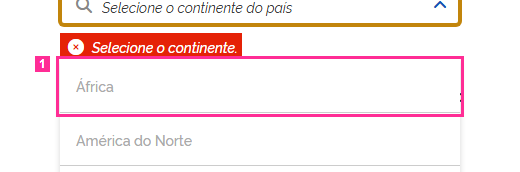

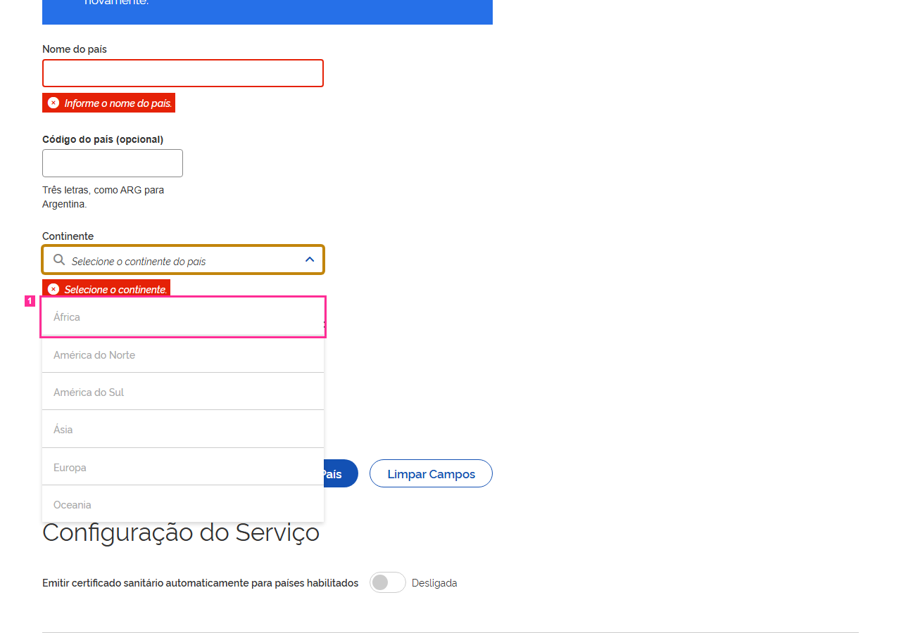

[a mesma tela sem o contorno](img/R-09-tela-sem-marca.png)

**Medido** (não é julgamento):
- foco depois dos passos: &lt;input#continente&gt; "Selecione o continente do país" (não é elemento deste cartão)
- &lt;label&gt; "África": background-color rgba(0, 0, 0, 0); color rgb(170, 170, 170)

**Defeitos da lista que parecem próximos** (só uma pista; pode ser outro da lista, ou nenhum):
- **U-07** — Estrato semeada · classe G · variante opcoes-texto-claro · sorteada (a2-7348bce34289). Em S2 (lista aberta), os rótulos das 6 opções do select ficam #AAAAAA sobre branco: 2,32:1 (texto 14 px, peso 500); o item selecionado mantém a cor do core.

**Sua resposta** (copie a linha e complete):

```
R-09: fato  descumpre  defeito  quem-escreveu
```

---

## R-10

**O que o cartão diz que acontece:** Texto de orientação "Como cadastrar." diz: "Os dados do país são persistidos no banco após o commit da transação, e a listagem abaixo é renderizada a partir do cache do endpoint de consulta." — jargão técnico (persistidos, commit, transação, cache, endpoint) que não orienta o cadastro.

**Correção que o cartão sugere:** Orientação em linguagem simples e compreensível para o público do serviço, explicando como cadastrar.

**Regra citada:** e-MAG 3.1 · emag:3.11 · Garantir a leitura e compreensão das informações
> Write clearly at elementary education level. Use short sentences, common vocabulary, and simple structure.
> Recomendação 3.11 – Garantir a leitura e compreensão das informações. *(força declarada na base: recomendado)*

**Onde:**
- `<span> "Os dados do país são persistidos no banco após o"` — seletor `body>main>div:nth-of-type(1)>div:nth-of-type(2)>span:nth-of-type(2)`
- seletor escrito no cartão: `#msg-orientacao .message-body`

**Como chegar ao estado** (janela 1280×900):
1. abrir a página (estado inicial)

**Na página congelada, depois desses passos** (refeitos automaticamente, como estão escritos, em janela 1280×900):
- nenhum passo no cartão: página no estado inicial

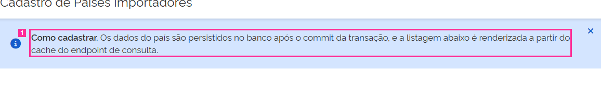

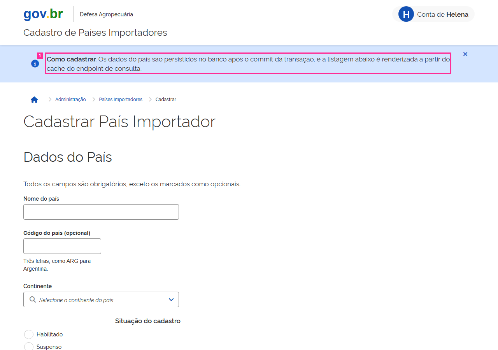

[a mesma tela sem o contorno](img/R-10-tela-sem-marca.png)

**Medido** (não é julgamento):
- foco depois dos passos: &lt;body&gt; (nenhum elemento focado) (não é elemento deste cartão)
- &lt;span.message-body&gt; "Os dados do país são persistidos no banc": a alegação não nomeia atributo nem propriedade de CSS

**Defeitos da lista que parecem próximos** (só uma pista; pode ser outro da lista, ou nenhum):
- **U-02** — Estrato semeada · classe DS · variante mensagem-jargao-tecnico · sorteada (a2-d6b3f0e36943). O corpo da mensagem informativa de orientação usa jargão de sistema (persistidos, banco, commit, transação, renderizada, cache, endpoint), sem explicação, no mesmo assunto do cadastro. Medido: 7 termos técnicos.

**Sua resposta** (copie a linha e complete):

```
R-10: fato  descumpre  defeito  quem-escreveu
```

---

## Lista de defeitos da tela

Use o id (ex.: `U-01`) na 3ª resposta.

- **U-01** (estado: sempre) — Estrato semeada · classe DS · variante secundario-a-direita-do-primario · sorteada (a2-2ac598dc24db). Limpar Campos (secundário) aparece à direita de Salvar País (primário) na barra de ações: `order: 1` na folha da página; DOM e ordem de Tab inalterados (Cancelar → Limpar → Salvar). Medido: x do Limpar 525,1 &gt; borda direita do Salvar 509,1.
- **U-02** (estado: sempre) — Estrato semeada · classe DS · variante mensagem-jargao-tecnico · sorteada (a2-d6b3f0e36943). O corpo da mensagem informativa de orientação usa jargão de sistema (persistidos, banco, commit, transação, renderizada, cache, endpoint), sem explicação, no mesmo assunto do cadastro. Medido: 7 termos técnicos.
- **U-03** (estado: sempre) — Estrato semeada · classe DS · variante circular-sem-icone · sorteada (a2-5b47246a41c1). Botão circular de ajuda (40×40) sem ícone: só o texto oculto; nome acessível mantido. Medido: 0 ícone visível, 0 pixel não branco em repouso.
- **U-04** (estado: sempre) — Estrato semeada · classe DS · variante fonte-do-sistema · sorteada (a2-a39f3ad397d4). O campo do código usa Arial (`font-family: Arial, Helvetica, sans-serif` na raiz .br-input pela folha da página): rótulo, campo e texto de apoio com Arial declarada e usada, não Rawline.
- **U-05** (estado: sempre) — Estrato semeada · classe DS · variante legenda-centralizada · sorteada (a2-f838b54da560). A legenda do grupo de opções fica centralizada (legend com `width: 100%; text-align: center`): o texto começa em 296,1 px, centrado no grupo, enquanto as opções começam em 62 px. A caixa da legend continua em 62 px; o desvio é do texto. A 1ª auditoria cega deu a frase como conforme medindo a caixa (EC-062); o 2º auditor cego, no pedido neutro, mediu o texto em 296,09 px e decidiu viola (R-05).
- **U-06** (estado: S1) — Estrato semeada · classe DS · variante mensagem-com-visual-selecionado · sorteada (a2-ef29db5bb4ac). Em S1, a mensagem de erro (classe danger, ícone times-circle) recebe o visual do estado Selecionado: fundo --blue-warm-vivid-50 (#2670e8), ícone e texto --pure-0, e um ícone fa-check antes do título.
- **U-07** (estado: S2) — Estrato semeada · classe G · variante opcoes-texto-claro · sorteada (a2-7348bce34289). Em S2 (lista aberta), os rótulos das 6 opções do select ficam #AAAAAA sobre branco: 2,32:1 (texto 14 px, peso 500); o item selecionado mantém a cor do core.
- **U-08** (estado: sempre) — Estrato semeada · classe G · variante campo-readonly-ate-clique · sorteada (a2-328f62cfe4ce). O campo Nome do país é `readonly` até receber um clique de ponteiro (script da página): com foco por Tab o texto digitado não entra (valor vazio).

## Modelo para copiar no comentário

```
R-01: 
R-02: 
R-03: 
R-04: 
R-05: 
R-06: 
R-07: 
R-08: 
R-09: 
R-10: 
```
