# Casos para julgar — Tela Processos

10 casos. Leia antes o [LEIAME](LEIAME.md) (5 min). Cada caso leva uns 3 a 4 minutos.

Responda num comentário do Linear com uma linha por caso (modelo no fim desta página).

## R-01

**O que o cartão diz que acontece:** Detalhe 0011 sem h1

**Correção que o cartão sugere:** Cabeçalho h1 para o conteúdo principal

**Regra citada:** e-MAG 3.1 · emag:1.3 · Utilizar corretamente os níveis de cabeçalho
> Heading hierarchy (H1–H6) must be logical. H1 for primary content, subsequent levels for subordinate sections. Do not skip levels.
> Recomendação 1.3 – Utilizar corretamente os níveis de cabeçalho. *(força declarada na base: recomendado)*

**Onde:**
- `<html> "U Olá, Usuária de Teste, SUPERVISOR Processos Me"`
- seletor escrito no cartão: `html`

**Como chegar ao estado** (janela 1280×900):
1. click 'Ver processo' (tbody tr:nth-child(2) br-button[title="Ver processo"])

**Na página congelada, depois desses passos** (refeitos automaticamente, como estão escritos, em janela 1280×900):
- passo 1 ("click 'Ver processo' (tbody tr:nth-child(2) br-button[title="Ver processo"])"): não achei "'Ver processo' (tbody tr:nth-child(2) br-button[title="Ver processo"])" na página

**Atenção: refeitos como estão escritos, os passos não chegam ao estado que o cartão descreve** (ver acima). As imagens e a medida são do estado a que eles chegam.


[a mesma tela sem o contorno](img/R-01-tela-sem-marca.png)

**Medido** (não é julgamento):
- foco depois dos passos: &lt;body&gt; (nenhum elemento focado) (não é elemento deste cartão)

*Avisos da preparação do cartão: segmento-a-decidir: o seletor resolve em 1280x900@lista-exibir, 1280x900@assinatura-cancelada, 1280x900@pagina-2, 1280x900@exibir-25, 1280x900@filtro-removido; escolha em "cena" de qual a alegação fala — só os sujeitos dela contam.*

**Sua resposta** (copie a linha e complete):

```
R-01: fato  descumpre  defeito  quem-escreveu
```

---

## R-02

**O que o cartão diz que acontece:** Detalhe CAOL: depois do h2 "Solicitação de CAOL -" vem h5 ("Produto a exportar"); há h3 usados para valores ("Kg").

**Correção que o cartão sugere:** Hierarquia de títulos sem saltos e só para títulos de seção.

**Regra citada:** axe-core 4.11.4 · axe:heading-order · Heading levels should only increase by one
> Ensure the order of headings is semantically correct
> etiquetas: best-practice, cat.semantics

**Outras normas que o cartão cita para o mesmo fato** (só contam se a regra citada não valer para ele):
- REF1: e-MAG 3.1 · emag:1.3 · Utilizar corretamente os níveis de cabeçalho
  > Heading hierarchy (H1–H6) must be logical. H1 for primary content, subsequent levels for subordinate sections. Do not skip levels.

**Onde:**
- `Seletor não resolvido` — seletor `unresolved:.col-4:nth-child(1) > .mb-2.br-card > .card-content > h5`
- seletor escrito no cartão: `.col-4:nth-child(1) > .mb-2.br-card > .card-content > h5`

**Como chegar ao estado** (janela 1280×900):
1. click tbody tr:nth-child(2) br-button[title="Ver processo"] button (processo 00000.000011/2026-00, Em análise supervisor)

**Na página congelada, depois desses passos** (refeitos automaticamente, como estão escritos, em janela 1280×900):
- passo 1 ("click tbody tr:nth-child(2) br-button[title="Ver processo"] button (processo 00000.000011/2026-00, Em análise supervisor)"): não achei "tbody tr:nth-child(2) br-button[title="Ver processo"] button" na página

**Atenção: refeitos como estão escritos, os passos não chegam ao estado que o cartão descreve** (ver acima). As imagens e a medida são do estado a que eles chegam.


[a mesma tela sem o contorno](img/R-02-tela-sem-marca.png)

**Medido** (não é julgamento):
- foco depois dos passos: &lt;body&gt; (nenhum elemento focado) (não é elemento deste cartão)
- elemento 1: não existe na página neste estado

*Avisos da preparação do cartão: segmento-nao-resolvido: o seletor não resolve em nenhuma cena da janela (1280x900@lista-exibir, 1280x900@assinatura-cancelada, 1280x900@pagina-2, 1280x900@exibir-25, 1280x900@filtro-removido).*

**Sua resposta** (copie a linha e complete):

```
R-02: fato  descumpre  defeito  quem-escreveu
```

---

## R-03

**O que o cartão diz que acontece:** Parte obrigatória ausente na raiz .br-breadcrumb: o último item ("Processos") é link para outra página e não é "PNIP" (título da página atual ausente).

**Correção que o cartão sugere:** Título da página atual (último item do Breadcrumb) presente, como a tabela de anatomia do componente exige.

**Regra citada:** base de regras do DS 3.7.0 (texto literal; id mascarado, D-87)
> 4 | Título da página atual | Tipografia | Obrigatório. *(força declarada na base: obrigatorio)*

**Onde:**
- `<div> "Home Processos" [shadow]` — seletor `body>pnip-root>main>pnip-mpa>pnip-mpa-processos>br-breadcrumb >>> div`
- seletor escrito no cartão: `pnip-root > main > pnip-mpa > pnip-mpa-processos > br-breadcrumb >>> div`

**Como chegar ao estado** (janela 1280×900):
1. abrir o endereço da tela e esperar `main .br-table tbody tr`
2. clicar em `govbr-custom-pagination nav &gt; div:nth-of-type(1) br-select-pnip input#total`
3. esperar `govbr-custom-pagination nav &gt; div:nth-of-type(1) br-select-pnip .br-list .br-item` aparecer
4. navegar para `/pnip-f3/portal-mpa/vistorias` (mesma página, sem recarregar) e esperar `pnip-propesc-vistorias`
5. navegar para `/pnip-f3/portal-mpa/processos` (mesma página, sem recarregar) e esperar `pnip-mpa-processos .br-table tbody tr`
6. clicar em `pnip-mpa-processos table tbody tr:nth-child(2) input[type=checkbox]`
7. esperar `pnip-mpa-processos div.mt-3 &gt; br-button[icon="check"][type="primary"]` aparecer
8. clicar em `pnip-mpa-processos div.mt-3 &gt; br-button[icon="check"][type="primary"]`
9. esperar `.swal2-cancel` aparecer
10. clicar em `.swal2-cancel`
11. {"action":"wait","ms":1500}
12. navegar para `/pnip-f3/portal-mpa/vistorias` (mesma página, sem recarregar) e esperar `pnip-propesc-vistorias`
13. navegar para `/pnip-f3/portal-mpa/processos` (mesma página, sem recarregar) e esperar `pnip-mpa-processos .br-table tbody tr`
14. clicar em `pnip-mpa-processos br-tab button[data-panel="HISTORICO"]`
15. esperar `pnip-mpa-processos .br-table tbody tr:nth-child(10)` aparecer
16. clicar em `govbr-custom-pagination nav.br-pagination button[aria-label="Página seguinte"]`
17. {"action":"wait","ms":1000}
18. navegar para `/pnip-f3/portal-mpa/vistorias` (mesma página, sem recarregar) e esperar `pnip-propesc-vistorias`
19. navegar para `/pnip-f3/portal-mpa/processos` (mesma página, sem recarregar) e esperar `pnip-mpa-processos .br-table tbody tr`
20. clicar em `pnip-mpa-processos br-tab button[data-panel="HISTORICO"]`
21. esperar `pnip-mpa-processos .br-table tbody tr:nth-child(10)` aparecer
22. clicar em `govbr-custom-pagination nav &gt; div:nth-of-type(1) br-select-pnip input#total`
23. esperar `govbr-custom-pagination nav &gt; div:nth-of-type(1) br-select-pnip .br-list .br-item:nth-child(2) .br-radio` aparecer
24. clicar em `govbr-custom-pagination nav &gt; div:nth-of-type(1) br-select-pnip .br-list .br-item:nth-child(2) .br-radio`
25. esperar `pnip-mpa-processos .br-table tbody tr:nth-child(14)` aparecer
26. {"action":"wait","ms":1000}

**Na página congelada, depois desses passos** (refeitos automaticamente, como estão escritos, em janela 1280×900):
- passo 1 ("abrir o endereço da tela e esperar `main .br-table tbody tr`"): feito
- passo 2 ("clicar em `govbr-custom-pagination nav &gt; div:nth-of-type(1) br-select-pnip input#total`"): feito
- passo 3 ("esperar `govbr-custom-pagination nav &gt; div:nth-of-type(1) br-select-pnip .br-list .br-item` aparecer"): feito
- passo 4 ("navegar para `/pnip-f3/portal-mpa/vistorias` (mesma página, sem recarregar) e esperar `pnip-propesc-vistorias`"): não sei refazer este passo automaticamente; a imagem mostra o estado antes dele

**Atenção: refeitos como estão escritos, os passos não chegam ao estado que o cartão descreve** (ver acima). As imagens e a medida são do estado a que eles chegam.


[a mesma tela sem o contorno](img/R-03-tela-sem-marca.png)

**Medido** (não é julgamento):
- foco depois dos passos: &lt;input#total&gt; "Selecione" (não é elemento deste cartão)
- elemento 1: não existe na página neste estado

**Sua resposta** (copie a linha e complete):

```
R-03: fato  descumpre  defeito  quem-escreveu
```

---

## R-04

**O que o cartão diz que acontece:** Células "Solicitante" com max-width 150px, overflow hidden, white-space nowrap, text-overflow clip, sem title: o texto é cortado sem reticências (ex.: scrollWidth 591px em 150px, "Pessoa Exemplo De...")

**Correção que o cartão sugere:** Conteúdo completo visível (quebra de linha) ou com reticências e acesso ao texto completo

**Regra citada:** nenhuma (o cartão não cita regra; julgue pela norma pública que o fato implicaria, se houver).

**Onde:**
- `<td> "Pessoa Exemplo De Nome Comprido Para Teste Da Li"` — seletor `body>pnip-root>main>pnip-mpa>pnip-mpa-processos>div>div:nth-of-type(2)>div:nth-of-type(1)>div:nth-of-type(3)>div:nth-of-type(2)>table>tbody>tr:nth-of-type(1)>td:nth-of-type(5)`
- `<td> "Pessoa Exemplo Esteves / Comercio Exemplo Do Mar"` — seletor `body>pnip-root>main>pnip-mpa>pnip-mpa-processos>div>div:nth-of-type(2)>div:nth-of-type(1)>div:nth-of-type(3)>div:nth-of-type(2)>table>tbody>tr:nth-of-type(2)>td:nth-of-type(5)`
- `<td> "Pessoa Exemplo Gomes"` — seletor `body>pnip-root>main>pnip-mpa>pnip-mpa-processos>div>div:nth-of-type(2)>div:nth-of-type(1)>div:nth-of-type(3)>div:nth-of-type(2)>table>tbody>tr:nth-of-type(3)>td:nth-of-type(5)`
- `<td> "Pessoa Exemplo Cardoso"` — seletor `body>pnip-root>main>pnip-mpa>pnip-mpa-processos>div>div:nth-of-type(2)>div:nth-of-type(1)>div:nth-of-type(3)>div:nth-of-type(2)>table>tbody>tr:nth-of-type(4)>td:nth-of-type(5)`
- `<td> "Pessoa Exemplo Farias / Barco Exemplo Eco"` — seletor `body>pnip-root>main>pnip-mpa>pnip-mpa-processos>div>div:nth-of-type(2)>div:nth-of-type(1)>div:nth-of-type(3)>div:nth-of-type(2)>table>tbody>tr:nth-of-type(5)>td:nth-of-type(5)`
- `<td> "Pessoa Exemplo Esteves"` — seletor `body>pnip-root>main>pnip-mpa>pnip-mpa-processos>div>div:nth-of-type(2)>div:nth-of-type(1)>div:nth-of-type(3)>div:nth-of-type(2)>table>tbody>tr:nth-of-type(6)>td:nth-of-type(5)`
- `<td> "Pessoa Exemplo Gomes / Barco Exemplo Charlie"` — seletor `body>pnip-root>main>pnip-mpa>pnip-mpa-processos>div>div:nth-of-type(2)>div:nth-of-type(1)>div:nth-of-type(3)>div:nth-of-type(2)>table>tbody>tr:nth-of-type(7)>td:nth-of-type(5)`
- `<td> "Pessoa Exemplo Alves / Barco Exemplo Delta"` — seletor `body>pnip-root>main>pnip-mpa>pnip-mpa-processos>div>div:nth-of-type(2)>div:nth-of-type(1)>div:nth-of-type(3)>div:nth-of-type(2)>table>tbody>tr:nth-of-type(8)>td:nth-of-type(5)`
- `<td> "Pessoa Exemplo Dias"` — seletor `body>pnip-root>main>pnip-mpa>pnip-mpa-processos>div>div:nth-of-type(2)>div:nth-of-type(1)>div:nth-of-type(3)>div:nth-of-type(2)>table>tbody>tr:nth-of-type(9)>td:nth-of-type(5)`
- `<td> "Pessoa Exemplo Barros"` — seletor `body>pnip-root>main>pnip-mpa>pnip-mpa-processos>div>div:nth-of-type(2)>div>div:nth-of-type(2)>div:nth-of-type(2)>table>tbody>tr:nth-of-type(1)>td:nth-of-type(4)`
- `<td> "Pessoa Exemplo Alves / Barco Exemplo Charlie"` — seletor `body>pnip-root>main>pnip-mpa>pnip-mpa-processos>div>div:nth-of-type(2)>div>div:nth-of-type(2)>div:nth-of-type(2)>table>tbody>tr:nth-of-type(10)>td:nth-of-type(4)`
- `<td> "Pessoa Exemplo Barros"` — seletor `body>pnip-root>main>pnip-mpa>pnip-mpa-processos>div>div:nth-of-type(2)>div>div:nth-of-type(2)>div:nth-of-type(2)>table>tbody>tr:nth-of-type(11)>td:nth-of-type(4)`
- (mais 20 elemento(s) do mesmo cartão, não listados)
- seletor escrito no cartão: `td.solicitante`

**Como chegar ao estado** (janela 1280×900):
1. abrir a página (estado inicial)

**Na página congelada, depois desses passos** (refeitos automaticamente, como estão escritos, em janela 1280×900):
- nenhum passo no cartão: página no estado inicial

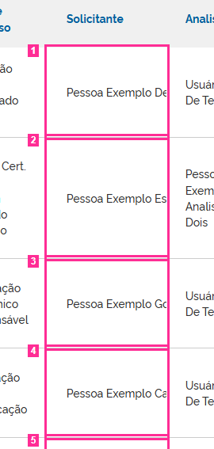

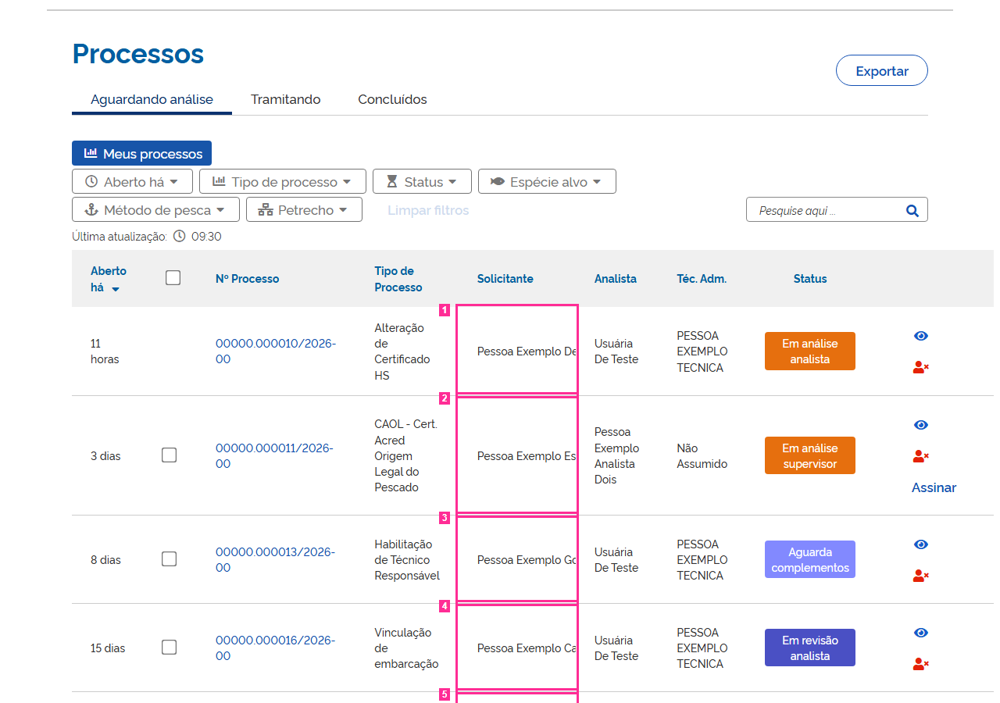

[a mesma tela sem o contorno](img/R-04-tela-sem-marca.png)

**Medido** (não é julgamento):
- foco depois dos passos: &lt;body&gt; (nenhum elemento focado) (não é elemento deste cartão)
- &lt;td.solicitante&gt; "Pessoa Exemplo De Nome Comprido Para Tes": hidden ausente; title ausente
- &lt;td.solicitante&gt; "Pessoa Exemplo Esteves / Comercio Exempl": hidden ausente; title ausente
- &lt;td.solicitante&gt; "Pessoa Exemplo Gomes": hidden ausente; title ausente
- &lt;td.solicitante&gt; "Pessoa Exemplo Cardoso": hidden ausente; title ausente
- &lt;td.solicitante&gt; "Pessoa Exemplo Farias / Barco Exemplo Ec": hidden ausente; title ausente
- &lt;td.solicitante&gt; "Pessoa Exemplo Esteves": hidden ausente; title ausente
- &lt;td.solicitante&gt; "Pessoa Exemplo Gomes / Barco Exemplo Cha": hidden ausente; title ausente
- &lt;td.solicitante&gt; "Pessoa Exemplo Alves / Barco Exemplo Del": hidden ausente; title ausente
- &lt;td.solicitante&gt; "Pessoa Exemplo Dias": hidden ausente; title ausente
- elemento 10: não existe na página neste estado
- elemento 11: não existe na página neste estado
- elemento 12: não existe na página neste estado

*Avisos da preparação do cartão: regra-incerta, sem-evidencia, segmento-a-decidir: o seletor resolve em 1280x900@lista-exibir, 1280x900@assinatura-cancelada, 1280x900@pagina-2, 1280x900@exibir-25, 1280x900@filtro-removido; escolha em "cena" de qual a alegação fala — só os sujeitos dela contam.*

**Defeitos da lista que parecem próximos** (só uma pista; pode ser outro da lista, ou nenhum):
- **D-07** — A tabela de processos não tem &lt;caption&gt; nem aria-label/aria-labelledby (nome "" na árvore); o h2 "Processos" fica fora do contêiner da tabela, sem associação. A norma pede caption que identifique a tabela (os exemplos oficiais da Table 3.7.0 trazem caption).
- **D-11** — Nenhum salto para o conteúdo: 0 âncoras "#…" e 0 .br-skiplink nas 2 paradas; o primeiro ponto de Tab é o botão Menu do cabeçalho. Casco da aplicação: **exposto** (adendo § E; C-04, B-01).
- **D-12** — Um só título visível na página, &lt;h2&gt; "Processos"; nenhum &lt;h1&gt; (light DOM e shadow roots), nas 2 paradas. Ausência global, ancorada na raiz. **exposto** (casco: ordem de títulos, como C-05).
- **F3-04** — Coluna "Solicitante" da tabela de processos: as 9 células cortam o texto na largura de 150 px, numa linha só e sem reticências (overflow hidden, white-space nowrap, text-overflow clip), e nenhuma tem title nem tooltip que mostre o texto completo ao passar o mouse. O nome comprido da 1ª linha ("Pessoa Exemplo De Nome Comprido Para Teste Da Listagem / Barco Exemplo Alfa") é o que mais perde, mas todas as células da coluna aparecem cortadas, até "Pessoa Exemplo Dias". Na Table, o texto truncado exibe reticências no final e o texto completo é revelado por tooltip ao passar o mouse. Uma única regra de estilo corta a coluna inteira: uma unidade para o conjunto; o relato de qualquer célula cortada é desta spec.

**Sua resposta** (copie a linha e complete):

```
R-04: fato  descumpre  defeito  quem-escreveu
```

---

## R-05

**O que o cartão diz que acontece:** Campo com placeholder "Pesquise aqui ..." e nenhum rótulo associado (sem &lt;label&gt; com texto, aria-labelledby com texto ou aria-label); o host &lt;br-input&gt; não recebeu label/aria-label da página: o placeholder faz o papel do rótulo

**Correção que o cartão sugere:** Um rótulo associado ao campo (&lt;label for&gt;/&lt;label&gt; ancestral, aria-labelledby ou aria-label); o placeholder não substitui o rótulo

**Regra citada:** e-MAG 3.1 · emag:6.2 · Associar etiquetas aos seus campos
> Every form input must have a programmatically associated label via: (a) &lt;label&gt; element with for attribute matching the input's id, (b) aria-label attribute, or (c) aria-labelledby pointing to a visible label element. Placeholder text is NOT a substitute for a label — it disappears on input and is not consistently announced by all screen readers.
> Recomendação 6.2 – Associar etiquetas aos seus campos. *(força declarada na base: recomendado)*

**Onde:**
- `<input#search> "Pesquise aqui ..." [shadow]` — seletor `body>pnip-root>main>pnip-mpa>pnip-mpa-processos>div>div:nth-of-type(2)>div>div:nth-of-type(2)>div:nth-of-type(2)>pnip-search-table-utils>div>div>div>br-input >>> div>input`
- seletor escrito no cartão: `#search >>> #search`

**Como chegar ao estado** (janela 1280×900):
1. abrir o endereço da tela e esperar `main .br-table tbody tr`
2. clicar em `govbr-custom-pagination nav &gt; div:nth-of-type(1) br-select-pnip input#total`
3. esperar `govbr-custom-pagination nav &gt; div:nth-of-type(1) br-select-pnip .br-list .br-item` aparecer

**Na página congelada, depois desses passos** (refeitos automaticamente, como estão escritos, em janela 1280×900):
- passo 1 ("abrir o endereço da tela e esperar `main .br-table tbody tr`"): feito
- passo 2 ("clicar em `govbr-custom-pagination nav &gt; div:nth-of-type(1) br-select-pnip input#total`"): feito
- passo 3 ("esperar `govbr-custom-pagination nav &gt; div:nth-of-type(1) br-select-pnip .br-list .br-item` aparecer"): feito

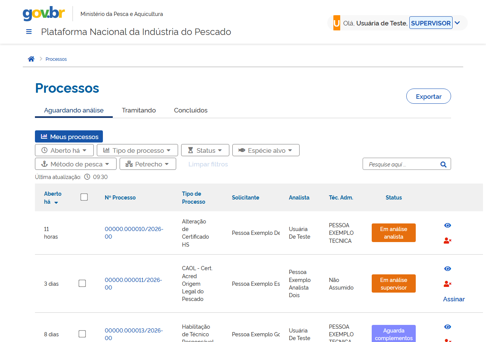

[a mesma tela sem o contorno](img/R-05-tela-sem-marca.png)

**Medido** (não é julgamento):
- foco depois dos passos: &lt;input#total&gt; "Selecione" (não é elemento deste cartão)
- elemento 1: não existe na página neste estado

**Defeitos da lista que parecem próximos** (só uma pista; pode ser outro da lista, ou nenhum):
- **D-05** — Campo de pesquisa da lista: o &lt;br-input&gt; recebeu `placeholder="Pesquise aqui ..."` mas não `label`, e o input interno (id search) fica com labels.length = 0, sem aria-label nem aria-labelledby; o nome acessível é o placeholder. Os seletores "Exibir" e "Página" da mesma tela têm rótulo associado.

**Sua resposta** (copie a linha e complete):

```
R-05: fato  descumpre  defeito  quem-escreveu
```

---

## R-06

**O que o cartão diz que acontece:** Campo com placeholder "Pesquise aqui ..." e nenhum rótulo associado (sem &lt;label&gt; com texto, aria-labelledby com texto ou aria-label); o host &lt;br-input&gt; não recebeu label/aria-label da página: o placeholder faz o papel do rótulo

**Correção que o cartão sugere:** Um rótulo associado ao campo (&lt;label for&gt;/&lt;label&gt; ancestral, aria-labelledby ou aria-label); o placeholder não substitui o rótulo

**Regra citada:** e-MAG 3.1 · emag:6.2 · Associar etiquetas aos seus campos
> Every form input must have a programmatically associated label via: (a) &lt;label&gt; element with for attribute matching the input's id, (b) aria-label attribute, or (c) aria-labelledby pointing to a visible label element. Placeholder text is NOT a substitute for a label — it disappears on input and is not consistently announced by all screen readers.
> Recomendação 6.2 – Associar etiquetas aos seus campos. *(força declarada na base: recomendado)*

**Onde:**
- `<input#search> "Pesquise aqui ..." [shadow]` — seletor `body>pnip-root>main>pnip-mpa>pnip-mpa-processos>div>div:nth-of-type(2)>div>div:nth-of-type(2)>div:nth-of-type(2)>pnip-search-table-utils>div>div>div>br-input >>> div>input`
- seletor escrito no cartão: `#search >>> #search`

**Como chegar ao estado** (janela 1280×900):
1. abrir o endereço da tela e esperar `main .br-table tbody tr`
2. clicar em `govbr-custom-pagination nav &gt; div:nth-of-type(1) br-select-pnip input#total`
3. esperar `govbr-custom-pagination nav &gt; div:nth-of-type(1) br-select-pnip .br-list .br-item` aparecer

**Na página congelada, depois desses passos** (refeitos automaticamente, como estão escritos, em janela 1280×900):
- passo 1 ("abrir o endereço da tela e esperar `main .br-table tbody tr`"): feito
- passo 2 ("clicar em `govbr-custom-pagination nav &gt; div:nth-of-type(1) br-select-pnip input#total`"): feito
- passo 3 ("esperar `govbr-custom-pagination nav &gt; div:nth-of-type(1) br-select-pnip .br-list .br-item` aparecer"): feito


[a mesma tela sem o contorno](img/R-06-tela-sem-marca.png)

**Medido** (não é julgamento):
- foco depois dos passos: &lt;input#total&gt; "Selecione" (não é elemento deste cartão)
- elemento 1: não existe na página neste estado

**Defeitos da lista que parecem próximos** (só uma pista; pode ser outro da lista, ou nenhum):
- **D-05** — Campo de pesquisa da lista: o &lt;br-input&gt; recebeu `placeholder="Pesquise aqui ..."` mas não `label`, e o input interno (id search) fica com labels.length = 0, sem aria-label nem aria-labelledby; o nome acessível é o placeholder. Os seletores "Exibir" e "Página" da mesma tela têm rótulo associado.

**Sua resposta** (copie a linha e complete):

```
R-06: fato  descumpre  defeito  quem-escreveu
```

---

## R-07

**O que o cartão diz que acontece:** O botão do usuário mostra "Olá, Usuária de Teste, SUPERVISOR", mas o nome acessível é aria-label="Avatar com dropdown", que não contém o texto visível.

**Correção que o cartão sugere:** Nome acessível que contenha o rótulo visível.

**Regra citada:** WCAG 2.2 · wcag:2.5.3 · Label in Name · nível A

**Onde:**
- `<button#avatar-dropdown-trigger> "Avatar com dropdown"` — seletor `body>pnip-root>pnip-header>div>div>button`
- seletor escrito no cartão: `#avatar-dropdown-trigger`

**Como chegar ao estado** (janela 1280×900):
1. abrir a página (estado inicial)

**Na página congelada, depois desses passos** (refeitos automaticamente, como estão escritos, em janela 1280×900):
- nenhum passo no cartão: página no estado inicial

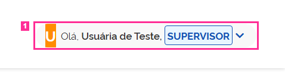

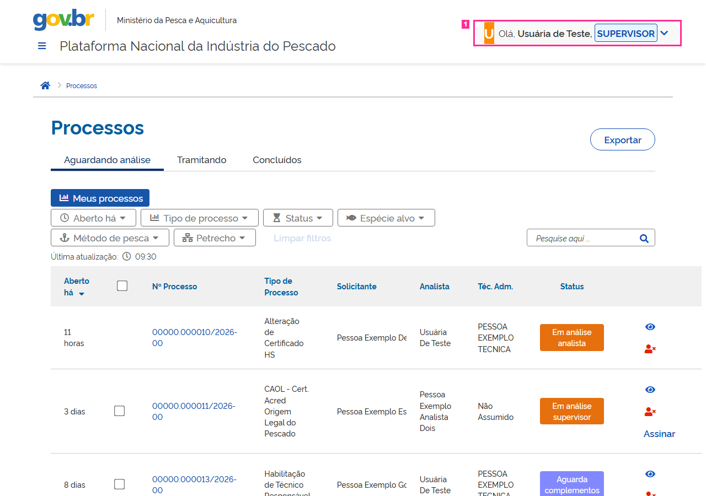

[a mesma tela sem o contorno](img/R-07-tela-sem-marca.png)

**Medido** (não é julgamento):
- foco depois dos passos: &lt;body&gt; (nenhum elemento focado) (não é elemento deste cartão)
- &lt;button#avatar-dropdown-trigger&gt; "Avatar com dropdown": aria-label "Avatar com dropdown"

*Avisos da preparação do cartão: segmento-a-decidir: o seletor resolve em 1280x900@lista-exibir, 1280x900@assinatura-cancelada, 1280x900@pagina-2, 1280x900@exibir-25, 1280x900@filtro-removido; escolha em "cena" de qual a alegação fala — só os sujeitos dela contam.*

**Defeitos da lista que parecem próximos** (só uma pista; pode ser outro da lista, ou nenhum):
- **D-11** — Nenhum salto para o conteúdo: 0 âncoras "#…" e 0 .br-skiplink nas 2 paradas; o primeiro ponto de Tab é o botão Menu do cabeçalho. Casco da aplicação: **exposto** (adendo § E; C-04, B-01).
- **D-12** — Um só título visível na página, &lt;h2&gt; "Processos"; nenhum &lt;h1&gt; (light DOM e shadow roots), nas 2 paradas. Ausência global, ancorada na raiz. **exposto** (casco: ordem de títulos, como C-05).

**Sua resposta** (copie a linha e complete):

```
R-07: fato  descumpre  defeito  quem-escreveu
```

---

## R-08

**O que o cartão diz que acontece:** Contêiner role=menu contém div, span e um button sem role=menuitem

**Correção que o cartão sugere:** role=menu apenas com filhos menuitem (ou não usar role=menu)

**Regra citada:** axe-core 4.11.4 · axe:aria-required-children · Certain ARIA roles must contain particular children
> Ensure elements with an ARIA role that require child roles contain them
> etiquetas: EN-301-549, EN-9.1.3.1, RGAA-9.3.1, RGAAv4, cat.aria, wcag131, wcag2a

**Outras normas que o cartão cita para o mesmo fato** (só contam se a regra citada não valer para ele):
- REF1: WCAG 2.2 · wcag:1.3.1 · Info and Relationships · nível A

**Onde:**
- `<div#avatar-menu> "Usuária de Testeusuaria.teste@exemplo.invalid SU"` — seletor `body>pnip-root>pnip-header>div>div>div`
- seletor escrito no cartão: `#avatar-menu`

**Como chegar ao estado** (janela 1280×900):
1. click #avatar-dropdown-trigger

**Na página congelada, depois desses passos** (refeitos automaticamente, como estão escritos, em janela 1280×900):
- passo 1 ("click #avatar-dropdown-trigger"): feito

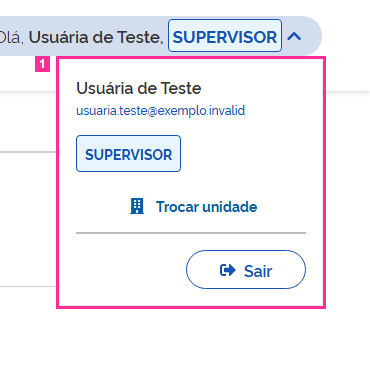

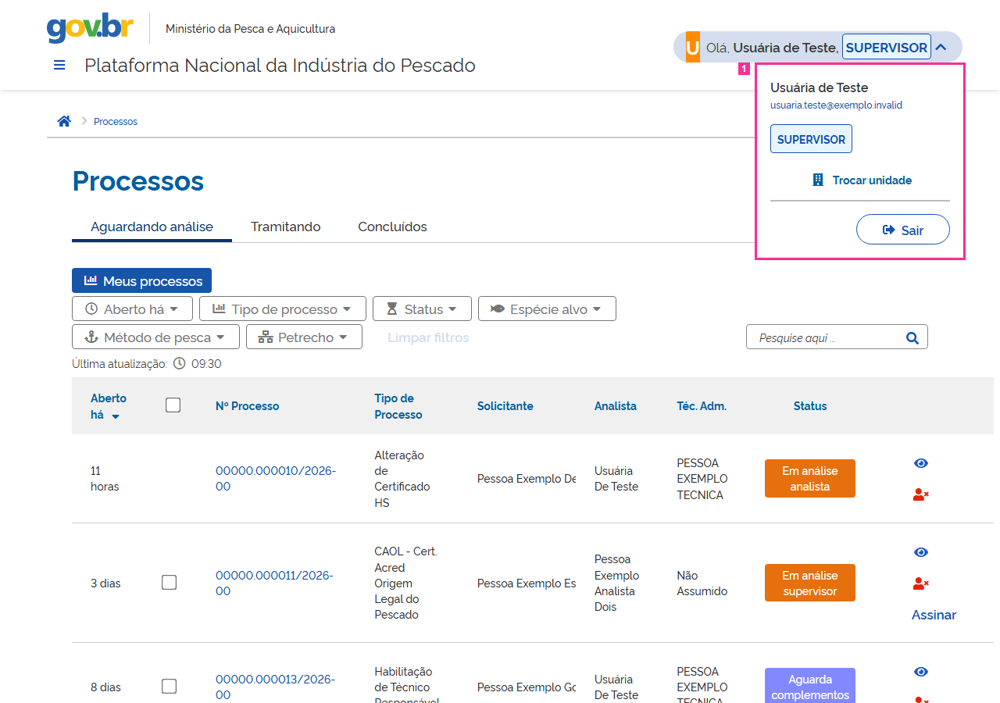

[a mesma tela sem o contorno](img/R-08-tela-sem-marca.png)

**Medido** (não é julgamento):
- foco depois dos passos: &lt;button#avatar-dropdown-trigger&gt; "Avatar com dropdown" (não é elemento deste cartão)
- &lt;div#avatar-menu&gt; "Usuária de Teste usuaria.teste@exemplo.i": role "menu"

*Avisos da preparação do cartão: segmento-a-decidir: o seletor resolve em 1280x900@lista-exibir, 1280x900@assinatura-cancelada, 1280x900@pagina-2, 1280x900@exibir-25, 1280x900@filtro-removido; escolha em "cena" de qual a alegação fala — só os sujeitos dela contam.*

**Defeitos da lista que parecem próximos** (só uma pista; pode ser outro da lista, ou nenhum):
- **D-11** — Nenhum salto para o conteúdo: 0 âncoras "#…" e 0 .br-skiplink nas 2 paradas; o primeiro ponto de Tab é o botão Menu do cabeçalho. Casco da aplicação: **exposto** (adendo § E; C-04, B-01).
- **D-12** — Um só título visível na página, &lt;h2&gt; "Processos"; nenhum &lt;h1&gt; (light DOM e shadow roots), nas 2 paradas. Ausência global, ancorada na raiz. **exposto** (casco: ordem de títulos, como C-05).

**Sua resposta** (copie a linha e complete):

```
R-08: fato  descumpre  defeito  quem-escreveu
```

---

## R-09

**O que o cartão diz que acontece:** background-color inline rgb(23,85,169) (#1755a9), que não corresponde a nenhum token de cor do DS.

**Correção que o cartão sugere:** Usar token de cor do DS.

**Regra citada:** base de regras do DS 3.7.0 (texto literal; id mascarado, D-87)
> Interfaces digitais do governo devem utilizar sempre as cores pré-definidas. *(força declarada na base: obrigatorio)*

**Onde:**
- `<span> "Meus processos"` — seletor `body>pnip-root>main>pnip-mpa>pnip-mpa-processos>div>div:nth-of-type(2)>div:nth-of-type(1)>div:nth-of-type(1)>div>span`
- `<span> "Meus processos"` — seletor `body>pnip-root>main>pnip-mpa>pnip-mpa-processos>div>div:nth-of-type(2)>div>div:nth-of-type(1)>div>span`
- seletor escrito no cartão: `div.col-auto.mb-1:not(.px-1) > span.br-tag.interaction`

**Como chegar ao estado** (janela 1280×900):
1. abrir a página (estado inicial)

**Na página congelada, depois desses passos** (refeitos automaticamente, como estão escritos, em janela 1280×900):
- nenhum passo no cartão: página no estado inicial

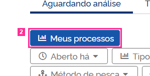

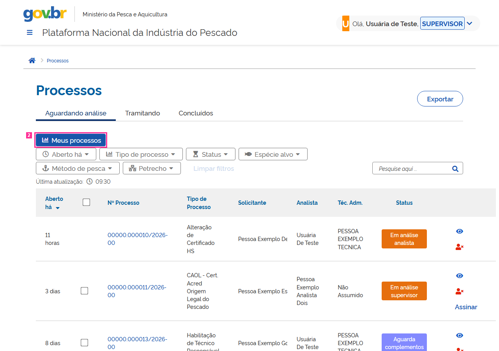

[a mesma tela sem o contorno](img/R-09-tela-sem-marca.png)

**Medido** (não é julgamento):
- foco depois dos passos: &lt;body&gt; (nenhum elemento focado) (não é elemento deste cartão)
- &lt;span.br-tag.interaction&gt; "Meus processos": background-color rgb(23, 85, 169); color rgb(255, 255, 255)
- &lt;span.br-tag.interaction&gt; "Meus processos": background-color rgb(23, 85, 169); color rgb(255, 255, 255)

*Avisos da preparação do cartão: segmento-a-decidir: o seletor resolve em 1280x900@lista-exibir, 1280x900@assinatura-cancelada, 1280x900@filtro-removido; escolha em "cena" de qual a alegação fala — só os sujeitos dela contam.*

**Defeitos da lista que parecem próximos** (só uma pista; pode ser outro da lista, ou nenhum):
- **D-03** — Etiquetas interativas "Meus processos" e os seis filtros ("Aberto há", "Tipo de processo", "Status", "Espécie alvo", "Método de pesca", "Petrecho"): &lt;span class="br-tag interaction"&gt; com cursor:pointer, sem role, sem tabindex (tabIndex -1), papel generic e nome "" na árvore. O clique liga/desliga o filtro "Meus processos" (a lista passa de 9 para 10 linhas) ou abre a lista de opções do filtro; nenhuma é alcançada por Tab nem acionável por teclado, e nenhuma expõe estado (aria-pressed/aria-expanded). Os exemplos oficiais da Tag 3.7.0 só usam button e input+label como elementos interativos.
- **D-11** — Nenhum salto para o conteúdo: 0 âncoras "#…" e 0 .br-skiplink nas 2 paradas; o primeiro ponto de Tab é o botão Menu do cabeçalho. Casco da aplicação: **exposto** (adendo § E; C-04, B-01).
- **D-12** — Um só título visível na página, &lt;h2&gt; "Processos"; nenhum &lt;h1&gt; (light DOM e shadow roots), nas 2 paradas. Ausência global, ancorada na raiz. **exposto** (casco: ordem de títulos, como C-05).
- **F3-05** — Tag de interação "Meus processos" (ligada, na barra acima da tabela): a superfície tem cor de fundo rgb(23, 85, 169) (#1755a9), posta em estilo inline na própria tag, em vez do azul da Tag de interação, rgb(19, 81, 180) (#1351b4). #1755a9 não é cor da paleta. A superfície da Tag de interação usa --blue-warm-vivid-70.

**Sua resposta** (copie a linha e complete):

```
R-09: fato  descumpre  defeito  quem-escreveu
```

---

## R-10

**O que o cartão diz que acontece:** O avatar (span.br-avatar &gt; span.bg-orange-vivid-30) é um retângulo de 18×40 px com border-radius 0 em ambos os elementos.

**Correção que o cartão sugere:** Superfície circular do Avatar.

**Regra citada:** base de regras do DS 3.7.0 (texto literal; id mascarado, D-87)
> 1 | Superfície circular | Superfície | Obrigatório. *(força declarada na base: obrigatorio)*

**Onde:**
- `<span> "U"` — seletor `body>pnip-root>pnip-header>div>div>button>span:nth-of-type(1)`
- seletor escrito no cartão: `#avatar-dropdown-trigger .br-avatar`

**Como chegar ao estado** (janela 1280×900):
1. click br-tab button[data-panel="HISTORICO"] (aba Concluídos)
2. click tbody tr:nth-child(1) br-button[title="Ver processo"] button (processo 00000.000033/2026-00, Deferida)

**Na página congelada, depois desses passos** (refeitos automaticamente, como estão escritos, em janela 1280×900):
- passo 1 ("click br-tab button[data-panel="HISTORICO"] (aba Concluídos)"): não achei "br-tab button[data-panel="HISTORICO"]" na página
- passo 2 ("click tbody tr:nth-child(1) br-button[title="Ver processo"] button (processo 00000.000033/2026-00, Deferida)"): não achei "tbody tr:nth-child(1) br-button[title="Ver processo"] button" na página

**Atenção: refeitos como estão escritos, os passos não chegam ao estado que o cartão descreve** (ver acima). As imagens e a medida são do estado a que eles chegam.

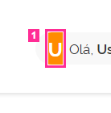

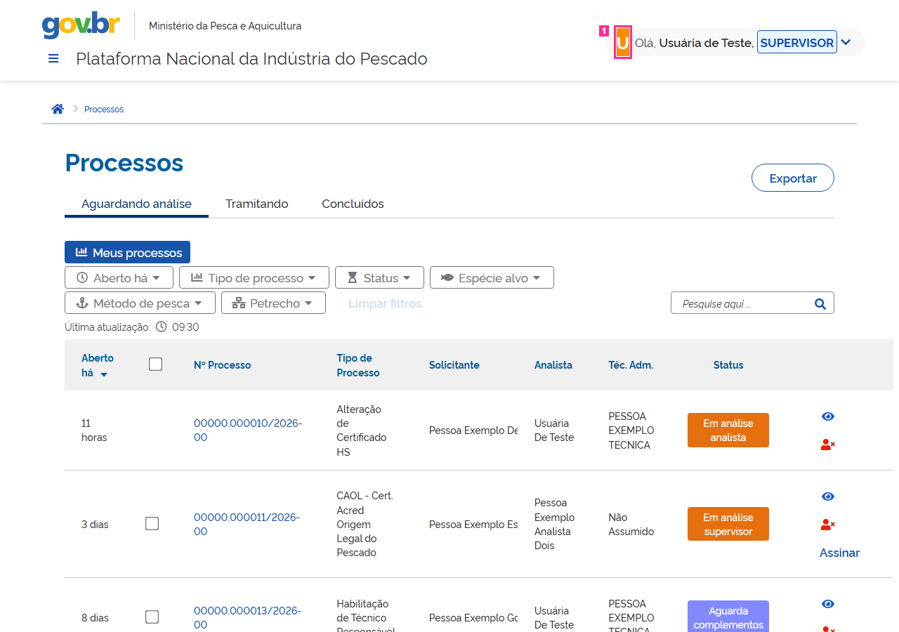

[a mesma tela sem o contorno](img/R-10-tela-sem-marca.png)

**Medido** (não é julgamento):
- foco depois dos passos: &lt;body&gt; (nenhum elemento focado) (não é elemento deste cartão)
- &lt;span.br-avatar&gt; "U": border-top-left-radius 0px

*Avisos da preparação do cartão: segmento-a-decidir: o seletor resolve em 1280x900@lista-exibir, 1280x900@assinatura-cancelada, 1280x900@pagina-2, 1280x900@exibir-25, 1280x900@filtro-removido; escolha em "cena" de qual a alegação fala — só os sujeitos dela contam.*

**Defeitos da lista que parecem próximos** (só uma pista; pode ser outro da lista, ou nenhum):
- **D-11** — Nenhum salto para o conteúdo: 0 âncoras "#…" e 0 .br-skiplink nas 2 paradas; o primeiro ponto de Tab é o botão Menu do cabeçalho. Casco da aplicação: **exposto** (adendo § E; C-04, B-01).
- **D-12** — Um só título visível na página, &lt;h2&gt; "Processos"; nenhum &lt;h1&gt; (light DOM e shadow roots), nas 2 paradas. Ausência global, ancorada na raiz. **exposto** (casco: ordem de títulos, como C-05).

**Sua resposta** (copie a linha e complete):

```
R-10: fato  descumpre  defeito  quem-escreveu
```

---

## Lista de defeitos da tela

Use o id (ex.: `F3-01`) na 3ª resposta.

- **F3-01** (estado: sempre) — Paginação no rodapé da tabela: só existe a seta "Página seguinte" (botão à direita dos números de página); a seta "Página anterior" não existe em nenhuma página da lista. Na carga, o número "1" fica sem seta antes dele; na página 2 (por exemplo na aba "Concluídos", 14 itens, depois de "Página seguinte") também não há seta para voltar, só o número "1". O defeito vale em qualquer página e em qualquer aba. A Pagination tem duas setas de navegação obrigatórias, um botão para a esquerda e outro para a direita.
- **F3-02** (estado: inicial) — Avatar de letra no cabeçalho ("U"): o conteúdo interno do avatar não tem a classe `content` (o span tem só bg-orange-vivid-30 e text-pure-0). Sem ela, o avatar vira um retângulo laranja estreito (cerca de 18×40 px, border-radius 0, display block) com a letra encostada, em vez da superfície circular de 40×40 com a letra centralizada. No Avatar, a classe `content` é propriedade obrigatória do conteúdo interno.
- **F3-03** (estado: filtro-removido) — Tag do filtro escolhido (aparece acima da barra de filtros depois de abrir o filtro "Aberto há" e escolher "Últimos 60 dias"): o botão × da tag aparece e recebe foco como o botão circular do DS (classe br-button, 28×28, azul), mas clicar nele, ou focá-lo e apertar Enter, não remove o filtro — depois do clique a tag "Últimos 60 dias" continua visível e o filtro continua aplicado ("Limpar filtros" segue habilitado e é o que tira o filtro). Uma Tag interativa dispensável apresenta o botão que permite ao usuário excluí-la.
- **F3-04** (estado: inicial) — Coluna "Solicitante" da tabela de processos: as 9 células cortam o texto na largura de 150 px, numa linha só e sem reticências (overflow hidden, white-space nowrap, text-overflow clip), e nenhuma tem title nem tooltip que mostre o texto completo ao passar o mouse. O nome comprido da 1ª linha ("Pessoa Exemplo De Nome Comprido Para Teste Da Listagem / Barco Exemplo Alfa") é o que mais perde, mas todas as células da coluna aparecem cortadas, até "Pessoa Exemplo Dias". Na Table, o texto truncado exibe reticências no final e o texto completo é revelado por tooltip ao passar o mouse. Uma única regra de estilo corta a coluna inteira: uma unidade para o conjunto; o relato de qualquer célula cortada é desta spec.
- **F3-05** (estado: inicial) — Tag de interação "Meus processos" (ligada, na barra acima da tabela): a superfície tem cor de fundo rgb(23, 85, 169) (#1755a9), posta em estilo inline na própria tag, em vez do azul da Tag de interação, rgb(19, 81, 180) (#1351b4). #1755a9 não é cor da paleta. A superfície da Tag de interação usa --blue-warm-vivid-70.
- **F3-06** (estado: inicial) — Seta "Página seguinte" da paginação: o botão tem border-radius 7px (estilo inline) e aparece como um quadrado de 40×40 com cantos arredondados, e não como botão circular; os botões "Exibir lista" dos dois seletores da mesma paginação são circulares (border-radius 50%). As setas de navegação da Pagination são Botões Circulares.
- **F3-07** (estado: inicial) — Breadcrumb: o último item, "Processos" (a página atual), é um link — &lt;a href="portal-mpa/processos"&gt;, que aponta para a própria página —, com a cor de link e no Tab, em vez de texto comum; o item não tem a marca de item atual (data-active). Cada item do breadcrumb é um link, exceto o último, que define a tela atual; a página atual não deve ser considerada um link.
- **F3-08** (estado: inicial) — Rótulos das três abas ("Aguardando análise", "Tramitando", "Concluídos"): font-size 16,8 px (--font-size-scale-up-01, o tamanho do texto dos botões), um degrau abaixo do previsto; o peso continua medium. O rótulo da Tab usa --font-size-scale-up-02 (20,16 px) com --font-weight-medium. Um único estilo no componente define os três rótulos: uma unidade para o conjunto.
- **F3-09** (estado: exibir-25) — Seletor "Exibir" (itens por página) da paginação, na aba "Concluídos" (14 itens): depois de abrir o seletor e escolher 25, a tabela passa a mostrar as 14 linhas ("1 – 14 de 14 itens") e o item 25 fica marcado na lista, mas o campo do seletor continua mostrando 10. O mesmo acontece com 50: o campo mostra sempre 10. O campo de entrada do Select exibe a opção selecionada.
- **F3-10** (estado: inicial) — Botões "Desassociar processo do analista responsável" desabilitados na coluna de ações (8): opacidade 1, iguais ao habilitado da 1ª linha (ícone vermelho cheio); só o cursor not-allowed indica o estado. O botão "Limpar filtros", também desabilitado, tem opacidade 0,45. No estado desabilitado, fundo e primeiro plano têm opacidade --surface-opacity-md. Uma única regra define os oito: uma unidade para o conjunto.
- **F3-11** (estado: inicial) — Abas: o item "Aguardando análise" aparece como aba ativa (marca de item ativo, texto destacado), mas o conteúdo exibido é o da aba "Tramitando" (tag "Meus processos", colunas Analista e Téc. Adm., processos em tramitação); o item "Tramitando" aparece como inativo. O item ativo da Tab mostra ao usuário em qual aba ele se encontra.
- **F3-12** (estado: assinatura-cancelada) — Botão de ação em lote abaixo da tabela (aparece ao marcar a caixa de ao menos uma linha da lista da carga, com "Meus processos" ligado; a 1ª caixa está na 2ª linha): o rótulo visível é "Confirmar", mas o botão abre o diálogo "Confirma a assinatura de 1 processo(s)?", com "Assinar" e "Cancelar" — a ação oferecida é assinar os processos selecionados, e o rótulo não diz isso. O rótulo do Button deve orientar de forma clara qual ação é esperada.
- **D-01** (estado: inicial) — Botões de ação das linhas da tabela "Ver processo" (9) e "Desassociar processo do analista responsável" (9; 8 desabilitados): &lt;br-button&gt; sem `label` e sem `circle`. O &lt;button&gt; interno é br-button middle de 72×40 px com raio de pílula (não circular), sem nenhum texto visível — só o ícone projetado (eye, user-times) — e o nome acessível vem só do `title`. A norma exige rótulo visível em todo Button não circular. Na mesma coluna o "Assinar" tem texto visível.
- **D-02** (estado: inicial) — Números de processo da coluna "Nº Processo": &lt;a role="button" style="cursor:pointer"&gt; sem href nem tabindex. Não são focáveis (fora do Tab real; a árvore do Chromium não os marca focusable), mas o clique navega: nas linhas 2, 3, 4, 6, 7 e 9 abre a sub-rota …/documentos do processo, que o "Ver processo" da mesma linha não abre (ele vai à rota do processo sem /documentos). Nas linhas 1, 5 e 8 o destino cai em /login com recarga — artefato do mock (adendo § C) —, mas o controle é o mesmo e igualmente inalcançável por teclado.
- **D-03** (estado: inicial) — Etiquetas interativas "Meus processos" e os seis filtros ("Aberto há", "Tipo de processo", "Status", "Espécie alvo", "Método de pesca", "Petrecho"): &lt;span class="br-tag interaction"&gt; com cursor:pointer, sem role, sem tabindex (tabIndex -1), papel generic e nome "" na árvore. O clique liga/desliga o filtro "Meus processos" (a lista passa de 9 para 10 linhas) ou abre a lista de opções do filtro; nenhuma é alcançada por Tab nem acionável por teclado, e nenhuma expõe estado (aria-pressed/aria-expanded). Os exemplos oficiais da Tag 3.7.0 só usam button e input+label como elementos interativos.
- **D-04** (estado: inicial) — Checkboxes de seleção da tabela — um no cabeçalho (coluna sem texto) e um em cada uma das 6 linhas selecionáveis: &lt;input type="checkbox"&gt; sem &lt;label&gt;, aria-label, aria-labelledby ou title; labels.length = 0 e nome "" na árvore. Estão no Tab (operáveis), sem nome.
- **D-05** (estado: inicial) — Campo de pesquisa da lista: o &lt;br-input&gt; recebeu `placeholder="Pesquise aqui ..."` mas não `label`, e o input interno (id search) fica com labels.length = 0, sem aria-label nem aria-labelledby; o nome acessível é o placeholder. Os seletores "Exibir" e "Página" da mesma tela têm rótulo associado.
- **D-06** (estado: inicial) — Etiquetas de status da coluna "Status": texto branco (text-secondary-01, 14 px/500) sobre bg-orange-vivid-40 #e66f0e = 3,16:1 (5 linhas), bg-indigo-vivid-40 #8289ff = 3,01:1 (1) e bg-secondary-06 #888888 = 3,54:1 (2) — 8 de 9 abaixo de 4,5:1 (cores da paleta, combinação autoral). O status "Em revisão analista" sobre indigo-vivid-60 passa (6,49:1, controle K-08). O texto do status vem do mock; a combinação de cores é do componente da página.
- **D-07** (estado: inicial) — A tabela de processos não tem &lt;caption&gt; nem aria-label/aria-labelledby (nome "" na árvore); o h2 "Processos" fica fora do contêiner da tabela, sem associação. A norma pede caption que identifique a tabela (os exemplos oficiais da Table 3.7.0 trazem caption).
- **D-08** (estado: inicial) — Cabeçalho da coluna de ações (Ver processo / Desassociar / Assinar): &lt;th scope="col"&gt; vazio, columnheader sem nome na árvore — as células de ação ficam sem cabeçalho identificável. Precedente B-26 (D-61).
- **D-10** (estado: inicial) — &lt;iframe&gt; vazio no fim do componente (sem src, documento about:blank sem conteúdo, 1160×500 px, sem title, name nem aria-label; papel Iframe com nome "" na árvore): é ponto de Tab depois do "Voltar" e, focado, nada muda na tela (outline none, sem sombra, :focus-visible falso). Depois dele o Tab real alterna iframe ↔ body (E-01); Shift+Tab sai para o "Voltar".
- **D-11** (estado: sempre) — Nenhum salto para o conteúdo: 0 âncoras "#…" e 0 .br-skiplink nas 2 paradas; o primeiro ponto de Tab é o botão Menu do cabeçalho. Casco da aplicação: **exposto** (adendo § E; C-04, B-01).
- **D-12** (estado: sempre) — Um só título visível na página, &lt;h2&gt; "Processos"; nenhum &lt;h1&gt; (light DOM e shadow roots), nas 2 paradas. Ausência global, ancorada na raiz. **exposto** (casco: ordem de títulos, como C-05).
- **D-13** (estado: sempre) — &lt;title&gt;PNIP&lt;/title&gt; nas 2 paradas: nomeia só o sistema, não o conteúdo principal ("Processos"). **exposto** (casco; B-25, C-06).
- **D-14** (estado: sempre) — Inicial do avatar "U" branco sobre #ff8c00 = 2,33:1 (24,2 px/700). **exposto** (casco; B-14, C-07).

## Modelo para copiar no comentário

```
R-01: 
R-02: 
R-03: 
R-04: 
R-05: 
R-06: 
R-07: 
R-08: 
R-09: 
R-10: 
```
